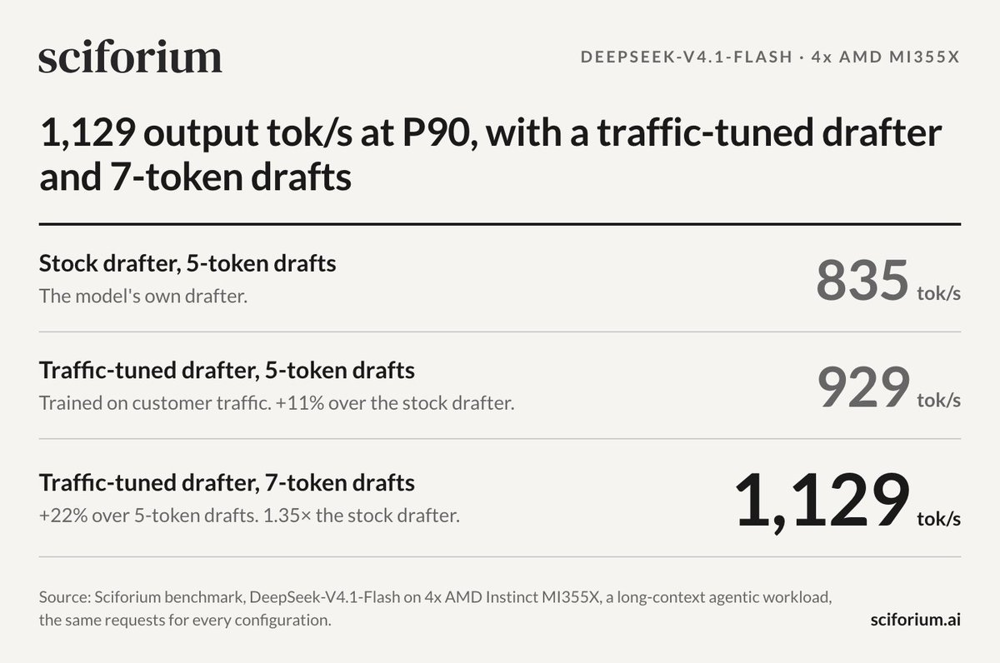

[Unlocking 1,129 output tps on AMD MI355x using Traffic-tuned Speculators](https://x.com/i/article/2122759644397674496)  
Hassan Akbari / Sciforium · 2026-11-17

Sciforium 报告在四张 AMD Instinct MI355X 上，用 DeepSeek-V4.1-Flash 原始主模型权重达到 P90 1,129 output token/s。它的工程路径由三个环节组成：按客户流量训练 drafter，提高被接受的草稿长度；从五 token 草稿扩到七 token；再优化主 kernel 周边的中间计算与通信。最值得理解的是这些环节如何配合，而非把单个速度数字当成所有工作负载的能力。

## 草稿更长之前，先让前面的 token 被接受

投机解码让较便宜的 drafter 提出多个后续 token，由主模型一起验证。只有被接受的连续前缀带来实际进展；如果第一个位置附近就被拒绝，再多提两个位置只是增加工作。因此草稿长度和接受长度是两个变量，最终要看每轮多产生的有效输出是否足以抵消起草及验证开销。

Sciforium 先在获得客户许可的流量上训练专属 drafter，使其适应该流量的输出分布，而不是改动主模型权重。接受情况改善后，七 token 才成为值得测试的配置。作者还提到稳定性修复，但没有给出这些修复的完整故障条件和实现，因此目前只能把它们计入最终配置，不能推断具体修复了哪些投机正确性问题。

## 结果阶梯能归因到什么程度

<a class="note-image-link" href="/assets/images/tech/sciforium-traffic-speculators/method.jpg" target="_blank" rel="noopener" aria-label="同一请求集的 P90 输出速度随流量定制和草稿长度变化；这不是总请求时延。 · 查看原图 ↗">查看原图 ↗</a>

*同一请求集的 P90 输出速度随流量定制和草稿长度变化；这不是总请求时延。*

官方图给出同一组请求、四张 MI355X、长上下文 agent 负载上的 P90 输出速率：原配 drafter、五 token 为 835；流量调优后仍五 token 为 929；流量调优加七 token 为 1,129 token/s。这个阶梯支持“更适配的草稿加更长验证批次”在该负载中有效。它没有披露足够完整的流量分布和所有实验配置，不能据此预计别的客户也会取得同样增幅。

P90 速度尤其需要谨慎阅读。它是输出速度的一个高分位，不是最慢 10% 请求的时延承诺，也不是多请求总吞吐。用 10,000 除以 1,129 得到约九秒，仅描述按该速度生成的输出阶段，不含 prompt 处理、排队或工具调用。保留原权重说明没有靠换主模型缩小任务，但也不能单独证明所有采样和验证路径的质量完全等价。

## 融合与重叠为什么得到不同结果

文章把 mHC、投影等大 kernel 之间的操作进一步融合，并将 all-reduce 与计算融合，目标是减少中间处理及数据移动。CUDA graph 已经削减 launch 间隙，所以不能把所有收益解释成填补 GPU 空闲时间。并发超过八时，既有 megakernel 的收益递减，促使作者优化周边执行，而不是一直扩大同一个 kernel。

一个有价值的负面结果是，将 all-reduce 放到独立流、希望与其他工作重叠，并没有收益：同时执行的操作争用内存带宽。融合通信计算与把两个操作放到不同流是不同机制，后者失败不否定前者。原文也强调高并发 kernel 实验不能作为额外百分比叠加到 1,129 的端到端配置结果上。

## 这份工业记录值得怎样使用

相较只展示 drafter 接受率，这篇把流量分布、草稿深度、稳定性和底层执行连成了一条解释链，并保留了一个未奏效的优化尝试。对推理系统读者，启发是投机方案应按实际请求评估净收益，不能从更多接受 token 直接推出同比例低延迟。

证据目前是供应商披露的生产负载结果，缺少可公开重放的请求集、完整延迟分布及并发配置矩阵；“首个超过某速度”的市场比较也不必承担技术结论。最有信息量的边界已经足够明确：客户定制 drafter 的收益依赖分布，七 token 需要额外验证成本，通信重叠可能被带宽竞争抵消。
