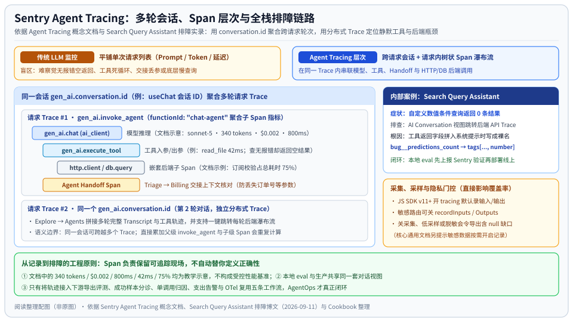
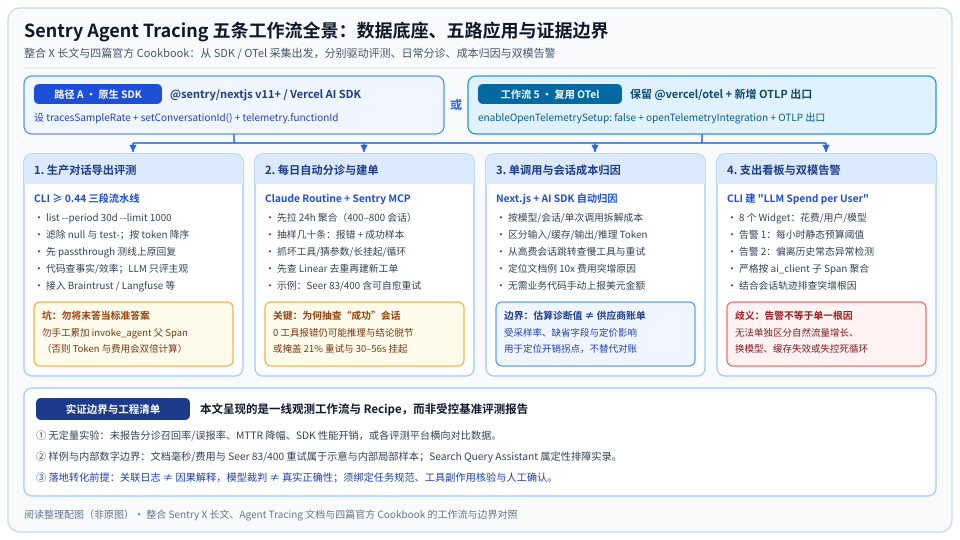

Sentry · 2026-11-05 · [X Article 原文《Five things you can do with Sentry’s Agent Tracing》](https://x.com/i/article/2118087303029510144)（[官方配套 X 帖](https://x.com/sentry/status/2118427253084463353)）· 对应一手技术资料：[Agent Tracing 概念文档](https://docs.sentry.io/concepts/key-terms/agent-tracing/) · [Search Query Assistant 排障实录](https://blog.sentry.io/debugging-our-ai-search-assistant-with-agent-tracing/)（Dominik Buszowiecki & Shaun Kaasten，2026-09-11）· 官方 Cookbook 系列（评测导出 / 日常分诊 / 成本监控与告警 / OpenTelemetry 导出）

AI Agent 在生产环境里很少像传统 Web 接口那样抛出未捕获异常再返回 `500`：一次工具调用因为参数格式猜错返回空集、Agent 反复重试后终于拼出一条语法通顺的答复，或者前置分流 Agent 在交接上下文时丢掉了订单编号，在常规错误看板上往往一片绿灯。Sentry 这组资料的价值，并不在于又发明一套私有追踪协议，而是把记录下来的 `gen_ai.*` Span 继续往研发与运维下游推了一步——把生产对话直接导出为离线评测集、让定时分诊连“看似成功”的会话一起抽检、把 token 与花费归因回具体工具和循环调用，并允许已有 OpenTelemetry 管线零重构接入。

> **口径与证据边界**：本文依据 2026-11-06 收录的 Sentry X 长文及四份冻存一手文档（`Agent Tracing` 概念文档、Search Query Assistant 博文、生产对话转 Eval Cookbook、Claude Routines 自动分诊 Cookbook），并核对配套的 Next.js 成本归因、支出告警与 Vercel OTel 导出三篇官方 Cookbook 重写。**整组资料属于一线工程架构说明、操作配方（Cookbook）与内部定性排障案例，未报告任何受控对比实验、MTTR 缩短百分比、分诊准确率/漏报率基准或 SDK 运行时性能开销实测**。文中出现的所有局部数值必须严格按所属语境区分：概念文档里的 `340` tokens、`$0.002`、`800ms`、`42ms`、`75%` 与 `10x` 支出突增均为教学示意；分诊 Cookbook 中 `Seer` 24 小时约 `445–551` 条会话（约 `11k` 次工具调用、`83/400` 约 `21%` 命中可自愈工具错误、`2` 条在报错前挂起 `30–56s`）及 FAQ 中的 `400–800` 条扫描量属于示范输出与经验估计；Search Query Assistant 博文记录的是真实内部排障过程（文末提及编码 Agent 通过 Sentry MCP 定位后端优化“每周消减数亿次查询”，但冻存正文未提供对应评测方法学）。

## Span 层次与会话模型：为什么平铺式 LLM 监控抓不住静默失效

理解这五条工作流之前，必须先厘清 Sentry 在[概念文档](https://docs.sentry.io/concepts/key-terms/agent-tracing/)中划出的底层数据模型差异：传统 **LLM Monitoring（大模型监控）** 记录的是平铺的、相互孤立的单次模型请求列表（Prompt、Completion、Tokens、延迟、估算成本、模型版本），它擅长发现“某条 Prompt 写坏了”或“单次模型响应变慢”；而 **Agent Tracing** 把一整次 **Agent Run（智能体运行周期）** 放进分布式追踪（Distributed Tracing）的**树状 Span 层次（Span Hierarchy）** 中，令 AI 调用与同一请求内的 HTTP 路由、数据库查询和队列 Span 并肩出现在同一条瀑布流里。

在这棵树中，Sentry 按 OpenTelemetry 语义约定组织四类核心追踪单元：

- **`gen_ai.invoke_agent`（运行根容器）**：包裹一次 Agent 执行或轮次的生命周期（在 Vercel AI SDK 中可通过 `telemetry: { functionId: 'chat-agent' }` 命名代理，AI SDK 6 及更早版本对应 `experimental_telemetry`），汇总下游模型与工具的整体上下文。
- **`gen_ai.chat` / `ai_client`（模型调用 Span）**：记录单次 LLM 请求的模型名、输入输出、token 拆解、估算费用与耗时（文档教学示例为 `sonnet-5` 消耗 `340` tokens、估算 `$0.002`、耗时 `800ms`），用于核对究竟喂给了模型什么上下文。
- **`gen_ai.execute_tool`（工具调用 Span）**：记录单次工具名、结构化入参、返回值与时长（文档示例：`read_file` 读取 `test_auth.py` 耗时 `42ms`）。它的决定性作用是捕获**静默工具故障**与**嵌套后端瓶颈**——前者如 Agent 传了无效客户 ID，工具不抛异常只返回空结果，导致模型编造订单状态或错判“无订单”；后者如账单助手查询订阅状态时，工具本身逻辑不慢，嵌套在工具 Span 下方的 `db.query` 却占用了整个请求 `75%` 的延迟。
- **Agent Handoff Span（多智能体交接）与 `gen_ai.conversation.id`（跨请求会话标识）**：当分流 Agent 将请求转交给账单 Agent 时，独立的 Handoff Span 记录交接边界传递了哪些上下文，方便排查“用户首轮说了订单号、下游子 Agent 却被迫重新追问或瞎猜”的交接丢参问题。更关键的是跨请求关联：单次聊天请求生成一条分布式 **Trace**，而一段多轮对话会跨越多个 HTTP 请求，因此必须在路由中调用 `Sentry.setConversationId(conversationId)`（例如直接复用前端 Vercel AI SDK `useChat` 传入的 `id`），为所有相关 AI Span 打上相同的 `gen_ai.conversation.id`。Sentry 明确提示两者的严格非等价关系**：同一会话不必共享同一条 Trace，同一条 Trace 内部也可能出现多个会话**——不能靠请求级 Trace 自动推断跨轮身份。

<figure class="note-figure"><a class="note-image-link" href="/assets/images/tech/sentry-agent-tracing-five-things/sentry-agent-span-hierarchy-zh.svg" target="_blank" rel="noopener" aria-label="放大查看 Sentry Agent Tracing 会话关联、Span 层次与排障链路图解">点击放大 ↗</a><figcaption>阅读整理配图（非原图）：依据 Sentry Agent Tracing 文档、Search Query Assistant 博文与 Cookbook 整理的会话-Trace 双层建模及隐私覆盖边界。</figcaption></figure>

在真实生产排障中，这种双层模型的价值体现在 Sentry 工程团队（Dominik Buszowiecki 与 Shaun Kaasten，2026-09-11）披露的 **Search Query Assistant** 缺陷复盘里。该助手负责把自然语言转成 Sentry Search Syntax 查询条件；端到端测试中团队发现，只要查询涉及自定义数值属性（例如购物车商品数大于 `10`），助手生成的查询就总是返回零结果。工程师没有去翻零散的 JSON 日志，而是在 Sentry 的 **Explore → Agents** 视图按时间范围、目标 Agent（`traces`）和开发者邮箱过滤出对应 **AI Conversation**，直接点击工具调用关联出的后端 API Trace，顺藤摸瓜查到根因**：工具返回可用字段列表后，系统提示拼接逻辑只写了裸字段名 `bug__predictions_count`，而没有转写为 Sentry Search Syntax 要求的带类型格式 `tags[bug_predictions_count, number]`**。定位后团队把该场景补进本地 eval，**并让本地 eval 运行同样上报 Trace 到 Sentry**，在开 Pull Request 之前就先在熟悉的时间线视图里确认提示词与后端 API 参数双双对齐，随后部署生产再次验证闭环。

同时，这套底层模型也直接决定了**隐私开关与数据集覆盖率的耦合**。细读文档可以注意到一个容易混淆的默认行为差异：概念总览页以通用口径提醒“提示词与输出可能含敏感信息，需按需开启 `recordInputs` / `recordOutputs`”；而在面向 Next.js 的 [Eval Cookbook](https://sentry.io/cookbook/agent-conversations-to-evals/) 中明确指出，**Sentry JavaScript SDK v11 及以上版本只要把 `tracesSampleRate` 设为大于 `0`，内置 `vercelAIIntegration` 就会默认启用并默认记录模型输入与输出**。若在敏感路由通过 `telemetry: { recordInputs: false, recordOutputs: false }` 关闭记录，或在 `Sentry.init()` 全局设置 `dataCollection: { genAI: { inputs: false, outputs: false } }`、开启服务端脱敏、或调低采样率，这些决策不仅改变控制台显示，更会导致导出行里的 `firstInput` / `lastOutput` 变为 `null` 或直接缺失，从而结构性地改变下游评测数据集的样本分布。

## Workflow 1 & 2：生产对话导出为 Eval 数据集，以及为何每日分诊必须抽查“成功”会话

打通 `gen_ai.conversation.id` 与完整输入输出采集后，Sentry 给出的前两条工作流分别面向**离线回归评测建设**与**每日生产主动巡检**。

**Workflow 1（Extract → Map → Load）**：把生产对话变成可持续回归的 Eval 数据集。在 [Conversations-to-Evals Cookbook](https://sentry.io/cookbook/agent-conversations-to-evals/)（前置要求：Next.js + Vercel AI SDK `7` + Node.js `22+` + `@sentry/nextjs >= 11` + **Sentry CLI `>= 0.44`**）中，Sentry 刻意把流水线拆成平台无关的三段：

1. **Extract（提取）**：执行 `sentry agent-conversation list YOUR_ORG --period 30d --limit 1000 --json --fields ...` 导出会话（注意默认只拉最近 `7` 天共 `25` 条，必须显式放大 `--period` 与 `--limit`）。关键工程细节在于**用 CLI 而不是 MCP 做批量导出，且不要自己抓原始 Span 手工累加**——MCP server 为节省 Agent 上下文窗口会截断响应，而手工累加 Span 会把父级 `gen_ai.invoke_agent` 聚合出的数字与子级 Span 重复相加，导致 token 与成本**直接翻倍**。若需逐轮查看每轮使用的模型和工具细节，则配合 `sentry agent-conversation view YOUR_ORG/CONVERSATION_ID --json`。
2. **Map（清洗与排序）**：过滤掉 `firstInput` 或 `lastOutput` 为 `null`（未开输入输出记录）以及测试/演示前缀流量（如 `id.startsWith('test-')`），随后**按 `totalTokens` 降序排列**——token 消耗最重的会话往往正是 Agent 反复重试、工具报错打转的现场，最适合优先进入评测集。
3. **Load & Score（幂等写入与“透传先测”）**：以 `conversationId` 作为主键做 upsert 写入 **Braintrust**（`dataset.insert({ id })`）、**Langfuse**（`langfuse.dataset.createItem()`）、**promptfoo**（本地 JSON + `npx promptfoo eval`）或 **Arize Phoenix**（`client.datasets.create_dataset()`），把 `lastOutput` 存进 `metadata.production_output`。首轮实验的任务函数写成**透传（passthrough）**：直接返回线上的真实回答来跑分，而不是立刻让模型重新生成一遍。

在评分设计上，Cookbook 强调两条严谨边界：第一，**能用确定性代码核查的绝不交给 LLM-as-a-judge**——例如回答中引用的数据库实体是否存在应写成查库函数 `citationsExistInDb`，token 效率（例 `Math.min(1, 15_000 / total_tokens)`）与工具成功率（`1 - tool_errors / tool_calls`）直接由遥测元数据计算，LLM judge 只留给“回答是否真正有帮助”这类主观维度，且必须用人工标注定期校准，并在 scorer 代码里埋入已知幻觉自测样本以防代码静默失效；第二，**生产 `lastOutput` 只是被测对象，绝不是天然的 `expected` 标准答案**——只有当某条样本通过确定性核查后才可晋升为回归黄金样本，且一旦对话中途补充了新约束或长任务在中途中断，`firstInput` 与 `lastOutput` 的首尾截断会丢失中间约束与工具副作用，这类任务必须通过 `agent-conversation view` 读取完整多轮轨迹来评测。

**Workflow 2（Claude Routines + Sentry MCP）**：用定时分诊重点抽查“成功”会话。在 [Automated Triage Cookbook](https://sentry.io/cookbook/automate-ai-agent-triage-claude-routines/) 中，团队把定时运行的 **Claude Routine**（作者注明也可用任意定时 cron、GitHub Action 调用 LLM API 替代）接上 **Sentry MCP** 与 **Linear MCP**（或团队常用工单系统），每日清晨自动检查过去 `24` 小时的线上对话。与传统异常汇总最大的思路反差在于：Prompt 要求助手**先通过 MCP 拉取聚合指标，再同时抽检“带报错的会话”和“表面完全成功的会话”**（典型运行先扫描 `400–800` 条会话统计，再按工具调用数或 token 量排序精读“几十条”样本），在创建工单前先检索 Linear 避免重复建单，专门捕捉六类问题**：工具调用失败**、**幻觉入参**（瞎猜参数名而非先查列表）、**延迟异常**（报错前长期卡顿的后端信号）、**Agent 死循环**、**成本异常**，以及**推理失败（Reasoning failures）**——即全程零工具错误，但结论根本不受前序推理与轨迹支持。

Cookbook 给出的 `Seer` 24 小时分诊示例直观展示了为什么必须读“成功”会话：在约 `445–551` 条对话（约 `11k` 次工具调用）的样本检查中，最终结论质量未见异常，但抽检 `400` 条对话时发现 **`83/400`（约 `21%`）命中过至少一次工具错误**，绝大多数靠后续重试自愈而未变成报错请求——根因包括搜索代码工具被喂入错误拼接了 monorepo 子路径的 `repo_name`（`"foo/bar/applications/integrations"` 而非 `"foo/bar"`）或猜错 `project_slug`（如 `"mobile"`）；此外还揪出 `2` 条对话在抛出不透明 `"internal error"` 前各自卡死了 **`30–56s`**，暴露出与模型猜参截然不同的后端超时隐患。

| 工作流编号与名称 | 核心机制与 SDK / CLI / MCP 接口 | 关键配置前提与高发工程陷阱 | 下游消费方与可执行产出 |
| :--- | :--- | :--- | :--- |
| **1. 生产对话转 Eval 数据集** | CLI `>= 0.44` 执行 `sentry agent-conversation list --json` / `view --json`；Extract → Map → Load 三段式 | 默认仅拉 `7d` / `25` 条；MCP 会截断全量；手工累加 `invoke_agent` Span 会翻倍；`firstInput/lastOutput` 会丢中途约束或未完结尾步 | Braintrust、Langfuse、promptfoo、Arize Phoenix；先跑 `production_output` 透传基线与代码确定性检查 |
| **2. 每日自动分诊（含成功样本）** | 定时 Claude Routine（或 cron/Action）经 **Sentry MCP** 先拉 `24h` 聚合再抽读样本，经 **Linear MCP** 查重建单 | 只盯错误堆栈会漏掉 `0` 工具报错的推理失败、高重试浪费（如 `Seer` 例 `83/400`）与报错前长挂起；Prompt 不宜写死僵化 MCP 查询语句 | 研发团队每日晨间分诊简报与去重后的跟进工单（带会话链接与错误率明细） |
| **3. 单调用与会话成本归因** | `@sentry/nextjs v11+` 自动启用 `vercelAIIntegration`，结合 `setConversationId()` 与 `telemetry.functionId` | Sentry 依据 token 估算费用，受采样率、缺省字段与定价处理影响；属于诊断线索而非供应商发票精确结算数 | Explore → Agents 看板与单次 Trace；把 `10x` 费用突增定位到重复模型调用或超大工具返回 |
| **4. 支出看板与每小时双告警** | Sentry CLI 创建共享 `LLM Spend per User` 看板（`8` 个 Widget）与 `2` 条每小时支出告警（静态阈值 + 异常检测） | 查询必须严格过滤 `gen_ai.operation.type:ai_client` 子 Span，防止父级 Agent Span 重复计费；单看异常告警无法区分涨量与死循环 | 值班 Slack / Webhook 实时预警，随后回到对应用户或高费会话轨迹核查真实诱因 |
| **5. 复用既有 OpenTelemetry 链路** | 安装 `@ai-sdk/otel` 等包；`Sentry.init` 设 `enableOpenTelemetrySetup: false` + `openTelemetryIntegration()`；`registerOTel` 加 `getOtlpTracesEndpoint` | 若未关 `enableOpenTelemetrySetup` 或同时保留 `tracesSampleRate`，会与 `@vercel/otel` TracerProvider 冲突或重复记账 | 让标准 `gen_ai.*` Span 并入现有 HTTP/DB 分布式 Trace，直接解锁上述 `1–4` 号工作流 |

## Workflows 3, 4 & 5：成本归因、支出双告警与现有 OpenTelemetry 链路无侵入接入

如果说前两条工作流解决的是“如何把行为轨迹变成评测与分诊”，后三条工作流则把同一条 Span 链条接进了**成本精细归因、自动预算守门与既有 OTel 基础设施复用**。

**Workflow 3（单调用与单会话成本归因）**：[`track-vercel-ai-sdk-costs-and-llm-calls`](https://sentry.io/cookbook/track-vercel-ai-sdk-costs-and-llm-calls/) 展示了如何在 Next.js 与 Vercel AI SDK 应用中启用 `@sentry/nextjs v11+` 追踪后自动完成成本拆解。应用代码无需自行计算或上报美元金额——Sentry 会自动读取每次模型调用的输入、缓存命中输入、输出及推理 token，结合内置模型定价估算单次 LLM Span、单次 Agent Run 以及完整会话的累计花费，并在 **Explore → Agents** 中按模型、版本与会话维度拆分展示。遇到概念文档中“平时只需几美分的任务某天突然贵了 `10` 倍”时，开发者不必等到月底收到模型厂商总账单才发觉，而是直接点击高开销会话钻进瀑布流，看清究竟是某个步骤连续重试调用了昂贵模型，还是某次工具吐回了超大文本块迫使后续轮次重复吞吐。但概念文档也专门加注了一项冷静边界**：成本数字只是帮助定位开销拐点的诊断估算值（estimate），并非与供应商月结账单逐分对齐的会计结算数**——采样率 `tracesSampleRate < 1.0`、部分流式或自定义端点缺失 token 字段、以及厂商阶梯定价/缓存折扣差异都会造成偏差。

**Workflow 4（共享支出看板与每小时双模告警）**：[`monitor-ai-agent-spend-dashboards-alerts`](https://sentry.io/cookbook/monitor-ai-agent-spend-dashboards-alerts/) 通过认证后的 Sentry CLI 自动生成名为 **"LLM Spend per User"** 的共享看板（包含 **`8` 个 Widget**，覆盖单用户开销、token 类型拆解、高消费用户排行与模型花费占比），并配置 **`2` 条每小时告警**：一条在每小时估算费用跨过静态预算上限时触发，另一条则采用**异常检测（anomaly detector）** 在支出偏离历史基线波动区间时预警。这里再次呼应了前文的 Span 层次陷阱——看板与告警查询必须明确过滤叶子节点属性 `gen_ai.operation.type:ai_client`（以及 `gen_ai.usage.total_tokens`、`gen_ai.response.model`、`user.id`），**如果错把父级 `gen_ai.invoke_agent` Span 一起聚合，看板与告警都会发生双倍计费**。同时，每小时异常告警本质上只回答了“支出分布偏离基线”，它本身无法自动分辨四种截然不同的现场：自然用户流量上涨、灰度切换了更贵模型、前缀缓存命中率下跌，还是个别用户的会话陷入工具重试死循环——仍然需要顺着看板里的 `gen_ai.conversation.id` 回到会话轨迹与工具报错率确认根因。

**Workflow 5（保留 `@vercel/otel` 并新增 OTLP 出口）**：[`vercel-ai-sdk-opentelemetry`](https://sentry.io/cookbook/vercel-ai-sdk-opentelemetry/) 面向早已在生产级 Vercel / Next.js 应用中部署 `@vercel/otel` 或自定义 `NodeSDK` 并把 Span 送往其他观测后端的团队，提供了一条无需推倒重写 SDK 的双路复用路径：

1. 安装 `@ai-sdk/otel`、`@opentelemetry/exporter-trace-otlp-http` 与 `@opentelemetry/sdk-trace-base`；
2. 在 `sentry.server.config.ts` 的 `Sentry.init()` 中设置 **`enableOpenTelemetrySetup: false`**、**不配置 `tracesSampleRate`**（把 TracerProvider 所有权完全留给现有的 `@vercel/otel`，避免冲突或重复采块），并显式注册 **`Sentry.openTelemetryIntegration()`**，使 Sentry 的运行时错误、日志与指标依然能够绑定到活跃的 OTel Span 上；
3. 在 `instrumentation.ts` 中调用 **`Sentry.getOtlpTracesEndpoint(process.env.SENTRY_DSN)`** 获取带项目鉴权头的目标地址，将 `OTLPTraceExporter` 与 `BatchSpanProcessor` 追加进 `registerOTel({ spanProcessors: [...] })`。

完成这三步后，AI SDK 发射的标准 `gen_ai.*` Span 会作为额外接收端输出直接并入同一条全栈分布式 Trace，和原有数据库、缓存及外部 API Span 共享上下文，不需要把原有可观测栈迁移出 OpenTelemetry 就能同时启用 Sentry 的 Agent 视图、CLI 评测导出与 MCP 分诊。

<figure class="note-figure"><a class="note-image-link" href="/assets/images/tech/sentry-agent-tracing-five-things/sentry-tracing-five-lessons-zh.svg" target="_blank" rel="noopener" aria-label="放大查看 Sentry Agent Tracing 五条工作流全景与实证边界图解">点击放大 ↗</a><figcaption>阅读整理配图（非原图）：将 Sentry 五条工作流收敛到共享 Span 底座与各自的核心陷阱及证据边界。</figcaption></figure>

## 证据边界、架构权衡与工程落地核查清单

纵观整组 Sentry 材料，它提供的是一套**贴近全栈研发与值班现场的可组合操作体系**，而不是一篇带对照基准的学术论文或第三方横向评测报告。为了避免团队在参考落地时把“工具能连通”误解成“质量已量化保证”，下表将资料中的每类证据与未证实区间逐项拆开：

| 资料宣称或示例数字 | 一手冻存来源与真实语境 | 它实际证明了什么 | 尚缺什么实证（不可过度外推） |
| :--- | :--- | :--- | :--- |
| **`sonnet-5` `340` tokens / `$0.002` / `800ms`；`read_file` `42ms`；`75%` 延迟；`10x` 费用突增** | [Agent Tracing 概念文档](https://docs.sentry.io/concepts/key-terms/agent-tracing/) | 仅用于解释 Model Span、Tool Span、嵌套 DB 瓶颈与单步归因机制的教学虚构示例 | 不代表任何真实生产模型延迟分布、Sentry 归因误差率或实际账单波动幅度 |
| **Search Query Assistant 发现 `tags[bug_predictions_count, number]` 提示拼接缺陷** | [Search Query Assistant 博文](https://blog.sentry.io/debugging-our-ai-search-assistant-with-agent-tracing/)（2026-09-11） | **真实内部定性排障案例**：证明会话视图跳转后端 Trace 与本地 eval 上报 Sentry 可定位 prompt 格式化 bug | 未提供定位耗时对比或长期在线查询准确率统计；文末“每周省数亿次查询”属 MCP 另案简讯且无方法学细节 |
| **`Seer` 示例**（`~445–551` 会话 / `~11k` 工具调用 / `83/400` 约 `21%` 命中重试 / `2` 例挂起 `30–56s`） | [Claude Routines 分诊 Cookbook](https://sentry.io/cookbook/automate-ai-agent-triage-claude-routines/)（示例输出与 FAQ） | 直观展示即使会话最终没有报错，抽检成功样本仍能揪出重复猜参重试与后端长挂起 | 属 Cookbook 示范输出与经验运行区间（`400–800` 会话扫描）；**无分诊召回率、漏报率或重复工单率评测** |
| **导出 `1000` 条、默认 `25` 条 / `7d`、`TOKEN_BUDGET = 15_000`、`8` 个 Widget 与 `2` 条告警** | 评测导出与支出告警 Cookbook | 展示官方配方中的 CLI 参数默认值、示例代码可调常数与生成的看板/告警规格 | 不构成最佳样本量或通用预算标准；未比较 Braintrust / Langfuse / promptfoo / Phoenix 评测效果 |
| **“把生产对话变成 ground-truth 测试集”** | Eval Cookbook 摘要标题与正文对照 | 正文实际纠正了标题的简化说法：原回答只是待测对象，需通过代码核查与人类校准后才可升格为 `expected` | 若不加人工抽检或代码查库门控，直接把线上答复当标准答案只会固化线上既有幻觉 |

在对照原文架构进行工程评估时，还有三组**系统权衡（以下为助手结合原文机制的工程推导，非 Sentry 官方定量结论）**值得上线前显式拍板：

- **采样率 `tracesSampleRate` 带来的“省钱 vs. 评测/账单失真”耦合**：文档在提及高并发时建议通过采样控制上报费用，但 Sentry 当前这套五步体系把**全量错误排查、成本总额仪表盘、以及生产 Eval 导出**全部挂在同一条 Span 链路上。如果采用简单固定比例随机降采样（例如 `0.1`），不仅用户级成本榜和每小时预算阈值会按比例缩水甚至失灵，稀有的长尾死循环或静默幻觉样本也更容易漏出 Eval 数据集。因此，生产流量较大时必须提前验证服务端/SDK 采样策略是否区分关键路由，并记录未采样比例作为财务估算修正因子。
- **JS SDK v11+“默认记录输入输出”的隐私与第三方外发边界**：相较于不少可观测工具默认关闭 Prompt 内容采集，Sentry JS SDK v11+ 在开启追踪时默认记录输入输出，极大降低了构建对话视图与导出 Eval 的门槛；但一旦执行 `sentry agent-conversation list --json` 并上传至 Braintrust 等第三方云端评测平台，或交由外部 Claude Routine 经 MCP 批量阅读，敏感用户数据就会跨出原始生产边界。对涉及 PII、凭据或受监管业务的路由，必须同时在 SDK 路由侧关闭 `recordInputs` / `recordOutputs`（或开启服务端数据脱敏），并在 Eval 导出脚本里再加一层字段过滤。
- **MCP 交互探索与 CLI 批量导出的接口分工**：两者读取的是同一份 Sentry 后端数据，但 Sentry MCP 会主动截断大响应以防撑爆分析 Agent 的上下文窗口，因此最适合“先拉聚合统计、再按工具数排序挑出几十条精读”的每日分诊；而一旦需要构造结构化离线回归数据集或按 `totalTokens` 排序全量对比模型版本，就应当切换至带分页/上限参数且不截断输入输出的 `sentry agent-conversation list --json` 命令行管线，并与 `agent-conversation view --json` 的逐轮明细配合使用。

结合五条工作流与上述边界，准备引入或梳理 Agent 可观测体系的团队，可以按以下五步顺序推进落地：

1. **统一关联锚点**：优先在每条对话入口绑定 `Sentry.setConversationId()` 与稳定的 `telemetry.functionId`；已有 `@vercel/otel` 时采用 `enableOpenTelemetrySetup: false` 加 `getOtlpTracesEndpoint` 双路导出，避免多套 TracerProvider 互踩。
2. **先划隐私与采样红线，再开批量导出**：清点哪些路由必须配置 `recordInputs: false` / `recordOutputs: false` 或服务端 PII 脱敏，并显式了解采样率对后续“每用户花费榜”和“Eval 抽样分布”的偏差方向。
3. **让本地 Eval 与生产共享同一套视图，先做透传代码评分**：用 Sentry CLI `>= 0.44` 拉取高 token 会话，优先用库内实体核查和遥测成功率给真实生产回答打分，并在评分器里植入已知幻觉用例防盲；仅把验证通过的样本晋升为黄金期望值，且在本地跑 eval 时就上报 Trace 到 Sentry 缩短复现回路。
4. **把每日分诊明确指向“看似成功的昂贵会话”**：配置定时 MCP 分诊时，强制要求按工具调用量与 token 降序抽检未报错样本，重点抓可自愈重试掩盖的坏工具入参、长延迟挂起以及轨迹不支持结论的推理断裂，并在建单前先检索已有工单去重。
5. **用 `ai_client` 过滤护栏守住成本告警**：搭建支出看板与每小时静态/异常双告警时，严格只聚合叶子 LLM Span（`gen_ai.operation.type:ai_client`）防止父子 Span 重复计费；收到异常告警后，始终联动会话并发量、模型版本和工具重试率联合排查，同时定期抽核 Sentry 估算费用与供应商实际月账单之间的系统性偏差。

---

### 参考来源与一手核对链接

- 主入口 X Article：Sentry, *[Five things you can do with Sentry’s Agent Tracing](https://x.com/i/article/2118087303029510144)*（2026-11-05，配套官方 X 帖 [`@sentry/status/2118427253084463353`](https://x.com/sentry/status/2118427253084463353)）。
- 一手概念文档：Sentry Docs, *[Agent Tracing - What It Is and How To Use It](https://docs.sentry.io/concepts/key-terms/agent-tracing/)*（冻存源 `sentry-agent-tracing-five-things-1.txt`）。
- 一手工程排障博文：Dominik Buszowiecki & Shaun Kaasten, *[Debugging Our AI Search Assistant with Agent Tracing](https://blog.sentry.io/debugging-our-ai-search-assistant-with-agent-tracing/)*, Sentry Blog, 2026-09-11（冻存源 `sentry-agent-tracing-five-things-2.txt`）。
- 一手评测导出配方：Sentry Cookbook, *[Turn production AI agent conversations into eval datasets](https://sentry.io/cookbook/agent-conversations-to-evals/)*（冻存源 `sentry-evals.txt`）。
- 一手自动分诊配方：Sentry Cookbook, *[Automate daily AI agent error triage with Claude Routines and Sentry](https://sentry.io/cookbook/automate-ai-agent-triage-claude-routines/)*（冻存源 `sentry-triage.txt`）。
- 配套核对官方 Cookbook（工作流 3–5）：*[Track Vercel AI SDK costs and LLM calls in Next.js](https://sentry.io/cookbook/track-vercel-ai-sdk-costs-and-llm-calls/)*、*[Monitor AI agent spend with dashboards and alerts](https://sentry.io/cookbook/monitor-ai-agent-spend-dashboards-alerts/)*、*[Send Vercel AI SDK telemetry to Sentry via OpenTelemetry](https://sentry.io/cookbook/vercel-ai-sdk-opentelemetry/)*。

> **AI 辅助整理 · 归档注记**：本篇中文深度解析与对应的英文配套版（[English note](/tech/en/sentry-agent-tracing-five-things/)）均由助手对照冻存的 Sentry 概念文档、Search Query Assistant 博文、两篇冻存 Cookbook 与核验后的官方 Cookbook 链接逐项重写，保留原 `id: sentry-agent-tracing-five-things`、`date: '2026-11-06'`、`permalink`、`source_url` 与 `published_at` 元数据，标签严格收敛至 `_data/note_tags.yml` 规范词表（`observability`、`agent-reliability`、`anomaly-detection`）。原信源中未包含本地留存图片，两幅 `v3-blue` 架构图（`sentry-agent-span-hierarchy-zh.svg`、`sentry-tracing-five-lessons-zh.svg`）均由助手依据上述一手资料绘制（非原文原图），所有教学示例数值与定性案例均严格标明所属语境，未虚构任何对比基准测试数据。
