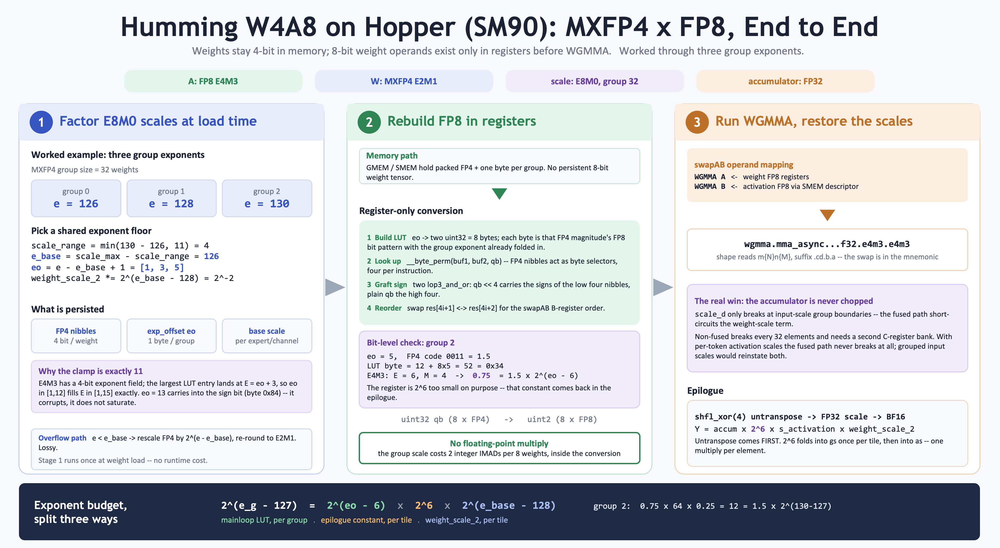

MoE 服务遇到的量化选择不只是一行权重位宽。存储格式决定搬多少字节，张量核心支持的格式决定如何乘，加上路由后每个专家收到了多少 token，才决定实际算子的形状。Humming 在 SGLang 中接管低比特计算，保留原来的路由、调度与分布式执行。它让同一个服务栈可以比较改变内核与改变激活精度各自的效果。

## 把一部分格式转换提前到加载阶段

在 Hopper 的 MXFP4 权重、FP8 计算路径上，加载模型时先分解缩放因子并整理布局，权重仍紧凑存放。运行时在寄存器中把读到的 FP4 值与剩余指数拼成 FP8 操作数，矩阵乘累加到 FP32，最后应用余下的尺度与激活尺度。这样避免在显存中常驻一套展开后的权重。可表示的指数范围仍有上限，越界组重新舍入可能引入误差。作者在 Humming 0.1.18 的指定配置上观察到，目标模型有效组无需这种调整，草稿模型却有 11.27% 的组受影响，主要与填充尺度参与范围选择有关。

<a class="note-image-link" href="/assets/images/tech/sglang-humming/overview.png" target="_blank" rel="noopener" aria-label="查看原图 ↗ — 从左到右，加载时分解尺度、寄存器内重建操作数、矩阵乘后应用剩余尺度。">查看原图 ↗</a>

*从左到右，加载时分解尺度、寄存器内重建操作数、矩阵乘后应用剩余尺度。*

## 长提示看首 token，连续解码看每轮接受量

同样的 A16 激活下比较 Humming 和 Marlin，可以先隔离内核实现的变化。团队在 H20-3e、DeepSeek-V4.1-Flash-1017 上，禁用干扰性的缓存复用，先测精确长度的合成输入。预热后并发一、每个长度三次请求的中位 TTFT 显示 Humming 的预填充加速为 1.07–1.23 倍。另做吞吐测试时，EP1 的同精度结果从并发一比 Marlin 低 2.89%，到并发 64 高 7.65%。解码还要看 DSpark 每次目标验证能交付几个 token，不能只给专家 GEMM 计时。

## 切换 AFP8 后重新核对质量

将专家激活换成逐 token 动态 FP8 后，权重格式、内核与激活舍入共同影响结果。完整 GSM8K 的八样例提示测评中，Marlin A16、Humming A16、Humming AFP8 分别为 97.12%、97.04%、96.82%。32K 和 128K 的定向检索检查没有覆盖所有长文本能力，更不能验证最高性能测点的 1016K 质量。文章同时介绍 Blackwell 的原生计算路径，以上实测全部来自 Hopper。这些限定让读者能逐项判断自己部署中换掉的究竟是哪一层。

[Humming in SGLang: Flexible Low-Bit Kernels for Efficient MoE Serving](https://www.lmsys.org/blog/2026-11-18-humming-sglang/) · Ant Group Venus and SCT Teams, and the SGLang Team · 2026-11-18
