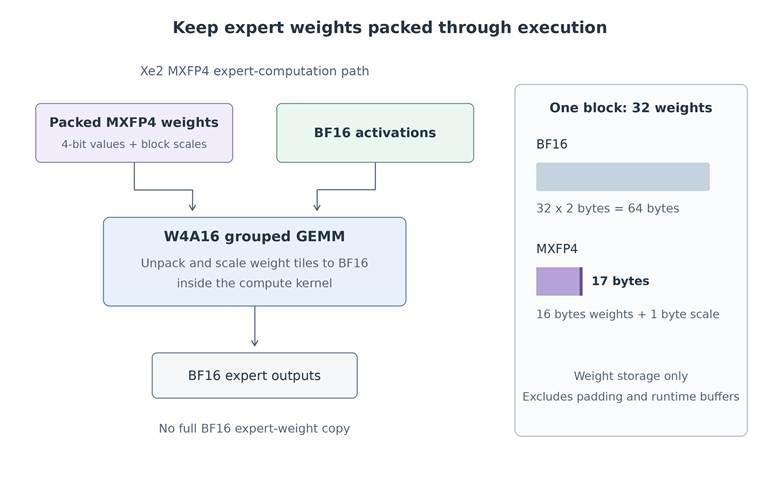

部署 GPT-OSS-20B 时，模型文件里的专家权重可以很小，执行矩阵乘时却仍可能需要一份展开后的大权重。RadixArk 与 Intel 在 SGLang 的 Xe2 后端把这两个时刻分开了：显存里一直存压缩块，只有本次计算用到的块才转成 BF16。这比“支持四位量化”更能说明服务究竟省下了哪一笔内存。

## 一组专家权重什么时候展开

MoE 路由让同一批请求中的 token 分别进入不同专家，每个专家分到的 token 数也会变化。XPU 路径在设备上整理输入，交给 grouped GEMM 处理这些大小不同的矩阵乘，再在设备上合并专家输出。这样，运行时无需由 Python 逐个发起专家计算。能否在这里保持权重压缩，取决于分组矩阵乘本身能读什么布局。

Xe2 的内核读入 MXFP4 权重块。32 个四位数合计 16 字节，另用 1 字节存共享缩放因子。同样数量的 BF16 权重需要 64 字节。内核取出一个 tile，在计算内部解包并按缩放因子转为 BF16，与 BF16 激活一起运算，专家输出也为 BF16。W4A16 描述的是权重存储与激活精度；这条路径执行矩阵乘时没有采用原生 FP4 算术。

<a class="note-image-link" href="/assets/images/tech/sglang-intel-xeon-xpu/expert-block.jpg" target="_blank" rel="noopener" aria-label="查看原图">查看原图 ↗</a>

*沿左侧数据流看，权重直到矩阵乘内部才展开。右侧的字节数只计算权重和块缩放因子。*

这个例子的硬件范围是 Xe2/BMG，包括 Arc B 系列和 Arc Pro B 系列。在文档列出的 GPT-OSS-20B 配置中，只有 MoE 专家权重用 MXFP4。注意力层、路由器、嵌入和输出头仍用 BF16。按整机容量规划时，还要计入对齐填充、KV 缓存、激活和工作区。17 与 64 的比值可以用来核算专家权重的原始存储，不能用来预测整个服务的显存降幅或每秒输出 token 数。项目也尚未验证这条路径的专家并行配置。

## 同一个服务请求，在 Xeon 上怎样执行

Xeon 路径的约束不同。支持 AMX 的处理器可以加速投影层和专家层的矩阵运算，实际收益受矩阵形状和批大小影响。兼容的检查点可以选择 W8A8 INT8，让权重和激活都以八位表示。数据位于哪个内存节点同样要紧：后端按 NUMA 节点或共享 L3 缓存的拓扑划分物理核，允许为每个并行进程显式绑核。在本地取数能减少跨节点访问，增加张量并行进程又会引入通信。只看单个算子的计算速度，很难推断整条解码路径的延迟。

在支持 AMX 的机器上，CPU 后端还可以编译计算图，减少重复进入 Python 的开销。逐 token 解码按批大小分桶，同一桶内复用图；可选的预填充图按输入 token 总数分桶，完整的预填充图后端仍属实验功能。GPU 上也有可选的图捕获与重放，而 Flash Attention 和 MLA 则各有预填充与解码内核。前者处理一段输入，后者反复读取增长的 KV 缓存，两种形状对数据访问的要求不同。

## 从单后端支持到跨设备执行，还要跨过什么

作者设想把视觉编码器交给 Xeon，把语言模型的预填充与解码交给两个独立 GPU 工作池。这样可以随图像数量、提示词长度和输出长度分别配置资源。代价也随切分点出现：编码器产出的嵌入必须传给预填充池，初始化后的 KV 缓存还要到达解码池。每段能独立运行只是起点，张量格式、缓存布局、传输路径和各段支持的模型仍要逐一对上。

原文给出的工程证据最具体的是单后端的执行路径和压缩块布局。跨 Xeon 与 GPU 的三级部署属于待验证方案，文中没有报告这套组合的端到端吞吐。对服务选型而言，读懂这两层证据的差别，才能分清哪些内存可以直接核算，哪些性能问题仍需要在目标负载上测量。

RadixArk & Intel · 2026-11-27 · [SGLang on Intel Xeon CPUs and Intel GPUs as First-Class Platforms: Execution Paths and Low-Precision Inference](https://www.lmsys.org/blog/2026-11-27-sglang-intel/)
