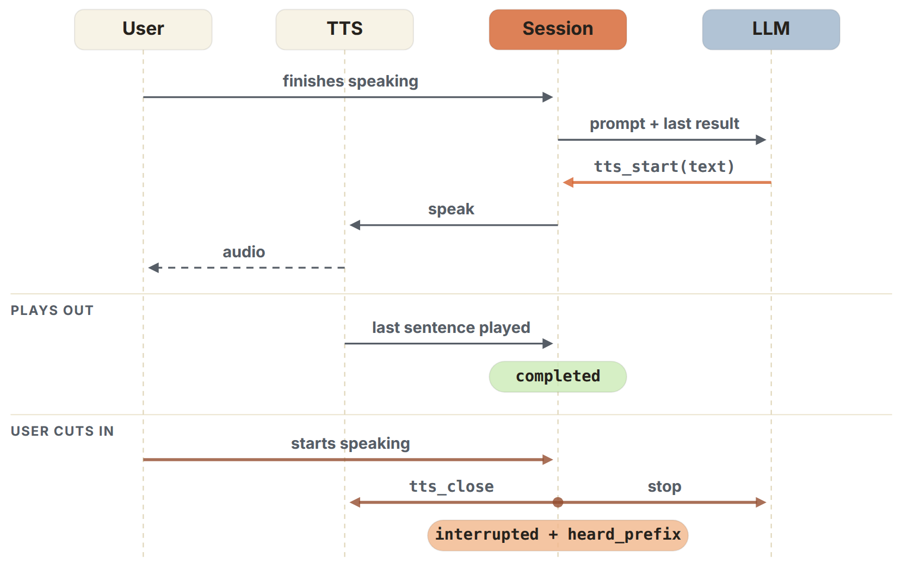

语音助手在一句话的末尾写下了取件码。用户在播到号码前插话，再问“你刚才念过了吗？”对下一轮推理而言，完整回复和截断后的回复各少了一半信息：前者只有说话计划，后者丢掉了已经写好的号码。SGLang Omni 把发声设计成工具调用，分别保存要说的内容和实际播放进度。模型由此既能回答“还没念”，也能接着把号码念出来。

## 一次发声只有一个结果

模型通过 `tts_start` 提交要说的文字，语音合成器逐句合成、播放。Session 集中维护会话状态，同一时刻只播放一段语音；播放中再次请求发声会收到 BUSY。被拒绝的调用立即返回，已接受的调用则在播完、中断或失败时返回一次结果。这样下一轮可以沿用同一个调用标识，把文字和它的执行结果对应起来。

用户插话时，语音活动检测器（VAD）直接通知 Session 停止合成播放和语言模型生成，清空缓冲。等语音识别完成再让模型决定是否停止，会在用户已经开口后继续播音，使“播放过”偏离“用户可能听见”。快速停止也有代价：VAD 对声音的含义和说话人身份没有判断能力，背景音乐、旁人的交谈都可能造成误停。

<a class="note-image-link" href="/assets/images/tech/sglang-omni-speech-tool/sequence.png" target="_blank" rel="noopener" aria-label="查看原图">查看原图 ↗</a>

*模型发起语音，Session 接收播放或插话事件。被打断时，同一次调用返回已播前缀。*

工具结果中的 `heard_prefix` 是对已播内容的估计。客户端报告截至何处截断，服务器用实际发出的音频量限定上界，再按播完的句子确定前缀。启用强制对齐器后，可以利用词级时间；一句话中途被截断且缺少词时序时，系统识别已经送达的音频，保留识别结果能确认的最长前缀。更晚到达的播放反馈可以修订这份记录。

## 先出声的时间省在哪里

默认工具解析器要等整个文本参数闭合才交给 TTS。团队改为流式释放参数，第一句写完就可以合成，后面的句子继续生成。另一个改动是预填工具调用开头，让模型直接续写要播的文字。这一步跳过生成思考，也可能改变答复内容。两项改动解决的是不同的等待。

作者对每种配置和回复长度重放同样的 15 段录音，从客户端发出包含 VAD 语音结束标记的数据包，计时到收到首个非空音频块。Inkling 2 Mini 和 Qwen3.8-27B 各用一张 H200，Inkling 2 Small 用四张 H200 做张量并行。在请求三句回复时，旧的直接朗读路径开启低档思考，三个模型首音中位数的平均为 1,826 毫秒；流式参数加预填开头的路径为 567 毫秒。两边的思考条件不同，不能把全部差值归功于流式解析。

单看流式改动，保持低档思考、用同一录音配对比较两种工具解析器，三句请求下 Small 和 Qwen 的首音中位收益分别为 148 和 417 毫秒。Mini 从写下第一个词到写完整段约需 70 毫秒，提前释放第一句几乎没有收益。保留低档思考时，三种模型走流式工具路径仍比直接朗读慢。对长口述回答，句间并行有实际价值；极短回复留下的重叠时间很少。

## 播放回执改善了哪一种判断

在取件码式的回放试验中，每对历史都把随机码放在工具参数里，其中一份历史的已播前缀包含它，另一份没有。三个模型在低、中两档思考下，都能在 32 对中全部正确区分“念过”和“没念过”；只保留截断回复时，各条件的成绩为 12 至 29 对。这个实验把播放历史直接交给模型，测到的是模型解读记录的能力。真实房间里能否准确识别插话、估计用户听见多少，仍取决于检测和对齐。

回执还影响失败恢复。部分句子播出后合成失败时，同一工具结果再提醒模型只说余下部分，从第一句重说的情况由 238 个样本中的 231 个降到 2 个。另一方面，在四会话并发的 Full-Duplex-Bench 测试中，保留思考的工具路径听到简短附和后，平均每 25 例有 15.2 例被判定为继续原话，直接朗读为 19.5 例。记住播了什么、决定何时继续说，是两项需要分别验证的能力。

SGLang Omni Team · 2026-11-24 · [Speaking Is an Action: Turning TTS into a Tool for Interactive Models](https://www.sglang.io/blog/tts-as-a-tool)
