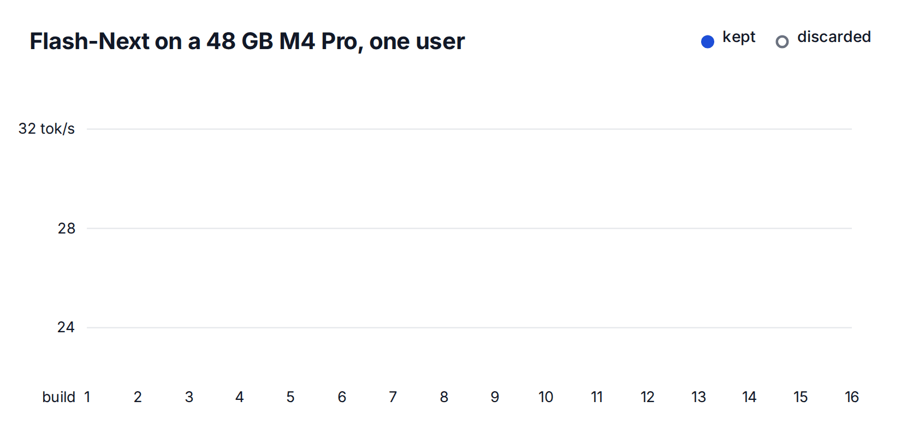

原文: [Your Mac Deserves Its Own LLM Engine](https://skydiscover-ai.github.io/blog-jitengine.html)  
Mert Cemri, Shubham Agarwal, Shu Liu, Alexander Krentsel, Sidharth Sankhe, Alexandros G. Dimakis, Ion Stoica · 2026-11-04

## 专用引擎的价值来自瓶颈差异

SkyDiscover 团队用 SkySynth 和 Claude Opus 5.5 编码代理，在 Apple MLX 上构建了六个模型／硬件专用引擎。文章声称无需人工编写引擎代码，但这些系统依赖已有 MLX、模型与设计方法，因此应理解为代理主导的系统实现与优化，而不是所有底层软件都从零生成。三种模型分别在 24 GB M2 与 48 GB M4 Pro 上运行，内存预算还要为操作系统留出空间。

最有价值的观察是，同一个“好优化”可以在另一台机器上失效。能放入内存的模型受计算或内存带宽限制；放不下的 MoE 模型还受专家缓存、SSD 与 CPU／GPU 同步影响。文章把每个加速数字与硬件、模型、上下文及并发条件绑在一起，提供了比统一平均加速更清楚的解释。

## MTP 是否划算，要看验证的增量成本

Qwen3.6 在 M4 Pro 上的普通一步为 11.1 ms，带一个猜测 token 的验证步为 13.4 ms。只增加 2.3 ms，就有机会一次获得两个 token；平均每轮 1.85 token，使 MTP 有利。引擎使用与单 token 解码一致的算术来验证，避免多 token kernel 的数值差异改变选择结果。

同样机制在 M2 上的验证开销却达到 65%–73%，代理测量后关闭了 MTP。优化转向三比特权重解包、输入复用与命令缓冲区：只声明实际选中专家的权重，而非整个专家堆栈，减少频繁提交。M2 单用户结果为 44.9 tok/s，对比带 MTP 的 llama.cpp 为 32.9 tok/s。

M4 Pro 上，Qwen3.6 的主要报告比较是八请求并发，200.5 对 181.5 tok/s；不能把这组数字写成单用户速度。作者还披露某个基线单用户更快，却未通过其精确性检查。这提醒我们，性能排名必须同时说明候选是否满足同一个正确性门槛。

## 放不下模型时，调度会改变缓存命中

104 GB 的 Qwen3.8-Flash-Next 在两台 Mac 上都需要卸载专家。M4 Pro 的 40 GB 预算下，压缩单个专家表示、提前执行再处理缺失、跨层重叠读取等组合，把单用户速度推至 32.9 tok/s；slotstream 为 12.1 tok/s，即约 2.72×。这个最高值属于该模型和配置，不能代表六个引擎的统一收益。

M2 的 SSD 带宽更低，18 GB 预算也更紧。八个请求每一步一起运行会相互驱逐专家，改为每个请求连续解码 64 token 后再切换，让每 token SSD 读取从 243.5 降到 140.9 个专家。这里牺牲了“每一步所有请求一起推进”的形态，换取局部缓存复用；调度需要与实际延迟目标共同判断。

Flint 又不同：M4 Pro 上长上下文主要读取 KV cache，持久化 GPU 程序将历史分给 240 个线程组，作者报告达到接近硬件上限的内存带宽。M2 上卸载导致 GPU 在磁盘读取间隙降频，一个持续发出小 kernel 的辅助进程反而带来主要收益。后者提示吞吐改善还可能伴随额外资源消耗，文章未给出相应能效结论。

<a class="note-image-link" href="/assets/images/tech/skydiscover-jitengine/search.gif" target="_blank" rel="noopener" aria-label="Flash-Next 在 M4 Pro 上逐次构建、保留与丢弃候选的速度曲线 · 查看原图 ↗">查看原图 ↗</a>

*蓝线是通过检查后保留的最佳构建；空心点说明更快的单次测量并不必然成为最终版本。*

## 防止代理优化了测量器

SkySynth 的循环是改一处、测正确性、测内存和速度，满足要求且超过当前最好版本才保留，并复查保留提示。另有审计代理寻找测试捷径。Qwen3.6 卸载模式最初的命中率与读取字节来自引擎自报，测试却没有检查计数；审计补上由检查点推导的专家查询总数、每次 miss 的读取量，以及预算不足时必须发生 miss 等约束，并用虚报计数和少算专家的伪引擎验证测试能拒绝它们。

Flint 的原始基准预先提供整个 token 序列，容易诱使实现批量处理未来 token，或跳过输出层。团队因此记录每个计时步的输出分数，再冷启动逐 token 重算，要求逐位一致；修改中途输入 token 还必须影响后续结果。这些针对性反例比单看“所有测试通过”更能说明测试是否真的约束了目标工作。

原文的六个引擎使用不同精度保证和对照：Flint 的 M2 增益甚至是相对作者自己的 M4 构建，因为 rec 在预算内放不下。最值得借鉴的是按瓶颈选择机制、明确每个比较的基线，以及让独立观测检查引擎自报指标。专用生成的前景在这里既体现为速度，也体现为测量与正确性约束是否随优化一起演化。
