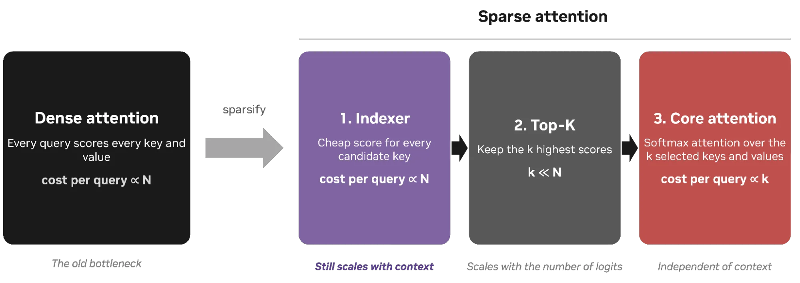

[Co-Designing Sparse Attention for Efficient Long-Context Inference](https://developer.nvidia.com/blog/co-designing-sparse-attention-for-efficient-long-context-inference/)  
Timmy Liu, Nidhi Bhatia, Samkit Jain, Makesh Tarun Chandran, Bita Darvish Rouhani · 2026-11-17

稀疏注意力只读取少量 key/value，并不意味着长上下文的成本已经消失。NVIDIA 的这篇设计分析把运行拆成 indexer、Top-k 和 core attention：最后一段按选中的 k 个条目计算，选择器却可能仍扫描整个 N 长度历史。模型开发者需要一起设计选择规则、张量形状和 GPU kernel，否则稀疏化只是换了瓶颈位置。

## Indexer 怎样变成矩阵乘与访存问题

文章讨论训练时纳入的模型级稀疏注意力，而非任意模型上的免训练补丁。indexer 的主体是带融合 epilogue 的批量 QK 矩阵乘，随后做 ReLU、跨头加权规约等处理，输出每个 key 的选择分数。prefill 同时处理很多 query，倾向计算受限；decode 只有少数 query 行，需要流式读取索引 key cache，更容易受内存带宽限制。

<a class="note-image-link" href="/assets/images/tech/sparse-attention-codesign/method.webp" target="_blank" rel="noopener" aria-label="core attention 只处理选中条目，indexer 仍需面对候选规模，Top-k 也属于这笔成本。 · 查看原图 ↗">查看原图 ↗</a>

*core attention 只处理选中条目，indexer 仍需面对候选规模，Top-k 也属于这笔成本。*

定义组大小 G=QH/KH，更多 query head 共享一个 key head，可在读同一份 key 的基础上增加计算。跨头规约还让输出只写一个 logit，减少写回流量。在固定 query head 数下增加 key head 则缩小共享组，decode 需要多读缓存；作者的扫描中，KH 从 1 增至 8，decode 时间约增至 7.6 倍。这个结果属于所测 kernel 和形状，不是所有注意力实现的定律。

## 投机长度与头数共用同一块硬件预算

投机解码一次验证 D 个草稿 token 加一个新 token，indexer 可以让这些 query 复用同一份 key 读取。但复用并非没有上限：G×(D+1) 要能放进同一个 Tensor Core tile。FP32 epilogue 的寄存器压力使实际预算约为 200 行，FP16 epilogue 可放到 256 行；超过以后需要更多 CTA 和重复工作，延迟会跃升。

这解释了为什么“多几个草稿 token 几乎免费”只能在一定区间成立，也解释了模型头数会影响系统最合适的投机深度。降低 epilogue 或累加精度还能提高效率，但必须保证 QK 数值范围适配 FP16，不能跳过正确性条件。

head dimension 同样有两面：太窄时 CUDA core 上的 epilogue 可能让 Tensor Core 等待，增宽能摊薄这部分成本；decode 又要为更多 key 字节付费。文章建议的 128 或 256 是从这种平衡得来，而不是越大越好。

## Top-k 应计入选择成本

少保留一些条目，并不一定明显降低 Top-k 时间，因为它首先要检查全部候选。压缩 indexer key、分层索引或跨层复用选择，减少的是需要打分的条目数，对 indexer 与 Top-k 都有帮助；它们降低总工作量，但不自动改变算术强度。

两个执行优化更具体。将 Top-k 融进 indexer，可避免完整 logit 矩阵写入 HBM 后再读回。decode 中相邻步选择往往相似，Guess-Verify-Refine 用上一步结果作猜测，再验证和细化；在文章引用的 DeepSeek V3.2/V4 测量中，Top-k 相对标准 radix select 快 2.1–2.4 倍。这个倍率是选择阶段，不是整个模型吞吐。

## 最后还要让稀疏读取适合硬件

逐 token 选择会产生分散地址，每个 query 的集合也可能不同，限制数据复用。块级选择让一组连续 key 一次载入，再供选择了该块的多个 query 使用。在固定 2,048 个选中 key 的实验里，块越小，地址处理、局部结果与合并次数越多；相同 FLOPs 和 KV 字节数不代表相同时间。

整篇最有价值的是把模型设计变量变成执行成本。默认扫描条件包括 FP8 indexer、64K 个索引 key、Hsz=128、KH=1、prefill batch 1 和 decode batch 128，具体曲线离不开这些条件。它没有证明某套稀疏配置同时保留所有模型质量，也没有给出跨硬件通用最优点。与 RecSA 对照阅读更清楚：RecSA 改变选择的渐近结构，这篇解释剩余选择工作怎样高效映射到 GPU，两个层面可以共同决定最终收益。
