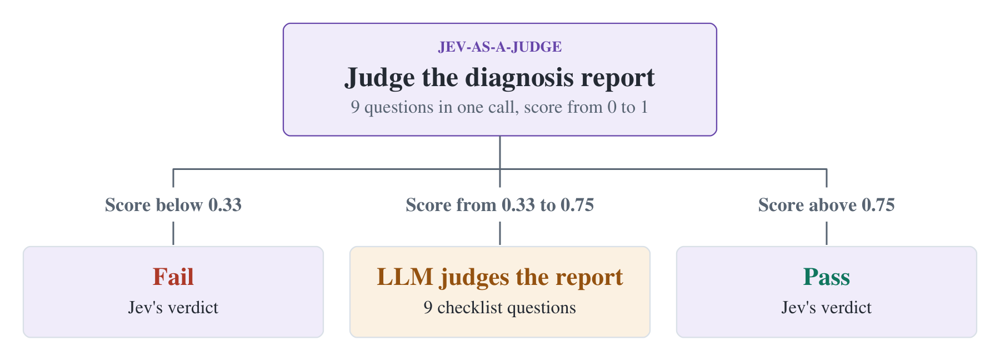

[Jev-as-a-Judge for SRE](https://www.sregym.com/blog/jev-as-a-judge)  
Yukun He, Saad Mohammad Rafid Pial, Jackson Clark, Yiming Su, Tianyin Xu · 2026-11-08

SRE Agent 的根因报告可能很长，但评估通常围绕少数明确问题：是否找对故障源、有没有把下游症状当根因、是否遗漏受影响组件。SREGym 的这篇实践用 TypeSafe Jev 决策模型执行这些判断，并把难以裁决的部分转给 LLM。值得关注的是评分接口与校准过程，而不是简单换成一个便宜模型。

## 从自然语言总评拆到九个问题

SREGym 注入故障，Agent 调查后提交诊断报告。原有 LLM 裁判将报告与答案对照，回答九个是非题，分为故障定位、故障刻画和范围精度，权重分别是 0.33、0.33、0.34。每组按肯定回答的比例计分，再做加权和；达到 0.70 即通过。在这个权重设置下，需要至少七个肯定回答。

Jev 输出的不是单个 Yes/No，而是每个答案的概率。系统用 Yes 概率替换二值结果，再计算同一加权和。这个分数不应直接视为“报告正确的概率”：它是多个判断合成的决策统计量，需要在目标任务上校准阈值。

## 问题写法与阈值必须一起适配

直接照搬给 LLM 的问题，在 0.70 阈值下只得到约 86% 的调优集一致率。一个原因是问题让模型判断“注入逻辑中改变的细节”，但它根本看不到注入代码。作者把答案拆成 component、namespace 和 description，并重写问题，明确在什么信息匹配、缺失或矛盾时回答 Yes/No。

SREGym-Lite 共 21 个问题，15 个用于调优，6 个留作未见问题。调优阶段每次留出一个问题，在其余问题上选择与 GPT-6 Astra High 最一致的阈值，再检查留出问题。各折阈值中位数为 0.62。改写后的问题在调优报告上达到约 91% 一致率。按问题划分比随机打散同一故障的报告更有意义，但六个未见问题仍是较小验证范围。

## 不确定时，花预算请 LLM 再判

Mixed Judge 先让 Jev 判断全部报告，只将中间区间交给 LLM。作者把调优报告中约四分之一的转交量作为预算，通过交叉验证选择区间中心，最后得到约 0.33–0.75 的分数区间。低于区间判失败，高于区间判通过，中间由 LLM 决定。

<a class="note-image-link" href="/assets/images/tech/sregym-jev-as-a-judge/mixed-flow.png" target="_blank" rel="noopener" aria-label="Jev 对所有报告打分，只有中间区间送交 LLM；0.33–0.75 来自调优问题上的预算与交叉验证。">查看原图 ↗</a>

*Jev 对所有报告打分，只有中间区间送交 LLM；0.33–0.75 来自调优问题上的预算与交叉验证。*

这条路由不需要把所有报告交给最贵的裁判，也不声称低分和高分绝不会出错。区间在调优数据上确定，未来报告风格和故障分布变化时，原有分数分布与转交比例都可能变化，因而它不是跨数据集通用的置信区间。

## 证据是裁判一致性，不是独立真值准确率

872 份报告上，Jev 单独判断与 LLM 的一致率约 91%，估计 API 成本约为 1/510；Mixed Judge 达到 98.7%，成本降低约 74%。原文以每千份报告约 8 美分对 42 美元说明规模差异，时间估算约为每份 0.1 秒对 14 秒。它们是指定 API 价格和评估条件下的估算，不是固定服务报价。

98.7% 还接近 LLM 自己重复判同一报告的一致程度，但这不证明两者都对。目标是拟合首次 LLM 判决，公共答案用于组织输入；没有独立人工真值就不能把一致率写成根因诊断准确率。对 AIOps 的可迁移经验，是先让裁判看见必要证据、将问题写成可操作规则，再选择阈值与转交预算。更广泛故障覆盖和人工误判审计仍是后续需要补齐的证据。
