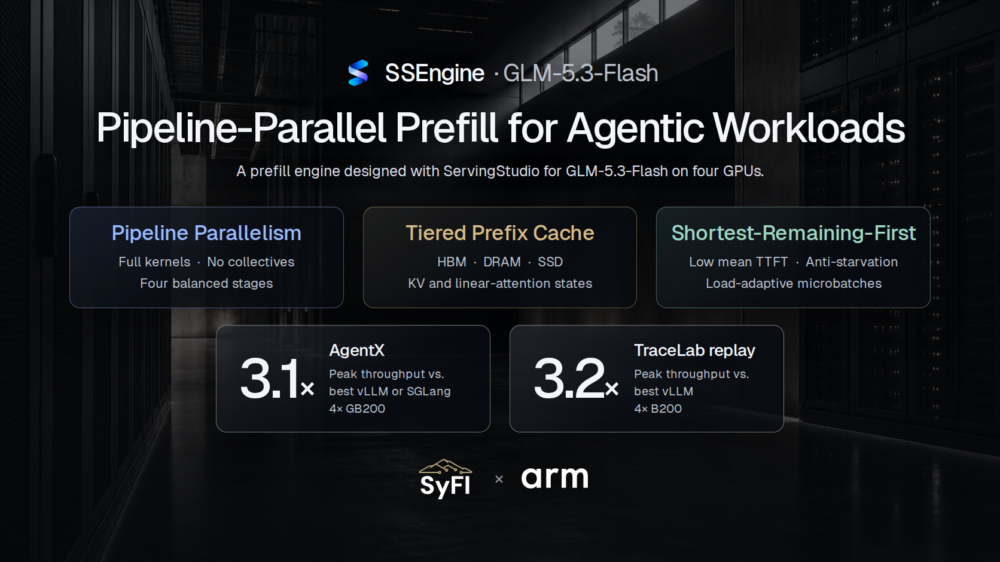

在 TraceLab 轨迹中，一个回合的提示中位长度是 154K token，每次新增部分的中位数只有 1.2K。推理成本因而很大程度取决于能否让上一个回合的状态留到下次请求。ServingStudio 为 GLM-5.3-Flash 做了一台专用预填充引擎，处理到首个输出 token 就结束。它把如何拆模型、如何保存状态和谁先进入流水线作为同一个问题处理。

## 四段流水线保持层内计算形状

把一个层分给四张卡，并不总能把耗时缩到四分之一。部分算子需要在各卡上重复，另一些在矩阵变小时效率下降。作者选择按层分四段，每张卡保留段内算子的形状，再按测得的工作量平衡各段。代价是单个孤立请求必须依次经过四段，低负载下张量并行可能更快；有足够多回合时，多个微批才可填满流水线。无限前缀缓存假设下的 49.1 请求/秒是模拟值，它用于比较拆分方案。

<a class="note-image-link" href="/assets/images/tech/ssengine-glm53-flash/overview.png" target="_blank" rel="noopener" aria-label="查看原图 ↗ — 流水并行、分层缓存和按剩余长度调度分别处理卡间通信、旧状态恢复与排队等待。">查看原图 ↗</a>

*流水并行、分层缓存和按剩余长度调度分别处理卡间通信、旧状态恢复与排队等待。*

## KV 与线性注意力状态一起恢复

DSA 层每个历史 token 都占 KV，KDA 层则更新一份固定大小状态。若新请求只匹配到缓存前缀的中间，不能拿更晚的 KDA 状态冒充该位置的状态。因此缓存需要保存可以共同恢复的边界。按 TraceLab 的中位上下文估计，一份会话约占 1.2 GB，四张 B200 的显存只能容纳约 330 份。引擎将逐出的状态放入主机内存和 SSD，从较慢介质异步读回；等待读入的会话留在加载队列，已就绪请求仍可成批前进。

两级低速介质的保留规则不同。主机内存相对紧张，数据回到显存后就释放主机副本；SSD 容量大些，读出后仍留副本，下次逐出只需追加新的 KV 和 KDA 状态。作者在八小时模拟中据此估算，每卡写 SSD 仍约为每天 66 TB。即使读取带宽够用，盘的写入寿命也可能成为长期运行的约束。

## 让短请求先走，给长请求保留位置

调度器看剩余待预填充 token 数，先排短请求，随积压增大微批。仅按最短优先，持续到来的短提示会让长提示一直等。引擎让已经等待 60 秒的请求进入下一个微批；这是获得调度机会的条件，不能直接当作首 token 的延迟上限。模拟中 1,200 会话时，调度把平均 TTFT 从 1.72 秒降到 0.53 秒，但超过 100K 新 token 的回合中位 TTFT 从 2.7 秒升到 19 秒。整体改善与稀有长请求付出的代价同时可见。

## 在真机上比较各系统的峰值

四张 GB200 GPU 上运行 AgentX，512 个 Agent 时引擎达到 24.0 请求/秒，中位首 token 等待 1.7 秒。最佳基线是 256 个 Agent 的 SGLang 流水线配置，达到 7.7 请求/秒。约 3.1 倍是各自最佳负载点的比较。TraceLab 回放中作者按每张 B200 每小时 6.73 美元估算，峰值下每千次预填充的 GPU 时间约值 0.18 美元；主机内存、SSD、闲置容量和后续解码费用均不在这个数里。

[SSEngine-GLM5.3-Flash: Pipeline-Parallel Prefill with Tiered Prefix Caching for Agentic Workloads](https://servingstudio.cs.washington.edu/blog/ssengine-glm53-flash/) · ServingStudio · 2026-11-18
