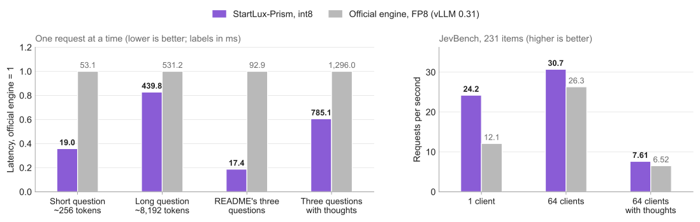

专用推理引擎的价值，往往出现在通用服务框架没有充分利用的请求结构里。StartLux-Prism 面向 StartLux-Decision 的结构化决策：同一份材料可以同时回答多个选择、是非或评分问题。它把共享材料的计算、问题分支和低精度执行放进同一条优化路径，值得关注的既有短请求延迟，也有并发变化时输出能否保持稳定。

**StartLux Labs · StartLux-Prism**  
原题：*StartLux-Prism: Fast, exact inference for StartLux-Decision models on NVIDIA GPUs*。仓库创建于 2026-10-13；可见初始代码提交为 2026-10-22。[项目原文](https://github.com/StartLuxLabs/StartLux-Prism/blob/f32ed8eee9d89ea56dde03a978cf4128d2bbf497/README.md) · [设计说明](https://github.com/StartLuxLabs/StartLux-Prism/blob/f32ed8eee9d89ea56dde03a978cf4128d2bbf497/docs/design.md) · [完整基准](https://github.com/StartLuxLabs/StartLux-Prism/blob/f32ed8eee9d89ea56dde03a978cf4128d2bbf497/docs/benchmarks.md)。

## 从多次提问，到共享材料的一次计算

StartLux-Decision 返回各候选项的概率。AutoThink 在首轮读出置信度低于门槛时生成思考，再读取答案；因此，快速决策和生成思考是两种不同负载。Prism 保留模型的提示格式、读出和决策规则，重写前向计算与调度。它直接读取已发布的 Q8_0、Q4_K_M GGUF 文件，但“直接读取”不表示内部计算毫无转换：Q8_0 权重启动时经 SmoothQuant 重量化，激活按 token 量化，形成 W8A8 路径。

核心结构是一片打包的 token 分支树：系统文本启动时算好，同一请求的材料只计算一次，各问题从材料状态分叉。一个批次运行主体图和答案读出图；批次结构通过设备表传入，相同 token 桶可复用 CUDA Graph。线性注意力先处理父状态已就绪的片段，再处理子片段；普通注意力直接读取共享父片段的 K/V。最后一层只在答案位置完成必要的查询、输出及读出计算。

这种设计同时减少重复前缀计算和主机调度开销。跨请求缓存又保存线性注意力的递归状态、卷积尾部及注意力 K/V，按精确 token 匹配与图像摘要查找。它适合同一份证据上的后续提问；输入材料变化后，不能因为语义相近就继续复用。

## 逐位一致是执行性质，不是无损量化

Prism 的 int8 矩阵乘法先用 int32 精确累加，再按固定舍入顺序缩放并加入残差。split-K 的部分和保持整数形式，张量并行也先合并整数部分和，避免不同归约顺序改变浮点末位。其优化日志记录过一个具体失败：浮点原子累加曾令近似平局的决策在不同运行间翻转，缓存命中与未命中的概率也曾出现差异。最终方案还固定了缩放、加法与读出路径，不能只靠“用了整数乘法”就推导整个模型确定。

官方测试报告覆盖缓存命中与重算、32 个客户端并发提交 64 个答案，以及单卡与 2/4 卡张量并行；目标是同一量化路径在这些执行条件下输出一致。思考采样按问题播种，减少与批次组成的耦合。这为服务扩缩容和故障回放提供了有用性质，但不意味着 Prism 与 BF16、FP8 引擎得到相同概率或思考文本。BF16 路径也不享有同样的批次不变性。

## 5.3 倍加速发生在哪里

<a class="note-image-link" href="/assets/images/tech/startlux-prism/v11-performance.png" target="_blank" rel="noopener" aria-label="单张 H200 上 Prism int8 与官方 FP8 的延迟和吞吐比较 · 查看原图 ↗">查看原图 ↗</a>

*读图：左侧以官方 FP8 延迟为 1，柱顶仍标实际毫秒；右侧是每秒请求数。共享材料的三问请求收益最大，长输入和高并发时差距缩小。*

厂商对 StartLux-Decision-v1.1-27B-AutoThink 的比较使用每个服务一张 H200，以官方 vLLM 0.31.0 服务为基线。官方端读 BF16 发布权重并启用 FP8，Prism 读取 Q8_0 GGUF；权重舍入、随机数生成器和递归状态精度均有区别。串行测试每组 25 个请求去掉前 5 个预热，每次换入独有材料，避免重复请求造成缓存命中假象。

| 场景 | 官方 FP8 | Prism int8 |
|---|---:|---:|
| 约 256 token 单问，平均延迟 | 53.1 ms | 19.0 ms |
| README 三问、不生成思考，平均延迟 | 92.9 ms | 17.4 ms |
| 约 8,192 token 单问，平均延迟 | 531.2 ms | 439.8 ms |
| JevBench，64 客户端、仅读出 | 26.3 请求/秒 | 30.7 请求/秒 |

92.9/17.4 才是约 5.3 倍的来源；高并发仅读出的吞吐提升约 17%。作者将后者解释为负载上来后两端主要受 tensor core 计算限制。数字支持“减少短请求和多问结构的开销”，不能外推成任意任务都有五倍收益。

思考负载还给出相反例子：JevBench 单请求逐条运行时，Prism 平均延迟为 1,212 ms，官方 FP8 为 1,150 ms；两者单序列生成速度都约 94 token/s。Prism 出现了更长的思考，抵消了快速读出的优势。在线服务因此还需观察思考长度与尾延迟，单看首次决策时间不够。

## 接近的平均准确率，仍可能掩盖思考质量差距

在沿用 v1 的七套评测、共 12,351 次决策中，v1.1 AutoThink 的 int8 平均分为 92.94，官方 BF16 为 92.97；W4A8 为 93.07。后者是在 RTX 5090 上以不同容量配置运行，不能拿耗时直接与 H200 对比，分数小幅领先也不足以证明四位量化更好。相关评测使用 gate 0.9，服务默认门槛为 0.6，改变门槛会改变进入思考路径的比例。

更有解释力的是重复采样：对 JevBench 的 231 项取九次样本，Prism int8 平均答对 221.2 项，官方 BF16 为 226.0、FP8 为 224.9。作者进一步把 67 个需要思考的问题各生成三份思考，再交叉交换读出引擎。官方 BF16 写出的思考由两种读出分别答对 187/185 项，Prism int8 写出的为 180/178 项；相同 Q8_0 权重用 BF16 算术生成思考则恢复到 186/185。这个对照支持作者将主要差距定位于生成阶段的 int8 激活量化，而非仅仅答案读出或 GGUF 权重舍入。

## 对推理服务的实际启发

对于围绕同一工单、告警材料或状态快照反复做结构化判断的系统，共享计算和执行不变性有明确迁移价值；这些是应用上的推论，原文没有给出 AIOps 故障诊断效果。尤其值得阅读设计文档和交叉读出实验：前者解释性能来自哪里，后者展示怎样把准确率回退拆成权重、计算和生成路径的问题。

本期版本服务 v1 与 v1.1 AutoThink 的 4B、9B、27B，尚不支持 v1.1 Instant 的双向提示计算。它是模型专用引擎，其优势不能直接推广到任意 LLM。仓库自身代码当时尚未选定许可证，借入代码另有 Apache-2.0 许可，模型权重为 CC BY-NC 4.0；可查看源码与可用于商业部署是不同条件。
