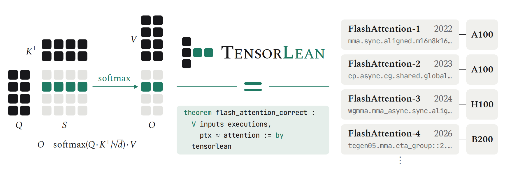
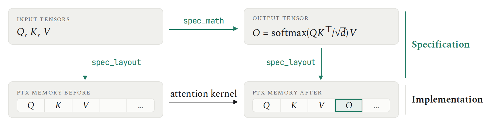
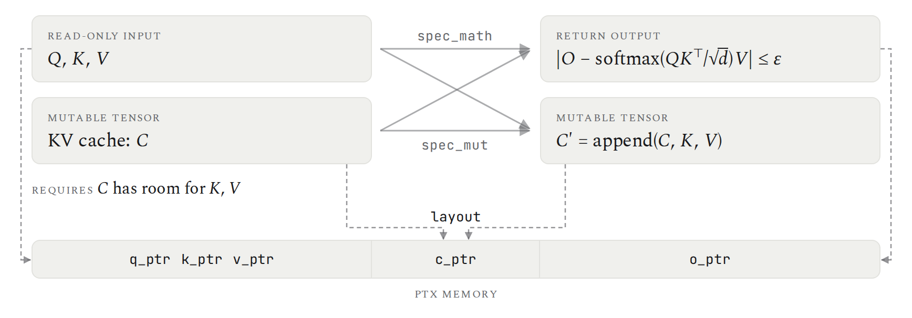
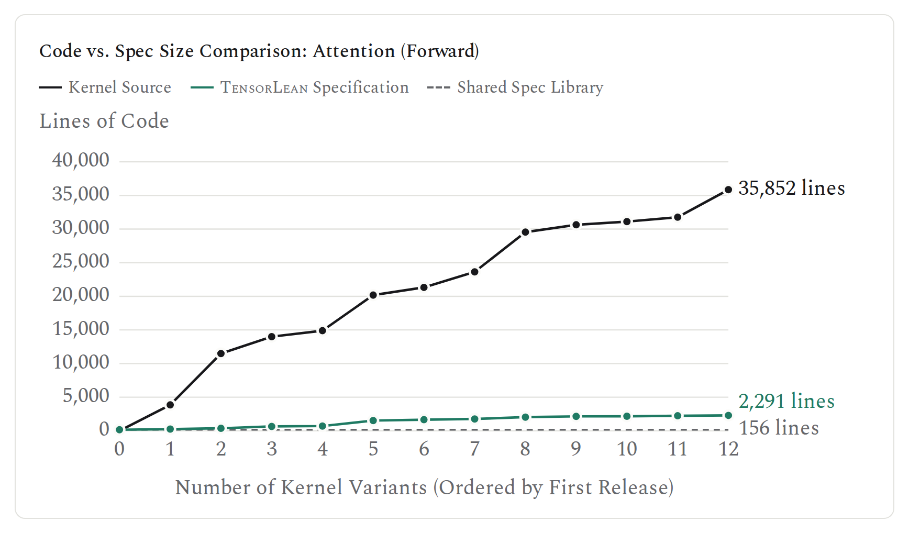
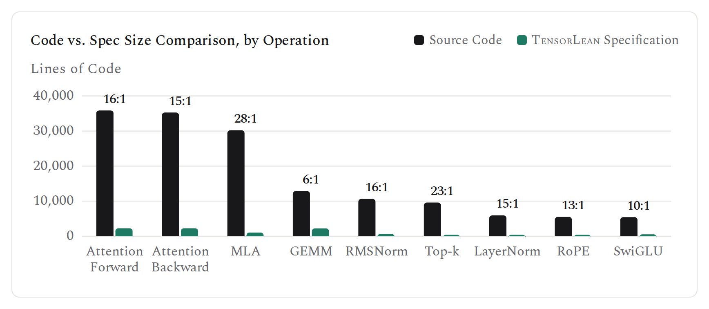
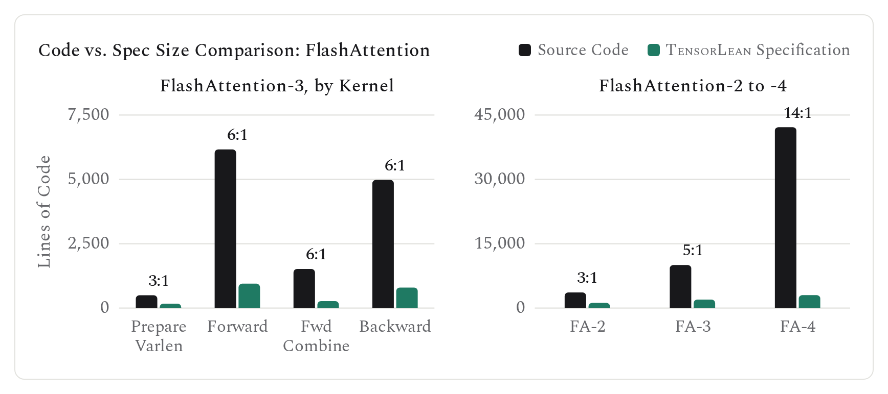
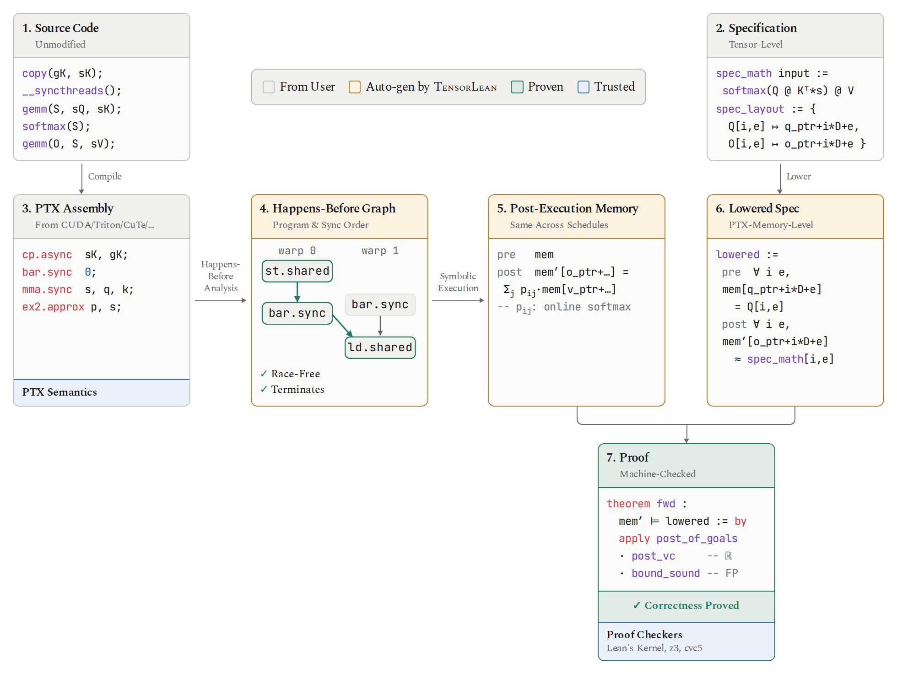
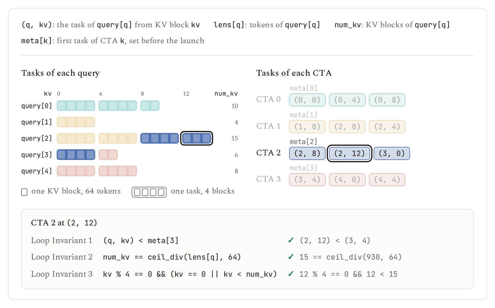
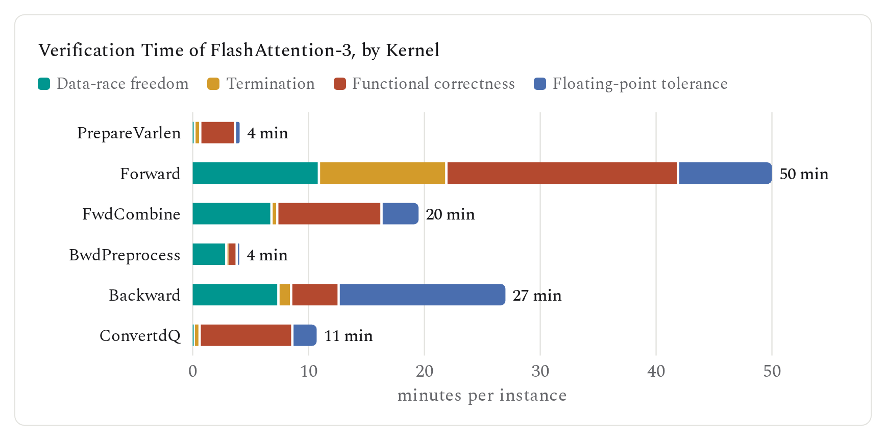
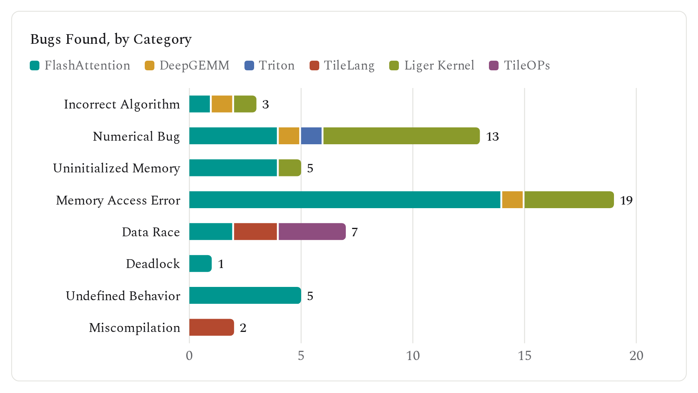

> AI 辅助技术精读。原文基准为哥伦比亚大学（Wei Qiang、Ganxiang Yang、Yi Rong、Ronghui Gu）与 CertiK（Xupeng Li、Ronghui Gu）联合发布的 [TensorLean 技术报告](https://tensorlean.ai/)（`2026-11-20`）以及公开仓库 [`TensorLean/TensorLean@3e83208`](https://github.com/TensorLean/TensorLean/tree/3e83208f3b11fa96ca9e2097e2f1bd524b0c60c2)（`2026-11-22`）；文中涉及的上游 Issue/PR 状态核查截至 **`2026-11-23`**。按照读者要求，本文保留 `tensorlean.ai` 原文全部 10 幅未翻译原图；需要预先说明的是：**截至该固定版本，仓库仅公开发布 `README.md` 与 39 项缺陷台账，完整学术论文、Lean 4 PTX 语义库、1.8K 行解析器及 149 个实例的证明脚本尚标注为「即将开源」**，本文分析全部基于公开技术文本、页面嵌入结构化数据及上游 GitHub 记录，未在本地复跑 Lean 4、cvc5/Z3 或 GPU 内核实验。

**AI 系统对 GPU Kernel 的信心，长期建立在「采样输入 + 容差比对」的经验主义之上；当内核从同步融合演进到异步 TMA、WGMMA 与 Blackwell `tcgen05` 时，真正危险的缺陷几乎不再以崩溃现身，而是隐藏在特定形状组合与罕见线程交织下的静默算错。** [`TensorLean`](https://tensorlean.ai/) 试图跨越「学术玩具原型」与「生产级前端内核库」之间的鸿沟：它不要求改写 CUDA、CuTe 或 Triton 源码，而是直接对编译产出的 **NVIDIA PTX 汇编**，在 Lean 4 与 SMT 求解器（cvc5 / Z3）上同时证明四项性质——**无数据竞争（Data-Race Freedom）、必然终止（Termination）、实数域代数等价、以及浮点计算树线性传播容差界**。

<figure>
<a class="note-image-link" href="/assets/images/tech/tensorlean-close-reading/orig-00-hero.png" target="_blank" rel="noopener" aria-label="TensorLean 核心定位原图：将数学式 softmax(Q K^T / sqrt(d)) V 与 FlashAttention-1 至 -4 跨 A100/H100/B200 的 PTX 指令通过 Lean 定理绑定。"><span class="note-image-action">放大原图 ↗</span></a>
<figcaption>图 1 · <code>TensorLean</code> 总体验证目标（<code>theorem flash_attention_correct</code>）：对所有合法输入与执行调度，证明跨 Ampere <code>mma.sync</code> / <code>cp.async</code>、Hopper <code>wgmma</code> 到 Blackwell <code>tcgen05</code> 的 PTX 与同一张量公式等价（图源：<code>tensorlean.ai</code> 原图）。</figcaption>
</figure>

把博客正文、`tensorlean.ai` 页面内嵌的交互图表原始 JSON、`TensorLean@3e83208` 提交历史以及跨 6 个上游代码库的 PR 逐一摊开核对后，既能看清它靠什么把代码规约比压到 **15:1**、把 Hopper `FlashAttention-3 Forward`（`31,402` 条证明目标）压进 **50 分钟**，也能一眼看清被它放进 **TCB（可信计算基）** 的 `ptxas` 降级层、Tensor Core 未公开舍入假设与尚未覆盖的多卡原子通信边界。

<h2 id="section-a">为什么测试与固定形状等价校验抓不住前沿 Kernel 的静默缺陷？</h2>

开篇并非从形式化方法本身讲起，而是点出大模型基础设施近年来反复出现的「静默正确性失效」：2024 年 2 月 OpenAI 披露 ChatGPT 异常乱码事故，2025 年 9 月 Anthropic 在事后复盘中披露编译器误编译（miscompilation）扰乱 token 选择，2026 年 10 月 Google DeepMind 又在 [arXiv:2610.31642](/digest/zh/daily/2026-10-26/#paper-arxiv-2610.31642) 中指出主流框架连标准 `softmax` 与交叉熵反向传播都存在截断微小梯度的数值错误。这类故障的共同特征是：**内核在常见形状与常规时序下返回看似正常的输出，却在长尾批大小、奇异头维度、非对齐分块或特定硬件调度下悄然写坏显存或张量数值**。

对于已经存在的动态测试（如 PyTorch 参考比对）和近年兴起的 Kernel 等价性检验器（文章在参考文献中点名 *Equivalence Checking of ML GPU Kernels* [OOPSLA 2026] 与 *SentryWard* [2026]），`TensorLean` 指出三道硬伤：

1. **固定配置展开会漏掉形状与特性组合边界**：按具体 `seqlen`、`batch`、分块参数展开循环的等价检查器，每次只能证明一套固定发射参数。作者统计显示，其在 FlashAttention 系列新发现的 **`23` 个缺陷中，有 `19` 个（82.6%）仅在开发者未测试到的特征/形状组合下才会触发**（例如 `int32` 偏移在 `2^31` 元素附近回绕、空页表列或 `batch * heads * seqlen` 未整除分块尺寸）。
2. **时序竞争在有限采样下几乎不可复现**：在 FlashAttention-4 中发现的稀疏分块竞争 [`#3195`](https://github.com/Dao-AILab/flash-attention/issues/3195)，在其自身测试集连续执行 **`17,760` 次从未报错**。
3. **只验高层源码抓不到编译器与后端降级错**：例如 [`tile-ai/tilelang#2699`](https://github.com/tile-ai/tilelang/issues/2699) / [`#2700`](https://github.com/tile-ai/tilelang/pull/2700) 中，前端源代码语义正确，但 Blackwell（`sm_120`）后端 `ThreadSync` 漏识别 `st.bulk`（即 `ptx_st_bulk_shared`）写入语义，导致编译产出的 PTX 缺少屏障。**如果验证目标不是源码而是编译后的 PTX，才可能一并捕获前端错、并行错、数值错与编译器降级错（miscompilation）。**

依据：[TensorLean 报告 Introduction 与 PTX-Level Verification](https://tensorlean.ai/)、[TileLang PR #2700 修复说明](https://github.com/tile-ai/tilelang/pull/2700)。

<h2 id="section-b">外延规约抽象：如何靠「数学—内存解耦」把代码规约比做到 15:1？</h2>

传统系统验证之所以极其昂贵（原文举出 `seL4` 微内核以 `8,700` 行 C 换 `200,000` 行证明与 `20` 人年，以及 `Verus` 往往仍需多倍于源码的规约与注解），核心原因在于**规约把「计算数学」和「底层内存地址/分布表示」死死耦在了一起**。

`TensorLean` 抓住了一条被多数 GPU 内核验证忽略的结构性事实：**GPU Kernel 的正确性是外延的（extensional）**——只要在所有允许输入（满足 `requires`）与所有可能调度下，内核结束后的显存状态在输出张量与原地状态张量处以容差 `spec_tol` 内符合理想数学函数，且其余显存字节不变，Kernel 就正确；至于内核内部用几层 shared memory swizzle、怎么拆 producer/consumer warp，外部规约一概不必关心。

<figure>
<a class="note-image-link" href="/assets/images/tech/tensorlean-close-reading/orig-02-spec-square.png" target="_blank" rel="noopener" aria-label="外延交换图原图：spec_math 仅约束纯数学张量变换，spec_layout 将抽象张量分别映射到内核执行前后的 PTX 显存布局。"><span class="note-image-action">放大原图 ↗</span></a>
<figcaption>图 2 · 外延规约交换图（原文 Figure 2）：上层仅用 <code>spec_math</code> 刻画抽象张量运算，下层通过 <code>spec_layout</code> 将其映射到内核执行前后的 PTX 内存状态（图源：<code>tensorlean.ai</code> 原图）。</figcaption>
</figure>

由此，`TensorLean` 把单个内核的 Lean 4 规约拆成干净的五元组：

- **`spec_math`**：仅操作实数域 $$\mathbb{R}$$ 抽象张量的纯函数（基于 Lean 4 `Mathlib` 与类 PyTorch 算子如 `@` 矩阵乘、`softmax`、`tanh`、`repeat_interleave`），写法与审计难度接近测试里的 PyTorch reference。
- **`spec_mut`**：刻画原地读写状态（`state`，如追加后的 KV Cache $$C' = \mathrm{append}(C, K, V)$$）。
- **`spec_layout`**：把每个抽象张量索引单独映射到 PTX 指针变量的字节偏移，例如 Paged KV Cache 中页表跳步只需写在布局项里，完全不进入 `spec_math`：

```lean
-- 抽象张量维度与计算逻辑保持与 PyTorch 测试参考对齐
structure Attn (H G L D : ℕ) where
  q : Tensor ℝ [H * G, L, D]
  k v : Tensor ℝ [H, L, D]
  scale cap : ℝ
  mask : Tensor Bool [H * G, L, L]

-- 仅通过 spec_layout 绑定 Paged KV 在 PTX 显存中的真实偏移
{ tensor := state.k[b, p, g, d]
  var    := k_ptr
  layout := block_table[b, p / page_size] * k_batch_stride
            + (p % page_size) * k_row_stride
            + g * k_head_stride + d }
```

- **`spec_tol` 与 `requires`**：分别规定每个输出/可变状态的允许浮点误差上界 $$\varepsilon$$，以及输入与显存前置合法约束（例如目标缓存槽位容量足够、无张量别名冲突等）。

<figure>
<a class="note-image-link" href="/assets/images/tech/tensorlean-close-reading/orig-03-spec-shape.png" target="_blank" rel="noopener" aria-label="Attention 带 KV Cache 的五元组规约原图：展示只读输入、可变 KV 缓存、requires 前置、spec_tol 容差与 PTX 内存指针映射关系。"><span class="note-image-action">放大原图 ↗</span></a>
<figcaption>图 3 · 五元组规约结构示例（原文 Figure 3）：只读输入（<code>Q, K, V</code>）与原地可变状态（<code>C</code>）分别经 <code>spec_math</code>（附容差 <code>ε</code>）与 <code>spec_mut</code> 更新，并经由虚线 <code>layout</code> 映射至全局指针区域（图源：<code>tensorlean.ai</code> 原图）。</figcaption>
</figure>

在共享张量原语库的复用下，以 Attention Forward 的 12 个变体为例，源码从 0 累积增长至 **`35,852` 行**，而规约仅增长到 **`2,291` 行**（其中共享原语库仅 `156` 行）：

<figure>
<a class="note-image-link" href="/assets/images/tech/tensorlean-close-reading/orig-01-spec-attention.png" target="_blank" rel="noopener" aria-label="12 个 Attention Forward 内核变体按发布顺序累积的源码行数与 TensorLean 规约行数对比原图（35,852 行对比 2,291 行）。"><span class="note-image-action">放大原图 ↗</span></a>
<figcaption>图 4 · Attention（Forward）12 个变体的累积代码/规约成长曲线（原文 Figure 1）：<code>35,852</code> 行内核源码仅对应 <code>2,291</code> 行规约，其中共享原语库占 <code>156</code> 行（图源：<code>tensorlean.ai</code> 原图）。</figcaption>
</figure>

按页面内嵌 JSON 统计，这套分层设计跨越 **`9` 类算子共 `72` 个开源 Kernel 变体**，将 **`151,285` 行源码**压进了仅 **`10,278` 行规约（总体代码/规约比约 `14.7:1`，原文概括为 `15:1`）**：

<figure>
<a class="note-image-link" href="/assets/images/tech/tensorlean-close-reading/orig-04-spec-by-operation.png" target="_blank" rel="noopener" aria-label="9 类算子共计 72 个开源内核的源码行数与 TensorLean 规约行数柱状对比原图（总体约 15:1）。"><span class="note-image-action">放大原图 ↗</span></a>
<figcaption>图 5 · 9 类算子（72 个内核，共 <code>151,285</code> 行源码 vs <code>10,278</code> 行规约）分算子规模对比（原文 Figure 4，图源：<code>tensorlean.ai</code> 原图）。</figcaption>
</figure>

| 算子类别 / 家族 | 覆盖变体数 | 源码行数 (LoC) | 规约总行数 (自身 + 共享库) | 代码 : 规约比 | 技术观察 |
|---|---:|---:|---:|---:|---|
| Attention Forward | 12 | 35,852 | 2,291 (2,135 + 156) | 16:1 | 覆盖 FA-1..4、CUTLASS、FlashInfer SM100/120、ThunderKittens、FlashMLA、vLLM 稀疏等 12 个变体；共享张量原语仅 156 行 |
| Attention Backward | 10 | 35,254 | 2,285 (2,178 + 107) | 15:1 | 梯度计算与前向对称复用同一批张量数学原语 |
| MLA | 6 | 30,194 | 1,070 (956 + 114) | 28:1 | 潜在注意力内核代码高度膨胀，但数学定义高度凝练 |
| GEMM | 16 | 12,866 | 2,220 (2,110 + 110) | 6:1 | 变体多且各带不同缩放/分组/布局细节（如 DeepGEMM 分组与 UE8M0 尺度） |
| RMSNorm | 9 | 10,646 | 646 (545 + 101) | 16:1 | 规约短而跨变体极易复用 |
| Top-k | 6 | 9,594 | 419 (348 + 71) | 23:1 | 排序/筛选内核控制复杂，外延输出规格简短 |
| LayerNorm / RoPE / SwiGLU | 4 / 4 / 5 | 5,929 / 5,499 / 5,451 | 408 / 408 / 531 | 15:1 / 13:1 / 10:1 | 常见基础融合算子的基础布局映射成本约为 `300–420` 行 |
| FlashAttention-2（Ampere） | 6 | 3,669 | 1,223 (1,085 + 138) | 3:1 | 越早期单变体越接近手写布局基线开销，尚未充分享受大家族摊销 |
| FlashAttention-3（Hopper） | 8 | 10,065 | 1,993 (1,853 + 140) | 5:1 | 引入 TMA + WGMMA + `mbarrier` 后源码扩大近 3 倍，规约仅增 `63%` |
| FlashAttention-4（Blackwell） | 23 | 42,176 | 3,026 (2,892 + 134) | 14:1 | CuTe DSL 涵盖 23 个复杂内核，数学 `spec_math` 不随指令代际重造，比值拉高至 14:1 |

<figure>
<a class="note-image-link" href="/assets/images/tech/tensorlean-close-reading/orig-06-spec-flashattention.png" target="_blank" rel="noopener" aria-label="FlashAttention-3 各内核及 FlashAttention-2 至 -4 的源码与规约行数对比原图。"><span class="note-image-action">放大原图 ↗</span></a>
<figcaption>图 6 · <code>FlashAttention-3</code> 按内核拆解（左）与 <code>FA-2</code> 至 <code>FA-4</code> 跨代扩展对比（右，原文 Figure 6，图源：<code>tensorlean.ai</code> 原图）。</figcaption>
</figure>

**精读提示**：注意区分文中两组并行口径——`9` 类算子横截面（`72` 个变体）共 `151,285 : 10,278`（约 `14.7:1`）；而 FlashAttention-2..4 全家桶（`37` 个内核，`55,910` 行源码对应 `6,242` 行规约，其中按 FA-3 单核拆解包含 `PrepareVarlen` `3:1`、`Forward` `6:1`、`FwdCombine` `6:1`、`Backward 3 核` `6:1`）的整体代码/规约比为 **`9.0:1`**，**真正把比率从 Ampere 的 `3:1` 推高到 `14:1` 的不是黑魔法，而是硬件特性迭代带来的源码膨胀与 `spec_math` 的跨代复用。**

依据：[tensorlean.ai Figure 1/2/3/4/6 内嵌原始数据](https://tensorlean.ai/)（`attention`、`attention_bwd`、`mla`、`gemm` 等 9 项 JSON）。

<h2 id="section-c">PTX 验证引擎拆解：并发序贯化、半环不变量与两步容差界</h2>

写得出外延规约，难点全在「如何把成百上千线程异步交织、动态边界循环和非结合浮点运算交给机器自动证明」。结合全文第 4 章及原文第 3 章流水线图与图 5、图 7，`TensorLean` 在 PTX 层面采取了三步结构化降维：

<figure>
<a class="note-image-link" href="/assets/images/tech/tensorlean-close-reading/orig-05-proof-pipeline.png" target="_blank" rel="noopener" aria-label="TensorLean 从源码、张量规约与 PTX 汇编出发，经过 Happens-Before 图、符号执行、规约下沉与 Lean/cvc5/Z3 验证的 7 步总流程图（原图）。"><span class="note-image-action">放大原图 ↗</span></a>
<figcaption>图 7 · <code>TensorLean</code> 端到端七步验证架构与信任分区（原文 Chapter 3 交互流程图稳态全览）：清楚标注用户输入（灰框）、框架自动综合与下沉（橙框）、机器证明模块（绿框）与可信组件（蓝框：PTX 语义及 Lean / Z3 / cvc5，图源：<code>tensorlean.ai</code> 原图）。</figcaption>
</figure>

### 1. 用符号 Happens-Before 图把 GPU 并发约简为按角色序贯执行

面对 A100 的 `mma.sync` + `cp.async`、H100 的 warp 特化（producer 用 TMA 异步搬运 + consumer 用 WGMMA 计算 + `mbarrier` 握手）以及 B200 的 Tensor Memory（`tmem`）+ `tcgen05.mma`，`TensorLean` 不枚举线程调度交织，而是在符号化所有 CTA、thread 与循环迭代的前提下构建 PTX 松弛内存模型的 **Happens-Before 图**（节点是单线程一次执行事件，边是程序顺序与同步配对 `arrive -> wait`）：

1. **先证无竞争**：任意指向同一共享/全局地址且至少包含一次写入的两个访问，必须被该符号图严格定序；否则直接报出精确跨线程/跨 CTA 数据竞争反例。
2. **再证必然终止**：每重循环有界，且图中每一个 `wait` 均能收到其等待的 `arrive`，不存在循环等待环路——作者特意指出，如果不证终止，一个在边界条件下死锁挂起的内核会对任意后置条件**空洞成立（vacuous truth）**。
3. **序贯化降维**：一旦「竞争自由 + 终止」成立，调度顺序便失去可观测差异。每个等价线程组（如 producer warp 与 consumer warps）仅按程序序符号执行一次：遇到 `arrive` 向外部推送写入集，遇到 `wait` 拉取对应的最近一次写入（last write），从而把并发内存模型直接压平为与输入符号相关的函数项。

### 2. 自动综合半环循环不变量，与 298 条 `tensorlean_assert` 切分提示

对于发射时才确定的符号化张量尺寸（如序列长度 `L`、KV 块数），静态验证必须求出循环不变量。作者的洞察是：GPU 张量计算的主循环几乎同时满足三条特征——**按 Tile 固定步数迭代（Tiled iteration）、每步将贡献可加/可缩并地汇入累计量（Accumulative updates）、控制流与同步仅依赖索引/配置而非张量数值（Data-independent control flow）**。于是，循环携带变量 $$f$$ 都服从半环上的仿射递推：

$$f_{k+1} = a_k \otimes f_k \oplus b_k$$

只要做一次符号循环体展开即可读出缩放因子 $$a_k$$ 与当步贡献 $$b_k$$，利用分配律即可在单个归纳 SMT 查询内闭合任意多步。以 FlashAttention 的在线 Softmax 为例：

| 携带变量 $$f$$ | 半环运算 $$(\oplus, \otimes)$$ | 缩放项 $$a_k$$ | 第 $$k$$ 块贡献 $$b_k$$ | 自动推导闭式不变量 |
|---|---|---|---|---|
| 行最大值 $$m_k$$ | $$(\max, +)$$ | $$0$$（无缩放） | $$\max_{j \in B_k} S_j$$ | $$m_k = \max_{j \le k} S_j$$ |
| 归一化分母 $$\ell_k$$ | $$(+, \times)$$ | $$e^{m_k - m_{k+1}}$$ | $$\sum_{j \in B_k} e^{S_j - m_{k+1}}$$ | $$\ell_k = \sum_{j \le k} e^{S_j - m_k}$$ |
| 未归一输出 $$O_k$$ | $$(+, \times)$$ | $$e^{m_k - m_{k+1}}$$ | $$\sum_{j \in B_k} e^{S_j - m_{k+1}} V_j$$ | $$O_k = \sum_{j \le k} e^{S_j - m_k} V_j$$ |

这套自动化在变量密集的内核中收益极大：文中指出 **FlashAttention-3 Split-KV combine 内核单个循环就携带了 `86` 个状态变量**，手写几乎不可维护。但真实前沿内核同样存在超出半环框架的两类情形，此时开发者便通过源内 `tensorlean_assert` 按逻辑上的 **切分规则（cut rule）** 引入中间归纳引理（全文跨 FlashAttention 2–4 与 DeepGEMM 合计编写了 **`298` 条断言**）：

$$\frac{\Gamma \vdash P_{\mathrm{assert}} \qquad \Gamma, P_{\mathrm{assert}} \vdash P_{\mathrm{goal}}}{\Gamma \vdash P_{\mathrm{goal}}}$$

- **第一类：斩断万级运算的 WGMMA 表达式膨胀**（如 FA-4 Hopper 反向 `flash_bwd_sm90.py`）：`dK`、`dV`、`dQ` 累加梯度展开包含数千次矩阵操作。开发者在 `epi_barrier.arrive_and_wait()` 后写下 3 条断言，先把共享内存 `sdK` 归纳证明等于缩放后的 `spec_math` 切片，后续所有 TMA 全局写回只消费这条简洁断言，不再展开巨型表达式树。
- **第二类：非半环的持久化调度器**（如 `DeepGEMM` `sm90_fp8_paged_mqa_logits.cuh`）：persistent CTA 按输入序列长度 `lens[q]` 跨不同 Query 切换且每次重置 `kv = 0`，循环步数与边界显式依赖数据输入，超出半环规则。此时在 `while` 循环头嵌入 3 条显式不变量断言（`(q, kv) < meta[sm+1]`、`num_kv == ceil_div(lens[q], 64)`、`kv % SPLIT == 0 && (kv == 0 || kv < num_kv)`），由框架以数学归纳法一次证成，进而保住循环体内全部页表、KV 缓存读与 `logits` 写的地址安全。

<figure>
<a class="note-image-link" href="/assets/images/tech/tensorlean-close-reading/orig-07-cta-tasks.png" target="_blank" rel="noopener" aria-label="DeepGEMM 分页 MQA 持久化内核中各 Query 任务切片、CTA 连续分配区间以及三条持久化循环头不变量断言原图。"><span class="note-image-action">放大原图 ↗</span></a>
<figcaption>图 8 · <code>DeepGEMM</code> 分页 MQA 持久化调度与非半环循环不变量示例（原文 Figure 5）：当循环边界依赖输入 <code>lens[q]</code> 与 <code>meta[k]</code> 且每次跨 Query 重置 <code>kv=0</code> 时，通过循环头 3 条 <code>tensorlean_assert</code> 归纳证成访存边界（图源：<code>tensorlean.ai</code> 原图）。</figcaption>
</figure>

### 3. 两步三角不等式绕开浮点 Bit-Blasting

直接把 IEEE-754 非结合浮点运算喂给 SMT Bit-Vector 求解器会导致路径指数爆炸。`TensorLean` 选择**拆解纯代数与数值舍入**：构造一套假想的「实数语义 PTX 模型（$$\mathrm{kernel}_{\mathrm{Real}}$$）」，先在实数域符号化证明内核不存在任何代数/索引误差，再在内核计算树上沿路径线性传播每条指令（包含近似指令 `ex2.approx`、张量核 `mma`/`wgmma` 与低精度格式）的舍入误差，靠三角不等式收口：

$$\lvert \mathrm{kernel}_{\mathrm{Float}} - \mathrm{spec\_math} \rvert \le \underbrace{\lvert \mathrm{kernel}_{\mathrm{Float}} - \mathrm{kernel}_{\mathrm{Real}} \rvert}_{\text{Round-off Error } \le\, \varepsilon} + \underbrace{\lvert \mathrm{kernel}_{\mathrm{Real}} - \mathrm{spec\_math} \rvert}_{\text{Algebraic Error } =\, 0} \le \varepsilon$$

**实测耗时（`16-core` 工作站）**：全量实例中位验证时间约为 **`10` 分钟**。对 Hopper 版 FlashAttention-3（[`Dao-AILab/flash-attention@68bd095`](https://github.com/Dao-AILab/flash-attention/tree/68bd095cdd338c5171bccb9c200529f3620b85c9/hopper)）全部核心算子的实测耗时依次为：`PrepareVarlen` `4 min`、`BwdPreprocess` `4 min`、`ConvertdQ` `11 min`、`FwdCombine` `20 min`、`Backward` `27 min`、以及含 **`31,402` 条证明目标的 `Forward` (`50 min`)**。

<figure>
<a class="note-image-link" href="/assets/images/tech/tensorlean-close-reading/orig-08-fa3-verif-time.png" target="_blank" rel="noopener" aria-label="Hopper FlashAttention-3 6 个内核单实例验证耗时分布原图，拆分为无数据竞争、必然终止、功能正确性与浮点容差四项耗时。"><span class="note-image-action">放大原图 ↗</span></a>
<figcaption>图 9 · Hopper <code>FlashAttention-3</code> 六个内核按四项性质拆分的单实例验证时间（原文 Figure 7，16 核工作站测得：<code>Forward</code> 总计 <code>50 min</code> 对应 <code>31,402</code> 条证明目标，图源：<code>tensorlean.ai</code> 原图）。</figcaption>
</figure>

依据：[tensorlean.ai 第 4–5 章与 Figure 5/7](https://tensorlean.ai/)、[FA-3 `flash_fwd_kernel_sm90.h` 锚点](https://github.com/Dao-AILab/flash-attention/blob/68bd095cdd338c5171bccb9c200529f3620b85c9/hopper/flash_fwd_kernel_sm90.h#L28)。

<h2 id="section-d">149 个实例与 39 项缺陷台账实查：抓住了什么、上游合入了多少？</h2>

结合 `tensorlean.ai`（`2026-11-20`，记录 **`38` 个 Bug**）与持续更新的 [`TensorLean/TensorLean@3e83208`](https://github.com/TensorLean/TensorLean/blob/3e83208f3b11fa96ca9e2097e2f1bd524b0c60c2/README.md)（`2026-11-22` 新增 **`DeepGEMM #514/#515`** 后共录得 **`39` 项公开缺陷**），以及我们在 `2026-11-23` 对仓库中全部 **`50` 条外部链接（`35` Issue + `15` PR）** 的逐一在线核查，整体战果如下：

<figure>
<a class="note-image-link" href="/assets/images/tech/tensorlean-close-reading/orig-09-bug-categories.png" target="_blank" rel="noopener" aria-label="TensorLean 在六大内核库上按 8 个缺陷类别统计发现的 38 个 Bug 分布柱状原图。"><span class="note-image-action">放大原图 ↗</span></a>
<figcaption>图 10 · 8 类缺陷跨库频次分布（原文 Figure 8，统计博客发布的 <code>38</code> 项缺陷多标签计数，内存访问错误 <code>19</code> 与数值缺陷 <code>13</code> 占主导；随后 <code>2026-11-22</code> 仓库 <code>@3e83208</code> 又追加了 <code>DeepGEMM #514/#515</code> 内存越界与竞争缺陷使清单增至 <code>39</code> 项，图源：<code>tensorlean.ai</code> 原图）。</figcaption>
</figure>

| 代码库 | 验证实例 / 口径说明 | 公开缺陷条目数（`@3e83208`） | 上游 PR 状态（`2026-11-23` 实查） | 代表性高危根因与复现条件 |
|---|---|---:|---|---|
| FlashAttention 2–4 | 102 实例（56 通过 / 46 失败；覆盖全部 37 Kernel） | **23**（FA-4: 4 · FA-3: 10 · FA-2: 9） | `1` 已合入（`#3152`）· `7` Open | `FA-4 #3195` `reduction_buffer` 无屏障竞争（17,760 次测试未触及）；`FA-3 #3193` 潜在 `ptxas 13.0` 掩盖死锁；`FA-3 #3014` 非交错 RoPE 静默写坏 KV Cache |
| Liger Kernel | 属 47 个其余实例核心来源之一（含多块 Softmax / CE / Swizzle） | **7** | `0` 已合入 · `1` Open（`#1525`） | 大批次/大词表下广泛存在 `int32` 偏移或块计回绕（`#1570`, `#1573`, `#1658`, `#1659`, `#1661`）；行首块全 `-inf` 导致交叉熵 / GRPO 输出 `NaN`（`#1660`） |
| DeepGEMM | 属 47 个其余实例核心来源之一（SM90 FP8 / BF16） | **3**（博客 `2` 项 + 11/22 新增 `#514`） | `0` 已合入 · `2` Open（`#477`, `#515`） | `#476` `fp8_einsum` 静默丢弃累加项 `c`；`#490` scale `int32` 绕回；`#514` `M % BLOCK_M != 0` 时尾块写穿下一组行（单测仅测 `4096` 逃脱） |
| TileOPs | 额外通报发现（见缺陷台账） | **3** | `2` 已合入（`#1728`, `#1730`）· `0` Open | 共享内存错跨步竞争（`#1584`）、块内/跨块全局读写缺同步导致数据竞争 |
| TileLang | 额外通报发现（Blackwell `sm_120` 降级编译器错） | **2**（`#2699`, `#2703`） | `1` 已合入（`#2700` 同时修复两项） | `ThreadSync` 遗漏 `ptx_st_bulk_shared`（Blackwell `T.clear`）写语义，漏插屏障造成 `sm_120` 上 `20/20` 运行失败 |
| Triton | 额外通报发现（数值缩放内核） | **1** | `0` 已合入 · `1` Open（`#12226`） | `_upcast_from_mxfp` 中 E8M0 缩放因子转换触发 FP16 上下溢出 |
| **合计** | **149** PTX 实例（**83** 证成 / **66** 失败） | **39** 条 | **`4` 个 PR（对应 5 项）已合入 · `11` Open · `0` 被拒** | 博客 38 项多标签计数最高：`Memory Access 19(+1)`、`Numerical 13`、`Data Race 7(+1)`、`Uninit 5`、`UB 5` |

### 四类尤其值得工程团队借鉴的代表性深层缺陷

1. **只靠 PTX 语义分析才能揪出的潜在硬件依赖（[`FlashAttention-3 #3193`](https://github.com/Dao-AILab/flash-attention/issues/3193)）**：在 Hopper forward 内核 [`mainloop_fwd_sm90_tma_gmma_ws.hpp#L805`](https://github.com/Dao-AILab/flash-attention/blob/68bd095cdd338c5171bccb9c200529f3620b85c9/hopper/flash_fwd_kernel_sm90.h#L320-L322) 中，`producer warp 0` 在分歧控制流分支退出后执行 `barrier_O.wait` 却遗漏了 `__syncwarp()`。**由于 `ptxas 13.0` 恰好在把这段 PTX 编译为 SASS 时提前把该 warp 重汇聚（reconverge），所有当代机器实跑全不死锁，测试永远测不出来**——但一旦换代 `ptxas` 不再在该点强制重汇聚，按照 PTX 独立线程调度模型就会在生产直接挂死。
2. **测试套件「只测 `2 的幂`」留下的跨组越界写竞争（[`DeepGEMM #514`](https://github.com/deepseek-ai/DeepGEMM/issues/514) / [`#515`](https://github.com/deepseek-ai/DeepGEMM/pull/515)）**：在 SM90 掩码分组 GEMM 中，输出 `D` 的 2D TMA tensor map 设为 `M * G` 行；只要 `M` 不是 `BLOCK_M` 的整数倍且组 `g` 触及尾块，该组部分结果就会直接覆写进 `g + 1` 组开头的有效行，并与 `g + 1` 组 CTA 并发写入发生数据竞争且零报错。上游 `tests/generators.py` 因为长期将 `max_m` 硬设为 `4096`（`BLOCK_M` 整倍数），从未触发过这起越界。
3. **跨层非交错特化静默损坏 KV Cache（[`FlashAttention-3 #3014`](https://github.com/Dao-AILab/flash-attention/issues/3014) / [`#3015`](https://github.com/Dao-AILab/flash-attention/pull/3015)）**：当开启非交错（non-interleaved）旋转位置编码且头维度不是 `64/96/128/192/256` 这几个标准值时，`flash_attn_with_kvcache` 会发生静默内存损坏。
4. **Blackwell 新异步指令绕过编译器同步分析（[`TileLang #2699/#2700`](https://github.com/tile-ai/tilelang/pull/2700)）**：这是上游较快合入的编译器级修复（`2026-07-21` 合入，一并消除 `#2699` 与 `TileOPs #2703`），验证了在 GPU 新微架构（`sm_120` `st.bulk`）快速演进期，面向 PTX 产物建模比人工维护编译器白名单更不容易漏洞。

**台账口径的一个透明细节**：报告文本将 **`149` 个被测实例**精确记为 `102` 个 FlashAttention 实例与 `47` 个「DeepGEMM 与 Liger Kernel 等库」实例（其中 `83` 证成、`66` 报错）；而公开的 `38`/`39` 项 Bug 表中还收录了 `Triton`、`TileLang` 和 `TileOPs` 发现（Liger 构建在 Triton 之上、TileOPs 基于 TileLang 编译），读者不宜把「`66` 个报错实例」和「`39` 条 Bug 报告」混同为同一统计单位——一个深层 Bug 往往会在多个编译实例化配置（dtype/head_dim/M_N 分块）上导致多份 PTX 实例验证失败（FlashAttention 即 `23` 项独立 Bug 对应 `46` 个实例失败）。

依据：[TensorLean 报告 Findings 与 Figure 8](https://tensorlean.ai/)、[TensorLean@3e83208 README](https://github.com/TensorLean/TensorLean/blob/3e83208f3b11fa96ca9e2097e2f1bd524b0c60c2/README.md) 及 15 项 PR 上游公开接口状态（`2026-11-23`）。

<h2 id="section-e">证明了什么、信任了什么？拆解五层可信计算基（TCB）与未解边界</h2>

技术报告在 `Limitations` 一章对自身的可信计算基和覆盖盲区给出了相当坦诚的披露。如果工程团队考虑把这类技术接入 CI 门禁，绝不能只记「PTX 全证明」，而必须看清**证明边界之外究竟还站在哪些可信前提上**：

| 边界层 | 报告披露的真实情况（`tensorlean.ai` Limitations） | 工程审视：为什么这一假设值得注意 |
|---|---|---|
| 1. `PTX ISA` 与 `ptxas -> SASS` | 直接信任 NVIDIA PTX ISA 9.4、`ptxas` 汇编器以及底层硬件执行语义 | PTX 仍是虚拟指令集，从 PTX 到真实 GPU 运行的寄存器分配、SASS 排布和重汇聚由闭源 `ptxas` 决定；`FA-3 #3193` 恰好正反两面印证了这一层的现实差异 |
| 2. Tensor Core 未公布舍入细则 | 报告坦言 PTX ISA **并未具体说明** Tensor Core 硬件舍入行为，直接信任作者自建的矩阵乘舍入模型 | 用于推导 $$\lvert\mathrm{kernel}_{\mathrm{Float}} - \mathrm{kernel}_{\mathrm{Real}}\rvert \le \varepsilon$$ 的硬件误差源靠自建模型假设支撑；换硬件代际或新型低比特（如 NVFP4 / E8M0）时必须人工核对模型 |
| 3. `1.8K` 行 PTX 解析器与手工 `spec` | 直接信任尚未经过自举验证的 `1.8K` LoC PTX 解析器与人工编写的 5 元组规约 | 解析器错译或用户 `requires` 前置写得过窄，都会导致证明「通过却空洞」（参考 [Verified but Vacuous](/digest/zh/daily/2026-11-06/#paper-arxiv-2611.05590)）；尽管规约比压至 15:1，高阶 `requires` 审计仍高度依赖专家或红队审查 |
| 4. `Lean 4` 内核 + `cvc5 / Z3` | 作者明确陈述：**同时信任 Lean 内核、cvc5 与 Z3 三个求解器的结果** | 虽然总体证明在 Lean 框架下组织，但并未像最高等级全检那样让所有外部 SMT 答案回传 Lean 内核以独立证明证书（proof reconstruction）重演——`cvc5/Z3` 本身仍在 TCB 之内 |
| 5. 未开源状态与作用域硬约束 | ① 暂不支持随机采样 Kernel（`Dropout`、`Top-p` 采样等）；② **尚未建模 atomic `acquire/release` 序**，因此 **NCCL、DeepEP 等跨卡通信内核**全部超纲；③ 缺失 `requires`、过宽泛化舍入上界或 SMT 超时仍会报失败 | 与学术先驱工作对照时尤其显著：`NCCL`/`DeepEP` 依赖全局内存标志的 acquire/release 同步目前无法验证；更关键的是，**截至 `TensorLean@3e83208` 工具链尚未正式开源，外部团队尚不能亲自复验其 PTX 语义与证明脚本** |

**分析判断**：把 `cvc5`/`Z3`、`1.8K` PTX 解析器和 Tensor Core 舍入模型摆进明面 TCB，本质上是一次**极其务实的工程权衡**——与其为了把 SMT 证明重建回 Lean 内核耗尽人年而止步于 toy matmul，不如先把 TCB 透明标定，从而一举打通 37 个 FlashAttention 真实内核，在几个月内先替社区抓出 39 个真实、可立即上报修复的生产级缺陷。只要使用者把这 5 条假设记在心底，就不会盲目把「TensorLean Verified」误读为「硬件绝对无错」。

依据：[TensorLean 报告 Limitations](https://tensorlean.ai/)（`2026-11-20`）、[TensorLean/TensorLean@3e83208](https://github.com/TensorLean/TensorLean/tree/3e83208f3b11fa96ca9e2097e2f1bd524b0c60c2)。

<h2 id="section-f">横向全景：与 arXiv:2611.04447 及 VeriServe 在可验证 AI 栈中的精准卡位</h2>

如果读者持续跟踪本站近期的研究阅读与技术精读，很容易混淆两条相隔仅 17 天的路线，甚至误以为同一篇工作出了网页版。借此报告，我们可以把**三条同在 2026 年 11 月交汇的形式化 AI 基础设施路线**一次性对齐区分：

| 对比维度 | [Koska et al.（`arXiv:2611.04447`）](/digest/zh/daily/2026-11-05/#paper-arxiv-2611.04447) | [`TensorLean`](https://tensorlean.ai/)（Columbia & CertiK） | [`vstack` + `VeriServe`](/tech/zh/verifiable-llm-infra-close-reading/)（Hao AI Lab） |
|---|---|---|---|
| **验证层次与目标对象** | 底层 PTX 语义建模 + 手写简化算子（WGMMA GEMM、标量 FA、3-Kernel MoE）与 **多 Kernel 顺序管线** | **现有生产 GPU Kernel 编译产物（PTX）**（FA 2–4、DeepGEMM、Liger Kernel 等），**单算子外延正确性** | **分布式推理引擎控制面与 KV 页生命周期**（`PdLedger` 能力状态机、GPUDirect RDMA / 前缀共享） |
| **源码/证明规模与自动化** | 手工编写：`454` 条 PTX 指令对应 `34,034` 行 Lean 证明（约 `75:1` 证明扩张） | 自动化序贯化 + 半环不变量 + SMT：`151,285` 行源码对应 `10,278` 行规约（`15:1` 代码规约比）+ `298` 条断言 | 多 Agent 防作弊 `S0–S8` 流程 + `TLA+/TLAPS`（`517,493` 义务，需显式警惕缓存与 4 实例空洞条件） |
| **并发与内存一致性覆盖** | 包含 **acquire-release、代理可见性（proxy）、多核串联与数据依赖分支**；采用部分正确性（不证终止，额外手造完成 witness 防空洞） | 建模 barrier / `mbarrier` / `cp.async` / TMA / WGMMA / `tcgen05` 的 HB 图，**证明竞争自由 + 必然终止**；暂不含 atomic acquire-release（不覆盖 NCCL/DeepEP） | 建模单边 GPUDirect RDMA 异步 DMA、租约到期与节点间 `LAYOUT_COMPARED` 握手；以局部 `QUARANTINED` 隔离换取隔离不变量 |
| **数值与终止模型** | 浮点运算直接建模为**精确实数**（无法捕捉 FP 舍入、溢出或 NaN） | **实数等价 + 浮点计算树线性误差界 $$\varepsilon$$**，抓出 `13+` 个数值溢出/NaN 缺陷 | **不涉及张量算子数值或浮点舍入**；关注页号 `gen` 单调代次与地址算数 |
| **开源透明度与复现状态** | 公开 arXiv 论文明确说明方法、指令子集（`81` 种）与手工见证规模 | **结果/缺陷表已公开、4 个 PR 已合入上游**；完整论文、PTX 语义及证明脚本尚标「即将发布」 | 完整源码、`TLA+` 证明与 `42` 项缺陷台账（目前 `1` 核心 PR 合入）全部公开可审计 |

### 对可验证 AI 基础设施的三条直接工程启示

1. **算子数据面与系统控制面正在垂直合拢**：`VeriServe` 通过 `PdLedger` 守住了「不要把请求 A 的 KV 显存写进请求 B」，却直接把内部注意力核（`k_launch()` / FlashInfer）信任为原子黑盒；而 `TensorLean` 正好补齐了「黑盒 Kernel 自身不发生 32 位索引越界、CTA 竞争、未初始化写、非幂等残留或 NaN 污染」的那一块。这两层拼合在一起，才是**全栈意义上的静默污染防线**。
2. **形式化门禁必须从固定参数走向「全形状参数 + 编译器下沉产物」**：`19/23` 的配置组合相关性与 `DeepGEMM #514`（只因单测 `max_m=4096` 逃避多年）、`TileLang #2700`（源码对、Blackwell 编译错）共同证明，**验证边界必须卡在 IR/PTX 之后，且把张量维度留作自由符号量**；否则 Agent 写的内核优化或人力维护的手写循环迟早会在非 2 的幂与长上下文线上爆炸。
3. **追踪开源交付与「`ptxas` 后黑盒」**：等待 `TensorLean` 正式开源其 Lean 4 PTX 语义与 `tensorlean_assert` 工具链时，重点关注三件实操证据——（a）`1.8K` 行 PTX 解析器对 `PTX 9.x` 新指令覆盖面及自身交叉检验方案；（b）当不满足半环条件或 `tensorlean_assert` 缺位时，AI Agent 自动合成 `assert` hints 是否会引入「过度受限前置/空洞断言」；（c）其与 Koska 等人针对 `acquire-release` 代理可见性及多卡集合通信原语（`DeepEP` / `NCCL`）模型的融合可能。

依据：[TensorLean 技术报告](https://tensorlean.ai/)、[TensorLean@3e83208](https://github.com/TensorLean/TensorLean/tree/3e83208f3b11fa96ca9e2097e2f1bd524b0c60c2)、[Formalizing PTX in Lean (`arXiv:2611.04447`)](/digest/zh/daily/2026-11-05/#paper-arxiv-2611.04447)、[vstack 与 VeriServe 技术精读](/tech/zh/verifiable-llm-infra-close-reading/)。

[VeriServe 与 vstack 技术精读](/tech/zh/verifiable-llm-infra-close-reading/) · [arXiv:2611.04447（PTX 形式化论文导读）](/digest/zh/daily/2026-11-05/#paper-arxiv-2611.04447) · [DeepMind Softmax 数值修复导读](/digest/zh/daily/2026-10-26/#paper-arxiv-2610.31642) · [Verified but Vacuous 精读](/digest/zh/daily/2026-11-06/#paper-arxiv-2611.05590)
