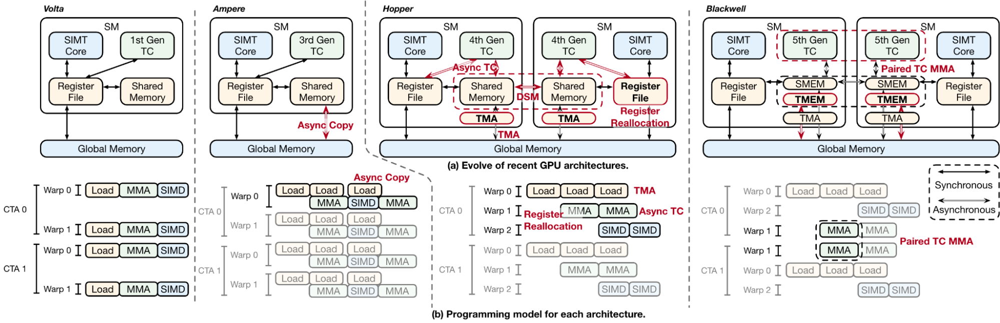

现代 GPU 的难点不只是矩阵乘法怎么写，而是何时搬运下一块数据、哪个 warp 负责计算、何时能安全复用缓冲。Triton 提供高层张量操作，CUDA/CUTLASS 暴露更多执行控制；Meta 的 TLX 尝试在 Triton 内增加编排层，让开发者只在关键路径显式控制异步执行，同时保留 Python、自动调优与张量表达。

原文：[How We Built TLX: A Hardware-Native GPU Compiler for Production ML at Scale](https://engineering.fb.com/2026/11/10/open-source/tlx-a-hardware-native-gpu-compiler-for-production-ml/)  
Hongtao Yu、Peng Chen、Daohang Shi、Nick Riasanovsky、Lei Wang、Partha Kanuparthy · 2026-11-10

## 硬件变化让“一个统一循环”不再够用

从 Volta 到 Hopper、Blackwell，数据搬运与 Tensor Core 越来越能够异步推进。不同 warp 可以承担加载、矩阵运算和结果处理，CTA cluster 之间还可通过分布式共享内存协作。如果源程序没有表达角色与依赖，编译器就只能从通用循环中猜测怎样排出这些流水。

<a class="note-image-link" href="/assets/images/tech/tlx-production/official-1.png" target="_blank" rel="noopener" aria-label="GPU 代际变化与不同 Warp 的加载、计算和同步编排 · 查看原图 ↗">查看原图 ↗</a>

*读图：上方比较硬件内存与 Tensor Core 连接，下方比较执行时间线；后两代出现更明确的异步搬运、专职 Warp 与协作。*

TLX 把 warp/wave group 作为一等执行任务。一个 group 异步搬运 tile，另一个等待数据就绪后发起 Tensor Core 计算，结果处理任务再等待计算完成。多级缓冲与轻量 barrier 管理“可写、可读、可复用”的交接，前一块正在计算时下一块已经搬入。收益来自重叠与减少中间流量，不能仅由某个新硬件指令解释。

## 保留张量表达，显式管理交接

原文将能力归纳为 warp-group 编排、group 级同步、内存编排、cluster 执行与可选布局。TMA、异步 dot、TMEM、mbarrier 等能力在执行层直接暴露，细粒度线程行为仍由基础模型与编译器处理。布局有默认推断，开发者可以先写正确计算，再针对性能覆盖布局。

这也让融合更容易：多个阶段原本需要分别决定 tiling、swizzle 和共享内存布局，融合时很容易把精力耗在表示转换上。TLX 让编译器尽可能协调兼容布局，把程序员注意力留给流水依赖。不过，自动推断不等于免除同步设计；生产者不能覆盖消费者仍在读取的环形缓冲，异步完成条件必须正确。

这篇文章给出了示意代码，最适合用来理解职责和依赖，不能仅凭代码注释认定所有实现细节或所有后端完全一致。NVIDIA 的 warp、AMD 的 wave 和不同代际内存结构仍需各自映射。

## 三类生产证据各自说明什么

GEM 推荐模型训练包含较小形状、较多 norm 和异构模块，优化比套用单一大 GEMM 更复杂。Meta 报告在数千 Blackwell GPU 上通过模型、kernel、编译器和硬件协同达到 20%–25% 端到端 MFU；其中 GDPA 前向内核最高约 2 倍加速。MFU 是整套协同结果，不能全部归功于 TLX，也不能把内核最高倍率当成训练端到端倍率。

IKBO 则先改变用户特征的广播方式：不再为每个候选物化一份相同输入，而在 kernel 内按自然批量读取并组合。最终 TLX 持久内核用生产者/消费者与 ping-pong 调度贯穿多个阶段。文中线性压缩内核在 H100 上提速 4 倍，部分协同模型的计算密集净时延最多减少三分之二。这里包含模型、运行时和算子共同改造，不是把任意 Triton kernel 换个语法就有同样效果。

第三个案例是大规模 LLM 预训练的 distributed grouped GEMM，将专家矩阵乘与通信结合，文章强调长期运行、调试和维护，但没有提供可独立比较的完整性能表。这部分证据适合说明生产采用范围，不能据此补出未经报告的加速数字。

## 跨硬件与自动化仍有边界

文章列出的目标包括 NVIDIA Hopper/Blackwell 与 AMD MI300/MI350X；MTIA 等更多后端、更高层自动编排和 `torch.compile` 集成属于后续方向。GEM 或 IKBO 也在 MTIA 上工作，不等于本文已经证明 TLX 的全部后端能力与性能可无差别迁移。

它值得系统优化读者关注，是因为把异步流水线的控制面移回可阅读、可调试的源程序，减少依赖难以解释的启发式。与 Kernel Agent 论文合看，更丰富的编程接口也需要真实执行验证：能表达高性能路径，和自动生成正确高性能路径，是两个仍需分别衡量的问题。
