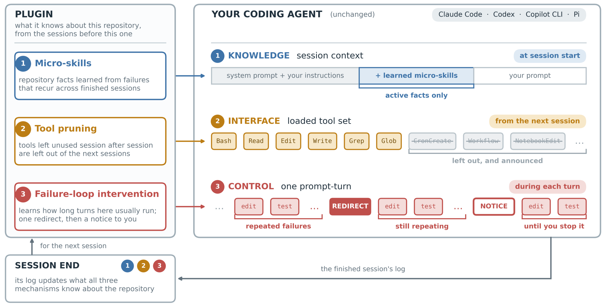

[TokenEconomizer: Learning from Experience to Make AI Coding Agents More Efficient](https://www.microsoft.com/en-us/research/blog/tokeneconomizer-learning-from-experience-to-make-ai-coding-agents-more-efficient/)  
Aaron J. Li, Weijia Xu, Chandan Singh, Zixiao Chen, Jeevana Priya Inala, Bin Yu, Ion Stoica, Michel Galley, Jianfeng Gao · 2026-11-16

编码 agent 的浪费常常横跨多个会话：今天重新寻找昨天已经确认的测试命令，反复加载从未使用的工具定义，或者在相同失败上继续消耗回合。TokenEconomizer 把仓库历史作为控制信号，在不修改底层模型和 agent 本体的前提下，调整初始知识、工具接口和失败时的干预。它关注的是持续使用同一仓库时的运行成本。

## 为什么单次会话优化不够

Microsoft Research 的官方文章先报告对 Claude Code 在 60 个 SWE-Bench 任务上的剖析。同一仓库积累至少五个完成任务后，30% 工具调用重复了该仓库早先任务的动作，跨仓库匹配只有 7%。23 个每轮提供的工具描述中，16 个从未调用；失败任务占 17%，却花掉 32% 的费用。

这些数字不能证明每一次重复都多余：代码或环境变化后，重新验证可能必要。它们更合理地指向一种机会——仓库内的经验比通用节流规则更有针对性。作者也比较固定策略插件，发现节省并非在所有仓库都成立，因而让控制器随新证据更新决定。

## 三个控制位置如何连接

Micro-skills 将反复出现的仓库事实写成一行知识，经过多个会话确认后才加入后续初始上下文；如果后来证据矛盾，便撤销旧知识。这样压缩的是重复探索，不是把整个历史不断堆进提示。维护与过期同样重要，否则缓存经验会把旧错误带入新任务。

<a class="note-image-link" href="/assets/images/tech/tokeneconomizer/method.png" target="_blank" rel="noopener" aria-label="会话日志更新三种控制：初始知识、工具集合和运行中的失败干预。 · 查看原图 ↗">查看原图 ↗</a>

*会话日志更新三种控制：初始知识、工具集合和运行中的失败干预。*

Tool pruning 根据历史移除不太可能用到的工具，但保留运行命令和编辑文件的核心工具，被移除工具仍可恢复。省下的是模型反复读取接口描述的成本，不能等价为功能永久减少。工具需求变化时，恢复机制决定历史经验是否会妨碍新任务。

Failure-loop intervention 在运行中观察重复失败，由 judge 判断是在有效推进还是确实卡住。确认停滞时发送简短改道提示；开源插件若发现提示后仍卡住，会通知开发者，而不是自动终止工作。这一职责划分很重要：控制器可以提醒，但把困难任务判成应放弃仍需要另一个决策。

## 费用结果包含控制器自身开销

主评测覆盖六个仓库、277 个 SWE-Bench 修 bug 任务和五种 agent—模型组合，每个仓库从没有历史开始。作者报告平均费用降低 18.4–30.9%，总体成功率保持大致稳定；图中五种组合有四种 Pass@1 上升。控制器自己的模型调用也计入费用，因此不是只把成本移到另一个未计量模块。

学习有启动成本：早期任务可能更贵，但文章中的每个仓库累计成本都在第六个任务前后低于默认配置。这个交叉点来自所测任务序列，不是任何新仓库的保证。文章还报告连续 Web 开发节省 16.0–21.2%，每任务换仓库的安全审计节省 6.4–19.6%，后者不能用同仓库长期积累一项机制解释全部收益。

## 适合关注的边界

这篇提供的是经验驱动的外部控制，而不是模型权重自我改进。它与 ELITE 改写 agent 实现、RepoFactory 改造训练环境处于不同层；也不同于直接降低 reasoning effort，后者在作者实验中可能节省相似费用却损害任务成功。

最应继续观察的是经验在仓库变更后如何失效、工具何时恢复，以及 judge 是否把真实探索误判为循环。官方材料给出了机制和净成本范围，但不足以保证每种语言、每个仓库都获益。对 AgentOps，它提供一条具体路径：同时管理历史知识、接口负担和无进展回合，把节省目标绑定到任务质量，而不是只追逐更短回答。
