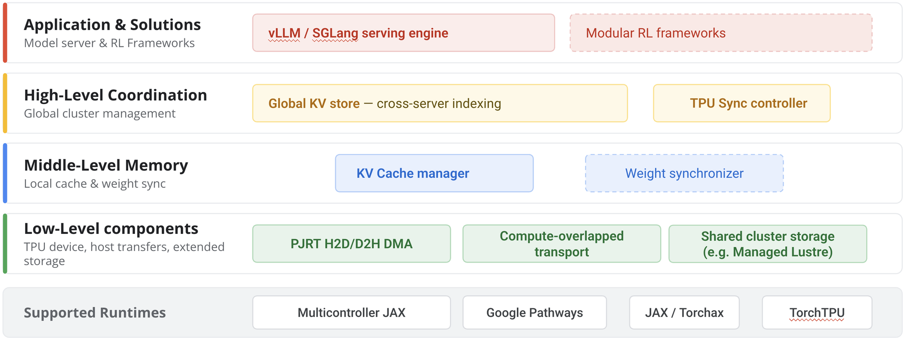

[Introducing TPU Sync: Fast KV cache and weight transfer for inference and RL on TPU](https://cloud.google.com/blog/topics/ai-infrastructure/introducing-tpu-sync-fast-kv-cache-and-weight-transfer-on-tpu/) · Google Cloud · 2026-11-10

长上下文、多轮 Agent 与 P/D 分离让 KV 搬运进入请求关键路径，持续 RL 又要求 trainer 把新权重送到 sampler。Google Cloud 的 TPU Sync 把两者统一到模型状态传输层：在 TPU HBM、主机内存、存储与数据中心网络之间保留张量原生布局，用异步 DMA 尽量和计算重叠。

## 先避免重排与复制，再讨论网络更快

普通框架层搬运可能包含序列化、布局转换、中间 buffer 和同步。TPU Sync 通过原始 PJRT buffer 或 PyTorch tensor 的别名访问既有设备内存，将 TPU tiled tensor 的 slice 直接搬到已注册、page-locked 的 host memory。数据在 HBM、DRAM 和线上维持物理 tile 布局，到达后可直接进入矩阵计算路径。

别名不持有排他 PJRT usage lock，也不先复制一份设备数据，因而可以与就地计算重叠；DMA pacing 用于防止大型传输拖延 kernel 提交。这里的“无锁别名”是并发传输机制，不意味着任意重叠写入都自动安全，仍需上层的 block 状态和生命周期协调。C++ 传输与 tile-aware resharding 位于 XLA 图外，避免把每次缓存搬运变成一次编译事件。

官方底层测试给出 Ironwood 每 host 合计 D2H/H2D 最高 223GB/s，相对硬件 256GB/s 上限；单 200Gbps NIC 约 192Gbps，双网卡 NUMA-aware striping 约 350Gbps。这些是传输路径带宽，不能直接换算成模型输出吞吐。

## P/D 交接是一条流水线

<a class="note-image-link" href="/assets/images/tech/tpu-sync/architecture.png" target="_blank" rel="noopener" aria-label="TPU Sync：让模型状态沿内存层次异步流动 · 查看原图 ↗">查看原图 ↗</a>

*底层统一设备、主机与网络传输，中层管理缓存，上层协调全局索引和计划；RL 权重路径仍标为实验模块。*

prefill 生成 KV 后先异步 D2H 到 pinned host RAM，controller 规划 host-to-host 网络传输，decode 端随块到达再异步 H2D。通过主机层缓冲，网络反压不必把 TPU 计算路径一起锁住；可以把下一批数据到达与当前计算交叠，而不是等待整份缓存搬完才恢复所有工作。

上层 Global KV Store 按前缀哈希查物理块、协调 LRU 和降层，controller 管传输计划与 lease/recovery，本地 cache manager 跟踪 block 状态并执行搬运。三者分别回答“在哪里”“怎样搬”“本地是否准备好”，不是仅开放一条裸 DMA 接口就完成分布式缓存。

## 分层缓存与 RL 的成熟度不同

把旧 KV 从 HBM 扩展到主机 DRAM，可让多个请求保留更多共享前缀，后续命中时取回，减少 prefill 重算。文章还描述 local SSD、Managed Lustre 的 POSIX 后端，但这部分明确为实验性，不应与 host-memory 路径混作相同成熟度。

RL 一侧开放 DMA/DCN 原语，让更高层框架流式同步 trainer 与 sampler 权重，并支持不同并行布局间 resharding。该模块经过内部 RL 工作负载验证，仍标 experimental；推理 KV 的公开百分比不能当作 RL 训练提速。vLLM、SGLang 与 llm-d 的 connector，以及 TorchTPU/JAX 接口，提供的是对接位置，不保证任意版本组合已自动兼容。

## 如何解读“90%”

原文导语用约 90% 概括 TTFT 收益，分项证据更具体：235B 模型的 P/D 低并发测试平均 TTFT 降约 60%，480B 低并发约 90%；64K 前缀缓存场景最高约 90%。235B 持续高流量的输出吞吐增幅为 30–70%，依流量分布而变。KV transfer overhead 降 90% 以上，也不是整个请求延迟统一下降同样比例。

测试注记为 2026 年 7 月内部实验，TPU v7x 2×2×1、PCIe Gen5、每 host 一或两张 200Gbps NIC、tpu-inference v0.24.0。页面署期为 11 月 10 日。**最值得关注的是保留布局、绕开编译和解耦反压的机制**；实际收益仍取决于可复用前缀、HBM 余量、传输链路与并发，不能将一次缓存命中或峰值带宽当作普遍 TTFT 保证。
