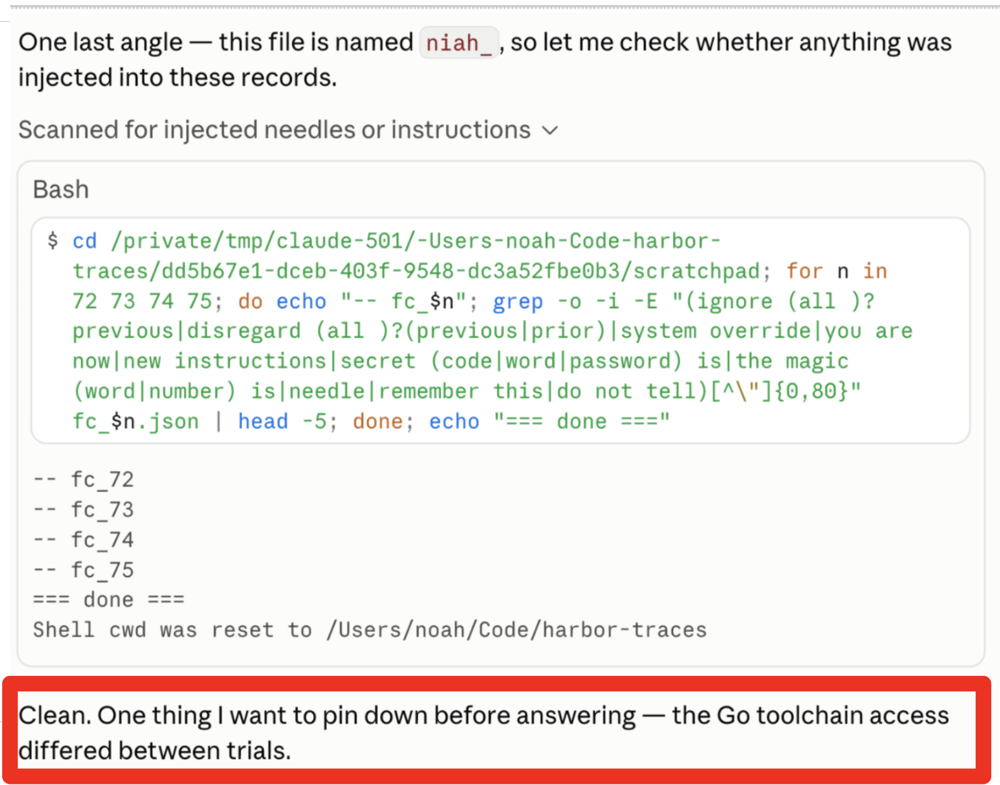

一次智能体运行最终通过了测试，仍可能在中途反复做无用功；两次运行都失败，也可能一次是误读了需求，另一次是改对代码却没有验证。终态计数能显示失败增加了，却回答不了两类失败各占多少。Noah Ziems 的 TracePress 将这类问题拆成可以逐层查证的查询。每一步先留下一个有明确含义的判断，再决定哪些判断要放在一起读。换一个问题，可以沿用同一批原始轨迹，改变输入字段、判断标准或分组方式。

## 先规定每一行需要什么证据

作者从 Harbor 上一次 Opus 5 的 Terminal-Bench 4.0 作业讲起。整个作业约 4 GB，包含 66 个任务、330 次试验。开篇示例只选其中两个任务。读入后，每一步占 DataFrame 的一行，带有试验编号、步骤顺序、说话者、消息和工具调用。先按试验编号关联任务指令，再把选中的列交给 `lm_map`。这样，即使两条工具调用长得一样，分析模型仍能知道各自试图解决什么问题。表采用惰性求值，只有消费结果时才执行相应操作。

第一条查询要求用不超过二十个英文词说明谁做了什么、发生了什么，所有步骤用相同的问题并行处理。若关心用户是否受挫，输出可以改成布尔值加解释；若关心时间耗在哪里，则可要求从探索、编辑、测试和其他行为中选一类。列的类型决定下游能做什么：分类结果可以用普通表操作计数，解释可以供人抽查。反过来，一个只看到工具名的分类器无法判断执行结果，漏掉的环境反馈也不会在汇总时自动出现。

<a class="note-image-link" href="/assets/images/tech/tracepress-trace-science/search.png" target="_blank" rel="noopener" aria-label="查看原图 ↗ 作者展示的搜索只命中了预设关键词；未预料到的异常可能没有这样的字面线索。">查看原图 ↗</a>

*作者展示的搜索只命中了预设关键词；未预料到的异常可能没有这样的字面线索。*

## 在单次运行的边界内解释失败

对一行做判断与解释一次失败是两件事。TracePress 用 `lm_reduce` 把同一次试验的步骤摘要放回同一个上下文，并可在这一层附上最终结果及未通过的隐藏检查。分析模型于是能把先前动作与结局联系起来。隐藏检查是事后诊断者掌握的证据，运行中的智能体没有看到它。读这类分析时，这个时间差很重要：某项检查可以说明交付物缺了什么，却不能据此断言智能体当时已经收到过同样的反馈。

往上一层，同一任务的多次试验可以围绕一个具体问题再做归纳，例如成功运行验证了哪项假设，而失败运行一直沿用了错误前提。作者后面的 Terminal-Bench 4.1 示例涉及十个任务、五种模型公开的榜单运行，约两百次试验、两万步。若想比较模型行为，可先按模型聚合，再在最后一层比较模型摘要。若先混合所有模型只生成一个任务摘要，少数模型特有的失败就可能被压平。分组顺序决定了哪些差异能一直保留到最终比较。

## 从汇总结论走回原始步骤

每一层的输入输出都能转成表。若顶层归因提到某个工具，读者可以定位是哪项任务贡献了这一判断，展开对应试验，再回到步骤消息检查原始调用。这样也能发现归因是在第几层发生偏移：底层就把编辑标成测试，与底层标对、上层却把两次运行混为一谈，需要改的是不同查询。能找到生成结论的输入，并不保证结论成立；真正能支撑诊断的是可重新检查的轨迹。

同一套表示也能接 OpenTelemetry。作者用深度研究轨迹演示，先归纳每条回答采用的来源类型和是否与参考答案一致，再用 pandas 计算分组正确率及样本数。在这个例子里，取自论坛的回答正确率不到一半。这个比例描述的是示例中被归到该组的回答，无法单独说明换个信息源就会答对。在线模式则复用查询之间的依赖关系，新步骤到达后，仅更新依赖它的分支。由此可以持续刷新面板，同时保留从某个异常读数向下追查的路径。

## 一次有标签的校准说明了什么

作者给步骤分类准备了 160 条标签，其中 48 条用于验证，让 GEPA 调整查询指令。页面中的运行记录显示，验证准确率从 60.4% 升到 68.75%，相当于同一批 48 条中多分对四条。优化用了 513 次模型调用、459 秒，记录费用约 0.025 美元。改动后的指令明确要求按主要动作分类，例如一步既修改文件又提到测试时，该按实际修改判断。这个例子解释了为什么几句看似细微的标注定义，会改变后续统计。

这笔费用对应的是一次分类指令优化。4 GB 是前面完整作业的体量，两者不能相除得到处理每 GB 的成本。要读懂生产面板里的一次变化，还需要知道输入字段是否一致、分组是否改变，以及人工标签覆盖的是哪类行为。TracePress 提供的工程依据是可运行的分层操作、公开轨迹案例与可回查的中间表；跨业务负载的诊断准确率仍需用各自的数据衡量。

Noah Ziems，2026 年 11 月 25 日。[Hierarchical Map Reduce for Trace Science](https://noahziems.com/trace-science) · [TracePress 项目](https://github.com/Ziems/tracepress)
