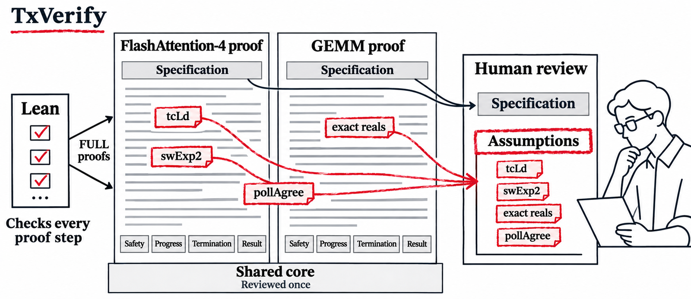

作者在 B200 上比较过一个注意力解码内核及其同步修正版：五种形状、15 次运行，输出逐位相同，修正版甚至慢了 0.3%–1%。那么为什么要改？一个异步操作完成后，程序仍有义务按规则观察它的完成，即使这一轮根本不用修改累加器。常规数值对照很容易错过这种错误。TxVerify 从实际 PTX 出发，用 Lean 检查程序能否在允许的各种执行顺序下兑现规格，并把证明所需的额外条件列在定理上。

## 对一份 PTX，怎样才算“正确”

同一个线程按顺序发出指令，不能推出它启动的异步复制、矩阵运算、其他线程的读写也按这个顺序完成。TxVerify 的共享核心依据程序顺序、屏障和内存栅栏确定哪些访问有先后关系，跟踪屏障等对象自身的操作顺序，也记录等待成功与它所等待的完成事件之间的依赖。缺少规则的指令形式会被拒绝。证明涵盖指定的手写或编译生成 PTX，以及满足启动前置条件的输入。

定理要回答四个问题。安全性要求模型允许的执行不会出现诸如非法访存、数据竞争和屏障误用的错误。可进展性要求如果再也不能加入一个计数事件，那么线程和未决异步工作已经结束。终止性给每次启动的计数事件数设定上界，失败的特定屏障轮询不计入；配合可进展性，在公平调度下每次运行最终完成。最后，完成时的内存必须满足内核的后置条件。四项分开很有必要：只证明完成时输出正确，会漏掉永远等不到结果的执行。

## 哪些判断留给审阅者

共享核心把对手册的解释放在相应规则旁，多个内核可以复用。具体内核若还需要某种取值、执行顺序或安全检查例外，作者将其限定在指定指令位置，说明依据和用途，并写进定理。Lean 检查由这些前提到结论的推导。审阅者要判断共享规则是否忠实、规格是否问对了问题，以及这些局部假设是否适用于真实设备。

<a class="note-image-link" href="/assets/images/tech/txverify-ptx/proof.png" target="_blank" rel="noopener" aria-label="查看原图">查看原图 ↗</a>

*两份证明复用底部的执行规则。沿红线可看到，每个内核额外依赖的条件进入了人工审阅范围。*

以 FlashAttention-4 为例，线程束中的各个执行通道分别轮询同一个屏障，随后走一条要求各通道条件一致的分支。轮询同一对象本身不能保证它们取到相同结果。其定理在 37 处分支上列出限定范围的例外；原文也指出改用普通分支可以消除这项依赖。某个假设可以覆盖多处指令，也可能只涉及一种数值近似，因此假设条数本身不能衡量一个内核的可靠程度。

## 证明如何推动了实际修复

在 Inkling 2 Small 的 decode 内核中，原程序把一次屏障等待和一次累加器重缩放放在同一个条件内。只有确需改变数值时才重缩放是合理的；但即使没有任何通道需要缩放，屏障阶段也会推进。团队把等待移到缩放条件之外，从第二次迭代开始每轮都观察上一阶段完成。这正是开头那项 B200 对照所测的第一处修复。第二处涉及没有键块可处理的分片：循环体一次都不执行，收尾时仍有未决的异步到达事件，要等它结束才能退出。该内核的证明对应已含两处修复的编译结果。

作者还修复了 TIRx FP16 GEMM 的一处输入屏障收尾问题。在整个评估中，13 个面向 Blackwell 的内核都得到四项性质的条件证明，既有小型原型，也有生产内核。FlashAttention-4 列出 8 项额外假设，FlashMLA 列出 11 项。它们指出了手工核查的位置，例如某个张量内存读操作与后续覆写的顺序。核查这样的条件比只知道“证明通过”更能帮助维护者决定该改哪段代码，或在哪一代硬件上需要重新验证。

## 两个仍会改变结论的边界

共享核心假设所有线程块从启动起就已驻留。真实 GPU 的驻留容量有限，如果等待数据的线程块占满设备，负责产生数据的线程块可能一直调度不上。模型里生产者始终有机会运行，公平性假设无法弥补这处硬件与模型之间的差距。数值方面，部分定理把列明的浮点运算按精确实数解释。它们能证明在这种解释下满足规格，实际舍入误差和逐位一致性还需要独立证据。

Bohan Hou and Tianqi Chen (MLC Community) · 2026-11-24 · [What Must We Trust? How TxVerify Uses a Core/Assumption Split to Formally Verify Production GPU Kernels at the PTX Level](https://blog.mlc.ai/2026/11/24/what-must-we-trust-verifying-production-gpu-kernels-with-a-core-assumption-split)
