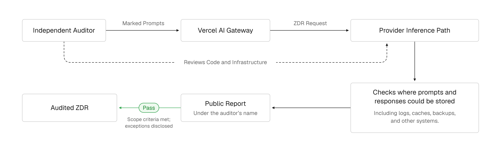

推理网关可以在提供商限流时重试另一个端点。对要求零数据留存（ZDR）的请求，这一步本身就改变了数据经过的系统。即使主端点按约删除提示，备用端点的追踪管线、崩溃转储或客服调试工具也可能留下一份副本。Vercel 公布的 Audited ZDR 将两项工作联系起来：独立审计查到哪条服务路径，网关的重试就只能落在满足条件的路径内。

## 一个标记提示要跟到哪里？

审计方先读提供商的服务代码和基础设施配置，再通过 AI Gateway 发送带标记的提示，到实际日志、缓存与存储系统里查找它。审计对象涵盖接收网关流量的模型、端点、功能和工具。数据范围也不限于提示文本：补全、系统提示、嵌入、文件、图像、音频和工具调用载荷，以及可识别这些内容的派生数据，都应在范围内。指标、备份、滥用监测与训练评测集也可能是副本的落点。

这里的缓存约束很具体。若一次请求使用 KV 缓存，提供商须披露该行为，缓存只能在请求期间存在于易失存储，返回响应后删除。对于普通推理系统，把 KV 挪到盘上可以换取更长的复用时间；在这个服务等级里，持久化违反了所要验证的条件。分包处理方也在同一约束之内。

<a class="note-image-link" href="/assets/images/tech/vercel-audited-zdr-ai-gateway/overview.png" target="_blank" rel="noopener" aria-label="审计方检查带标记请求经过的系统，报告决定路由资格">查看原图 ↗</a>

*审计方检查带标记请求经过的系统，报告决定路由资格*

## 审计范围怎样变成路由边界？

通过的提供商要以审计机构的名义公开报告，列出范围、方法、日期、发现、修复状态及例外。团队启用相应策略后，网关选择主提供商和执行故障转移都只能从满足要求且已发布报告的集合中取。这样，单个端点看似合规却在限流时转向普通端点的问题，成为可以沿重试链核查的行为。工具或功能承担后续处理时，同样要满足条件。

这也使上线状态可以核实。11 月 23 日公告称 Baseten、Modal 和 Wafer 已开始审计，预计在 12 月 8 日前发布报告，各自在公开报告后才进入该等级。公告说明了测试方法和准入规则，三个合作方的实测发现需等各自报告披露。

## 两次审计之间，金丝雀能看到什么？

代码和配置审查只对应一个时间点。Vercel 的持续检测会向指定提供商和模型发送含有唯一、未被索引 URL 的提示，在内部记录 URL 与本次运行的对应关系。若该地址被访问，团队可以定位到具体模型和提供商并调查。这个信号有清楚的盲区：如果提示被写进日志后从未有人读取或打开网址，它不会产生访问事件。一次命中需要调查，长期没有命中也无法证明磁盘上没有副本。持续检测的价值在于生产配置变化后仍可能留下可追查的信号；实际留存边界仍由链路审计、公开范围和故障转移约束共同决定。

Harpreet Arora, Talha Tariq · 2026-11-23 · [Introducing Audited ZDR on AI Gateway](https://vercel.com/blog/introducing-audited-zdr-on-ai-gateway)
