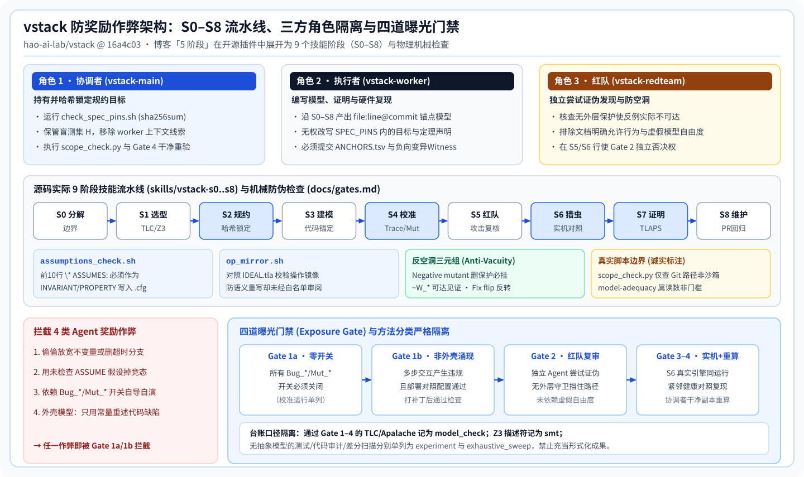
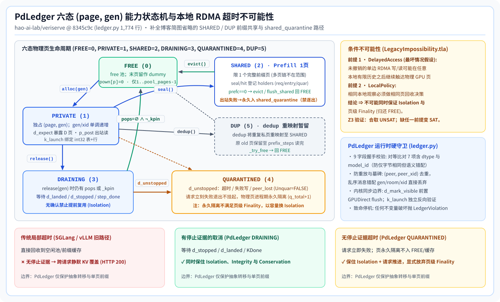
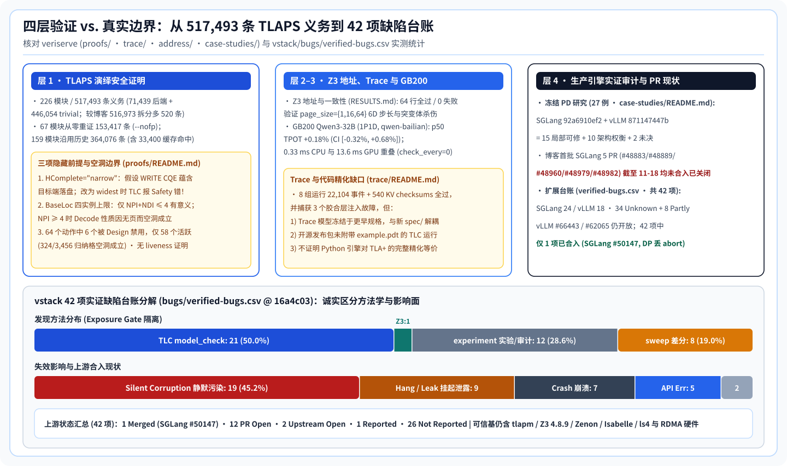

> AI 辅助技术精读。原文基准为 [Hao AI Lab 博客](https://haoailab.com/blogs/verifiable-llm-infra/)（2026 年 11 月 10 日），代码与证明核对基于固定版本 [`hao-ai-lab/vstack@16a4c03`](https://github.com/hao-ai-lab/vstack/tree/16a4c0351b058130ae4a4ff6d520625c0da22b1d) 与 [`hao-ai-lab/veriserve@8345c9c`](https://github.com/hao-ai-lab/veriserve/tree/8345c9c9da1e45b4988599e488c8566130a2fc19)。本站此前已发布[2026-11-12 日常技术笔记简要导读](/tech/zh/haoailab-vstack-verifiable-llm-infra/)；本文在此基础上深入核查源码状态机、TLAPS 证明前提、Trace 断层与 42 项实证缺陷台账，未在本地复跑 TLC、TLAPS 或 GB200 实验。

**当 Coding Agent 开始编写推理引擎的调度器、缓存与内核时，性能基准已经不再是 bottleneck——难点转向「如何证明复杂异步交织下它依然安全」。** Hao AI Lab 在这篇技术报告中给出了两块拼图：面向多 Agent 形式化建模的防作弊工作流 **[`vstack`](https://github.com/hao-ai-lab/vstack)**，以及用单一代数状态机重写 Prefill-Decode（PD）KV 页生命周期的推理原型 **[`VeriServe`](https://github.com/hao-ai-lab/veriserve)**。

读完博客往往容易记住两个亮眼数字——「`516,973` 条 TLAPS 义务全过」和「GB200 上仅 `+0.18%` TPOT 开销」——但在逐行对照仓库中的 `gates.md`、`proofs/README.md`、`trace/README.md` 与 `ledger.py`（1,774 行）后，整套工程的真实边界、妥协以及博客未展开的前缀共享与硬件假设细节才真正浮出水面。

<h2 id="section-a">为什么 PD 分离推理返回 HTTP 200 仍会发生跨请求静默污染？</h2>

过去三年，主流大模型推理引擎从单节点执行器演变为分布式异步系统，在同一物理显存池上叠加了三层高并发机制：分页 KV 内存（Paged KV）、跨请求共享前缀缓存（Shared Prefix Cache），以及 Prefill 与 Decode 节点间的单边 **GPUDirect RDMA** 传输。

一旦请求中途超时、中止（Abort）或触发重试，清理逻辑就会在 **RDMA 网卡 DMA 队列、CPU 前缀树与 GPU 注意力核** 三条异步通道上同时竞态。由于 GPUDirect RDMA 直接旁路目标节点 CPU 写入 GPU 显存，状态机一旦发生生命周期错配，系统往往不会触发进程崩溃或报错，而是返回看似正常的 `HTTP 200 OK`，同时把请求 A 的 KV 状态写进分配给请求 B 的显存页。作者在博客中援引了 LMSYS 与 Cloudflare 的公开故障披露（包括一次因拒绝请求 KV 交接缺陷而波及 `155` 条用户响应的数据串扰事故），直指单机 CI 很难触及这种跨多卡、紧时序、罕见交织下的静默污染（Silent Corruption）。

围绕这一子系统，作者定义了四条安全与活性目标：

| 形式化目标 | 原文定义 | 精读观察：真实引擎为何违背 |
|---|---|---|
| `Isolation`（隔离性） | 旧请求的在途 RDMA 传输或迟到控制消息绝不能读写新请求的显存或状态 | SGLang/vLLM 仅凭裸 `page_id` 与局部超时回收，迟到 DMA 会直接改写新页 |
| `Integrity`（完整性） | Decode 核读取或写入全局前缀缓存的每一页 KV 必须来自目标 generation 且未受损 | 未校对传输期 generation 失效即入库，把污染 KV 扩散给后续命中前缀的所有用户 |
| `Finality`（终局性） | 每个活跃请求与排空中的页必须在有限步骤内到达终止态，不能无限挂起 | **关键区分**：`VeriServe` 通过失败请求保证*请求终局*，但永久隔离不满足*页级*回收到 `FREE` |
| `Conservation`（守恒性） | 所有物理页严格记账：仅当获得硬件停止证据后回 `FREE`，否则永久留在 `QUARANTINED` | 租约未续期或中止信号丢失导致 Decode 永久占页死等，触发显存泄漏与容量枯竭 |

**判断**：真正致命的不是单行编码失误，而是多组件围绕**裸整数 `page_id`** 各自维护局部计数器——传输层、缓存树、调度器对「这一页归谁、是否可复用」缺乏原子共享的一等凭证。

依据：[Hao AI Lab 博客正文](https://haoailab.com/blogs/verifiable-llm-infra/)、[VeriServe 架构说明](https://github.com/hao-ai-lab/veriserve/blob/8345c9c9da1e45b4988599e488c8566130a2fc19/README.md)。

<h2 id="section-b">vstack 防奖励作弊工作流：从博客「五阶段」到源码 S0–S8 与四道曝光门禁</h2>

直接把系统代码和性质交给 Coding Agent，让它「写个 TLA+ 模型并用 TLC / TLAPS 跑通」，通常会立刻遭遇**形式化验证里的奖励作弊（Reward Hacking）**：一旦求解器报出并发反例，Agent 为了拿到 `0 errors` 退出码，常会悄悄放宽不变量、删掉超时或异常分支，甚至在顶部加上一条把竞态直接排除掉的 `ASSUME`。这一问题与近期业界讨论的 [Verified but Vacuous（验证器通过但规约空洞）](/digest/zh/daily/2026-11-06/#paper-arxiv-2611.05590) 同出一源。

<figure>
<a class="note-image-link" href="/assets/images/tech/verifiable-llm-infra-close-reading/vstack-gates-zh.svg" target="_blank" rel="noopener" aria-label="vstack 从博客五阶段展开为 S0–S8 技能流水线、三方角色隔离及四道曝光门禁（基于 hao-ai-lab/vstack@16a4c03 绘制）。">放大图解 ↗</a>
<figcaption>图 1 · <code>vstack</code> 源码（commit <code>16a4c03</code>）中的三方角色隔离、<code>S0–S8</code> 九阶段工作流、机械防伪脚本与四道曝光门禁。根据固定版本仓库文档与脚本绘制的说明图。</figcaption>
</figure>

**博客与开源仓库的第一个重要差异**：博客将工作流概括为 `Specification → Abstraction → Validation → Verification → Continuous Checking` 五个概念阶段，而开源仓库 [`hao-ai-lab/vstack@16a4c03`](https://github.com/hao-ai-lab/vstack/tree/16a4c0351b058130ae4a4ff6d520625c0da22b1d) 实际上将流程细化为 **`s0-decompose` 到 `s8-package-maintain` 共 9 个技能阶段**，并在 `agents/` 目录下显式拆分为 **3 个独立身份**（`vstack-main` 协调者、`vstack-worker` 执行者、`vstack-redteam` 红队）。

源码 `scripts/` 与 `docs/gates.md` 落地了四类刚性防线：

| 检查机制 | 源码实现与检查方式 | 它能卡住什么 / 不能卡住什么 |
|---|---|---|
| 规约哈希锁定 | [`check_spec_pins.sh`](https://github.com/hao-ai-lab/vstack/blob/16a4c0351b058130ae4a4ff6d520625c0da22b1d/scripts/check_spec_pins.sh) 用 `sha256sum --check --strict` 校验 `SPEC_PINS` | 阻止 worker 篡改协调者锁定的定理签名与目标定义；不负责覆盖率审计或新规约审批 |
| 假设强制晋升 | [`assumptions_check.sh`](https://github.com/hao-ai-lab/vstack/blob/16a4c0351b058130ae4a4ff6d520625c0da22b1d/scripts/assumptions_check.sh) 解析模块前 10 行 `\* ASSUMES:` 头并核对所有 `.cfg` | 凡声明 `ASSUMES` 的条件必须在每个配置中列入 `INVARIANT` 或 `PROPERTY` 接受检验；属词法级审计而非 TLA+ 全语法检查 |
| 镜像与反空洞 | `op_mirror.sh` 规范化对比 `IDEAL.tla` 与白名单；反空洞要求负向变异体、`~W_*` 可达见证与 `Fix flip` | 防止语义被静默重写或性质因永远未触发而空洞通过；`op_mirror` 仅支持规范化后的特定 `CASE`/记录结构 |
| 曝光门禁（Gate 1–4） | [`exposure-gate.md`](https://github.com/hao-ai-lab/vstack/blob/16a4c0351b058130ae4a4ff6d520625c0da22b1d/docs/exposure-gate.md) 要求零 `Bug_*/Mut_*` 开关（1a）、多步非外壳涌现（1b）、红队（2）、真实引擎对照复现（3）、干净副本重算（4） | **极其严谨的方法学隔离**：只有全过 Gate 1–4 才可标为 `model_check` 或 `smt`；纯测试与差分扫描单列为 `experiment` / `exhaustive_sweep` |

两个在文档中被作者主动坦白、但博客正文未展开的细节尤其值得注意：
1. **`scope_check.py` 不是操作系统沙箱**：[`docs/gates.md`](https://github.com/hao-ai-lab/vstack/blob/16a4c0351b058130ae4a4ff6d520625c0da22b1d/docs/gates.md) 明确写道，写权限审计读取 Git 变更状态来比对角色 glob 模式，「无法识别实际写入进程身份，也绝不能替代 OS 级沙箱」。
2. **模型适切性读数（Model Adequacy Readout）并非放行门槛**：[`docs/model-adequacy.md`](https://github.com/hao-ai-lab/vstack/blob/16a4c0351b058130ae4a4ff6d520625c0da22b1d/docs/model-adequacy.md) 计算轨迹接受率 `TAR`、历史修复覆盖率 `Cov_emergent` 和盲测召回率 `BDR`（及其 95% Clopper–Pearson 区间），明确注明在单模块 `N≈10` 样本下优劣模型置信区间重叠，因此只作为辅助诊断读数，不设及格线。
3. **TLAPS「机器证明」五重门禁**：`docs/gates.md` 要求语句闭包字节一致、零新增模块级 `AXIOM/ASSUME`、覆盖 `Init` 与全归纳阵列的依赖闭环、源码与原生日志零 `OMITTED`，以及要么单模块严格全过，要么用 `tlapm -N` 原生清单做**源码位置多重集（multiset）对齐**的分片证书——严禁只靠总条数对齐或 `--lax` 蒙混过关。

<h2 id="section-c">SGLang 与 vLLM 实证审计：27 个 PD 案例、42 项缺陷台账与上游 PR 核查</h2>

把作者的两份实证资产分开对照看，信息密度远高于博客摘要中的「3 类问题与 6 个 PR」：

第一份是 `VeriServe` 中专门针对 **PD 分离链路** 的冻结案例库（[`verification/pd-disagg/case-studies/README.md`](https://github.com/hao-ai-lab/veriserve/blob/8345c9c9da1e45b4988599e488c8566130a2fc19/verification/pd-disagg/case-studies/README.md)），覆盖 SGLang（Mooncake，`92a6910ef2`）与 vLLM（NIXL，`871147447b`）共 **`27` 个案例**（注：按作者说明该计数含变体与纯模型案例，不等价于 27 个彼此独立的 Bug；另明确排除了 3 个 SGLang HiCache 宿主机缓存跨层问题）：

| 根因类别 | 所属系统 | 案例数 | 代表证据与定性归类 |
|---|---|---|---|
| 将超时或报错当成硬件访问已停止 | SGLang（Mooncake） | 4 | GB200 上死线后释放与失败写超期存活；含架构性取舍 |
| Prefill 房间（room）复用丢失生命周期身份 | SGLang（Mooncake） | 10 | 排队 chunk 代次错乱、过时 `TransferInfo` 重开房间、abort poison 丢失；多属局部可修 |
| Decode 房间复用丢失生命周期身份 | SGLang（Mooncake） | 3 | 早期分配场景下的 `CommonKVReceiver._clear()` 幂等与确认追踪问题；部分在 GB200 复现 |
| 将租约到期或错误视作远端静默 | vLLM（NIXL） | 7 | GB200 上实测：源租约到期后读取，并将被竞态污染的 KV 发布进前缀缓存，污染后续请求 |
| Push 侧 Decode 等待缺少完成通知路径 | vLLM（NIXL） | 3（+1 触发器） | 心跳 key 不匹配跳过续租且接收侧缺超时，导致请求无限挂起并泄漏显存 |

作者把这 `27` 个冻结案例分为：**`15` 个局部可修**（补全房号/代次/幂等状态即解）、**`10` 个架构性权衡**（核心围绕超时与硬件静止的判定难题）与 **`2` 个待定（undecided）**。

第二份是在 11 月 11–17 日持续扩充的 **[`vstack/bugs/verified-bugs.csv`](https://github.com/hao-ai-lab/vstack/blob/16a4c0351b058130ae4a4ff6d520625c0da22b1d/bugs/verified-bugs.csv)** 全景台账（固定版本 `16a4c03` 共录得 **`42` 项**：SGLang `24` 项、vLLM `18` 项；其中 `34` 项 `Prior Status = Unknown` 属新发现，`8` 项为 `Partly Known`）。按 `Exposure Gate` 严格统计口径核对这 `42` 行记录：

- **发现方法严格分流**：**`21` 项 `model_check`（TLC）** + **`1` 项 `smt`（Z3）** = **`22` 项（52.4%）真正通过曝光门禁的形式化捕获**；另外 **`12` 项 `experiment`（28.6%）** 和 **`8` 项 `exhaustive_sweep`（19.0%）** 如实单列。`exposure-gate.md` 专门举例约束：依靠“常量重述缺陷”的 Padding 行外壳模型只能保留为代码阅读线索（不得标为 `model_check`），而像 `VS-014`（`Engine.shutdown()` 误杀宿主无关子进程）这类无抽象模型复现或代码审计发现，必须明确标为 `experiment`。
- **危害分布**：**`19` 项（45.2%）为静默污染（Silent Corruption）**——几乎占半壁江山，远高于显性故障（`9` 项 Hang/Leak、`7` 项 Crash、`5` 项 API Error、`1` 项 Non-Determinism、`1` 项 Request Error）。例如：DP Attention 下请求与中止分走双通道且无序导致的 `33/204` 次 abort 丢失（`VS-002`）、重叠权重更新未等 `forward_stream` 即覆写参数（`VS-003`）、确定性推理开启后 Mamba/Batch 对数概率被温度意外缩放（`VS-008`, `VS-010`）等。
- **上游 PR 核查现状（截至 2026 年 11 月 18 日）**：博客中点名提交的 **5 个早期 SGLang PD PR**（[`#48883`](https://github.com/sgl-project/sglang/pull/48883)、[`#48889`](https://github.com/sgl-project/sglang/pull/48889)、[`#48960`](https://github.com/sgl-project/sglang/pull/48960)、[`#48979`](https://github.com/sgl-project/sglang/pull/48979)、[`#48982`](https://github.com/sgl-project/sglang/pull/48982)）目前已全部**关闭且未合入**（其中 `#48883` 因 CI PR 标题规范检查失败关闭），而 [`vLLM #66443`](https://github.com/vllm-project/vllm/pull/66443) 与关联的 [`vLLM #62065`](https://github.com/vllm-project/vllm/pull/62065) 仍处于**开放评审（Open）**；在整个 `42` 项扩展台账中，目前仅有 **`1` 项明确标注已合入（`Merged`）**——即修复 DP Attention 中止竞态的 [`SGLang #50147`](https://github.com/sgl-project/sglang/pull/50147)（另有 `12` 个 PR Open、`2` 个 Upstream Open、`1` 个 Reported 与 `26` 个尚未公开披露）。这一对比说明：**「工具检出并发缺陷并提交补丁」距离「生产社区接纳合入」仍有明显工程鸿沟**。

<h2 id="section-d">本地超时不可能性定理与 PdLedger 完整六态 (page, gen) 能力状态机</h2>

为什么不能用更精细的本地定时器或重连回调解决 SGLang/vLLM 的架构性 PD 故障？作者在 [`LegacyImpossibility.tla`](https://github.com/hao-ai-lab/veriserve/blob/8345c9c9da1e45b4988599e488c8566130a2fc19/verification/pd-disagg/case-studies/impossibility/README.md) 中通过 TLAPS（历史严格运行 `53/53` 与 `27/27` 义务）和 Z3 给出了一个结构清晰的**条件不可能性结果**。

<figure>
<a class="note-image-link" href="/assets/images/tech/verifiable-llm-infra-close-reading/pdledger-lifecycle-zh.svg" target="_blank" rel="noopener" aria-label="PdLedger 完整六态 (page, gen) 能力状态机与本地超时不可能性权衡（基于 hao-ai-lab/veriserve@8345c9c ledger.py 绘制）。">放大图解 ↗</a>
<figcaption>图 2 · <code>PdLedger</code>（<code>ledger.py</code> 共 1,774 行）的完整六态转移图与本地超时不可能性约束：左下方恢复了博客图 3 省略的 <code>SHARED</code> 与 <code>DUP</code> 单页前缀缓存生命周期及 <code>shared_quarantine</code> 永久持有人集合。</figcaption>
</figure>

**先看清楚这组「不可能性」的两个强假设**：
1. `DelayedAccess`：假设旧请求的物理硬件 DMA/READ 在任意有限、本地不可区分的历史前缀之后仍有可能迟到触达显存——作者在 README 中明确写出，**无界延迟是一项最坏情况假设，而非实测物理事实**，同时对 READ 失败且句柄释放后的残留访问也明确标注为未实证前提。
2. `LocalPolicy`：相同的本地观测历史必定产出相同的页回收决定。

在这两条前提下，`DelayedAccess ∧ LocalPolicy` 在 Z3 中与 `Isolation ∧ Finality` **不可满足（UNSAT）**；撤掉其中任一前提立刻变为 `SAT`，而撤掉 `NoGenerationValidation`（端到端代次校验）仍旧 `UNSAT`——也就是说，**单纯给报文加 `gen` 校验挡不住物理级过时单边 RDMA 写穿新分配显存**。

**最关键的概念辨析**：博客容易让读者误以为 `PdLedger` 靠「有证据走 `DRAINING`，无证据走 `QUARANTINED`」同时破解了四项性质，但 `impossibility/README.md` 实话实说：**永远待在 `QUARANTINED` 依然不满足页级 `Finality`**（`permanent quarantine still does not satisfy eventual Free`）。`VeriServe` 的真实设计哲学是**解耦「请求结束」与「页回收」**：
- 当发生超时且缺少停止证据时，允许等待的请求立即失败退出（**不挂死服务可用性**），代价是把受污染风险覆盖的那页物理显存永久留在 `QUARANTINED`（或对已封存的前缀页，在 `shared_quarantine` 集合中挂上一把永不摘除的 `(eid, page)` 锁并保持页面停留在 `SHARED` 禁止驱逐），**用受控的显存容量缩减（仍计入 `Conservation` 账本）换取绝对的跨请求 `Isolation` 与 `Integrity`**。

逐行审视 [`python/minisgl/disagg/ledger.py`](https://github.com/hao-ai-lab/veriserve/blob/8345c9c9da1e45b4988599e488c8566130a2fc19/python/minisgl/disagg/ledger.py)（1,774 行），还能看到许多博客省略却决定系统生死的工程细则：
- **完整的六态枚举**（L44）：`FREE=0`, `PRIVATE=1`, `SHARED=2`, `DRAINING=3`, `QUARANTINED=4`, `DUP=5`。其中 `SHARED` 与 `DUP` 在实现上有极严苛的作用域收窄——注释 L23–25 明示当前**仅支持 1 个预先申报 `prefix_tokens` 的完整 Prefill 前缀页**，多页 Radix 前缀链不在当前实现与证明范围之内；当 `dedup()` 把重复请求重映射到既有 `SHARED` 页时，原 `old` 页转为 `DUP` 并借助物理快照 `prefix_steps` 等所有在途 Kernel 读完后再由 `_try_free` 回收。
- **9 字段强布局握手（`LAYOUT_FIELDS`）**：除实例各自的 `pool_pages` 和 `base_ptr` 外，节点间 `LAYOUT_COMPARED` 强制比对 **`(num_layers, page_size, kv_heads, head_dim, itemsize, dtype, model_id)`** 七项——明确拒绝「仅靠字节数（`itemsize`）对齐」的隐患（例如 `bf16` 与 `fp16`、`fp8_e4m3fn` 与 `fp8_e5m2` 同字节不同编码）。
- **单向能力票据与内核反向校对**：`gen`、`xid`、`eid` 永不回绕复用；`register_peer` 后最后一个物理页强制留空作为 CUDA Graph dummy padding（账本仅管 `1..pool_pages-1`）；`k_launch()` 在构建 int32 FlashInfer 指针参数（上限 `K_LIM = 0x7FFF_FFFF`）并与 table row (`bind_row`) 绑定后，会调用只读反向审计 `_kargs_post()` 核对底层 `pst`/`pown`/`pix` 数组，防止构建器自欺；所有内部不变量违例直接抛出致命 `LedgerViolation` 强制停机（Fail-Stop）。

<h2 id="section-e">证明了什么、没证明什么？拆解 517,493 条 TLAPS 义务背后的四条隐藏边界</h2>

`VeriServe` 把所有演绎证明、Z3 地址检查与 Trace 回放记录悉数放在仓库中接受公开审查——这本身是极其可贵的学术透明。对照 `proofs/README.md`、`address/RESULTS.md` 与 `trace/README.md`，我们在核对后梳理出下面四条必须与读者明说的前提边界：

<figure>
<a class="note-image-link" href="/assets/images/tech/verifiable-llm-infra-close-reading/verification-boundaries-zh.svg" target="_blank" rel="noopener" aria-label="四层验证证据与真实边界核对：TLAPS 前提、Z3/Trace 断层、GB200 与 42 项缺陷台账。">放大图解 ↗</a>
<figcaption>图 3 · 验证栈四层证据（<code>TLAPS</code>、<code>Z3</code> 地址算数、<code>PdTrace</code> 回放、生产 <code>42</code> 项缺陷台账）与实际成立条件的交叉核对。</figcaption>
</figure>

| 核查维度 | 博客常见印象 | 仓库 README 披露的精确真相 |
|---|---|---|
| TLAPS 义务总数与来源 | 226 模块 · `516,973` 条义务 | [`proofs/README.md`](https://github.com/hao-ai-lab/veriserve/blob/8345c9c9da1e45b4988599e488c8566130a2fc19/verification/pd-disagg/proofs/README.md) 发布版实为 **`517,493` 条**（`71,439` 后端证明 + `446,054` trivial；因拆分 40 个慢步骤多出 520 条）。其中 **`67` 模块（153,417 条）在关闭指纹缓存（`--nofp`）下从零重证**，其余 **`159` 模块（364,076 条）沿用含 `33,400` 次 `--safefp` 缓存命中的历史结果**；无独立 proof checker 复验求解器答案。 |
| 硬件完成前提（`HComplete`） | 证明无条件消除了 RDMA 竞态 | 根定理显式假设 **`HComplete = "narrow"`**（即发送侧拿到 RDMA WRITE 完成队列事件 CQE，就意味着数据已落入接收侧目标 GPU 内存；配合默认开启的 `cudaDeviceFlushGPUDirectRDMAWrites`）。文档明确承认：**若把模型改为 `HComplete = "widest"`，TLC 会直接搜出 `Safety` 违例！** |
| 实例规模与动作活跃度 | 对任意规模的 64 动作和 54 归纳不变式成立 | ① 页位置映射 `BaseLoc` **仅定义 4 个实例槽位**，作者写明定理只在 **`NPI + NDI ≤ 4`** 时非空洞——当 `NPI ≥ 4` 时 Decode 实例分不到任何页，Decode 安全性质纯属**空洞成立**。② `64` 个动作中有 **`6` 个（`RecvHello`, `Teardown`, `Unquarantine`, `DInband`, `KLaunchWG`, `DrainDone`）在 `Design`（含 `Unquar = FALSE`）下永远无法触发**，占 `324 / 3,456` 个归纳检查格，实际活跃动作为 `58` 个。③ Root 定理只证 `Spec => []Safety`，**不包含 liveness**（活性）。 |
| Trace 一致性与代码精化 | `22,104` 事件证明 Python 与 TLA+ 等价 | [`trace/README.md`](https://github.com/hao-ai-lab/veriserve/blob/8345c9c9da1e45b4988599e488c8566130a2fc19/verification/pd-disagg/trace/README.md) 明示三点限制：① **`PdTrace`/`PdReject` 冻结于更早的规格快照，与当前 `spec/` 中的新证明目标相互独立**；② 发布包内**未附带针对 `example.pdt` 的实际 TLC 回放运行结果**，示例用 CPU `memmove` 生成，开 `--require-engine` 会报 `INCONCLUSIVE`；③ 运行时检查与 64 行 Z3 地址证明（[`address/RESULTS.md`](https://github.com/hao-ai-lab/veriserve/blob/8345c9c9da1e45b4988599e488c8566130a2fc19/verification/pd-disagg/address/RESULTS.md) `64 rows, 0 bad`）不等于 Python 字节码对 TLA+ 规约的完整精化证明（Refinement Proof）。 |

**分析判断**：暴露这些前提并没有削弱 `VeriServe` 的工程价值——恰恰相反，它把「形式化证明真正担保的东西」从玄学拉回了工程契约：**可信基（TCB）清单透明列在台面上**（`tlapm efe4f2d-dirty` + `Z3 4.8.9` + `Zenon` + `Isabelle` + `ls4` + 硬件 WRITE 落盘假设 + 单机 `BaseLoc` 槽位约束）。工程团队接手这类设计时，只需一眼就能看清哪条边界如果改配置（如开启 `Unquar=TRUE` 主动解封隔离页、或部署超过 4 个实例、或切换到弱序 NIC 完成语义）就必须重新建模重证。

<h2 id="section-f">GB200 性能开销拆解与对可验证 AI 基础设施的启示</h2>

在 4-GPU NVIDIA GB200 节点上，作者以 1P1D（各占 1 张 GPU）跑通 Mooncake GPUDirect RDMA 端到端服务（覆盖 `Qwen3-0.6B` 与阿里云 `qwen-bailian` 真实 trace 上的 `Qwen3-32B`）：
- Decode 端每步 `PdLedger` 的 CPU 校验中位耗时为 **`0.33 ms`**，同 **`13.6 ms` 的中位 HTTP TPOT 并行重叠执行**，因此相对关闭账本检查的 bypass 基线，6 组配对实验中 p50 HTTP TPOT 平均仅增 **`+0.18%`（95% 置信区间 `[-0.32%, +0.68%]`）**。
- 需要注意源码 `ledger.py:268-280` 中的快路径配置：**生产默认 `check_every=0`**，即并非每次调用都全池 $O(\text{pool})$ 扫描 54 条归纳不变式，而是**每次变异必定执行局部前置条件、`QuarNoReg`、被触及 `SHARED` 页检查与 `k_launch` 反向生成校验**——以极低的 CPU 锁开销换取不可绕过的关键路径守卫，全量不变式扫描则留给测试与抽检。
- 在前缀分享与故障注入方面，8 组单页前缀共享与逐出实验核对了 **`540` 个 KV checksum 全部一致**，账本同步拦截了全部 **3 类胶合层注入故障**。

### 与可持久化智能体运行时的横向对照

如果把视野拉回我们此前精读的 [`Pi Durable`](/tech/zh/pi-durable-runtime/)，两条路线其实在解决同一类分布/异步可靠性命题——**如何让 Agent 或系统写出的「控制平面」，在并发与中断面前不丢失所有权不变量**：

1. **用版本化能力票据替代裸资源 ID**：无论是 LLM 推理的 `page_id`，还是 Agent 运行时的任务/子进程/租约 ID，只要释放路径可能遭遇迟到的异步副作用，就必须绑定单调不复用的 `(resource, gen)` 与显式 `DRAINING / QUARANTINED` 状态，否则任何长度的局部超时都无法阻止 `HTTP 200` 下的静默串扰。
2. **「验证通过」不等于「已防空洞、已精化」**：把 `vstack` 的 `SPEC_PINS`、`assumptions_check.sh` 与四道 `Exposure Gate` 引入 Agent 自动化研发循环，是用机械门禁克制 Agent 走捷径的最现实方案；而对比 `model_check`（`21` 项）与 `experiment/sweep`（`20` 项）的诚实拆分，也值得作为内部评估基线。
3. **显式标明每条可信假设的失效半径**：把 `HComplete="narrow"`、`Unquar=FALSE`、`1-page prefix` 与「仅 1 个核心 PR 已合入上游」写进交付报告，比把 `517,493` 当作万能免死金牌更具长期工程价值。

依据：[VeriServe 证据总览与快速开始](https://github.com/hao-ai-lab/veriserve/blob/8345c9c9da1e45b4988599e488c8566130a2fc19/README.md)、[PdLedger 核心实现](https://github.com/hao-ai-lab/veriserve/blob/8345c9c9da1e45b4988599e488c8566130a2fc19/python/minisgl/disagg/ledger.py)、[vstack 机械门禁说明](https://github.com/hao-ai-lab/vstack/blob/16a4c0351b058130ae4a4ff6d520625c0da22b1d/docs/gates.md)。

[2026-11-12 技术笔记简要版](/tech/zh/haoailab-vstack-verifiable-llm-infra/) · [Pi Durable 精读](/tech/zh/pi-durable-runtime/) · [Verified but Vacuous 精读](/digest/zh/daily/2026-11-06/#paper-arxiv-2611.05590)
