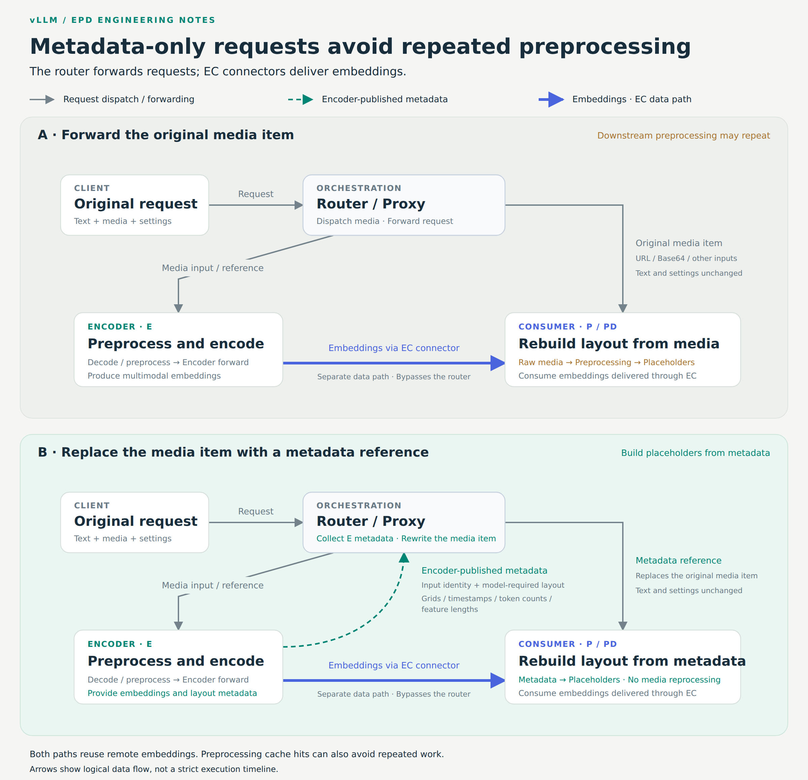

[Encoder Disaggregation in vLLM: Scaling Multimodal Serving with EPD](https://vllm.ai/blog/2026-11-11-encoder-disaggregation-epd)  
Inferact, InferMatrix, and IBM · 2026-11-11

多模态请求先把图像、视频或音频变成 embedding，再进入语言模型的 prefill 与 decode。媒体尺寸和模态比例会改变编码需求，却不一定同步改变生成需求。vLLM 的 EPD 工作把三阶段分开部署，同时解决一个容易忽略的问题：算力拆开以后，下游是否仍在重复下载和预处理媒体。

## 传 embedding 还不够，布局也要交接

E+PD 将编码器独立出来，E/P/D 再拆开 prefill 与 decode。EC connector 负责 embedding，KV connector 负责 P 到 D 的注意力状态，两者传的是不同内容。

如果路由器把原媒体照样送给 P，P 即使复用了远端 embedding，也可能为了确定占位 token 长度、图像网格或特征形状而重新解码和预处理。metadata-only 路径让 E 返回已经算好的结构信息，路由器用这些引用替换下游媒体项；文本提示和生成设置保留，实际 embedding 仍走独立数据通道。

<a class="note-image-link" href="/assets/images/tech/vllm-epd-encoder-disaggregation/handoff.png" target="_blank" rel="noopener" aria-label="上半图仍把原媒体交给 P，下半图用 E 返回的布局元数据替换；embedding 均通过独立 EC 数据通道传输。">查看原图 ↗</a>

*上半图仍把原媒体交给 P，下半图用 E 返回的布局元数据替换；embedding 均通过独立 EC 数据通道传输。*

这份契约随模型和模态变化。图像需要网格，视频还可能需要时间戳，音频需要 token 数或特征长度。小型结构字段用数值 JSON 数组传输，避免 tensor 序列化和 base64 转换，也让不同语言编写的路由器能消费同一表示。这里省掉的是重复媒体处理，不应笼统说成“消除了第二次 encoder forward”，因为远端 embedding 原本就可能避免该 forward。

## 独立执行路径必须保留完成语义

编码器不采样 token，也不维护语言模型 KV。Model Runner V2 因此提供专用 MMEncoderModelRunner，单独管理 GPU 完成事件，避免依赖采样路径而过早复用缓冲。编码器还可按权重布局安全地跳过纯语言模型 checkpoint 分片，并选择编码器 CUDA Graph 捕获；不匹配的情况保留 eager 回退。

远端传输支持 NIXL 的 CPU mmap 路径，以及 Mooncake 的 TCP/RDMA 路径。输出形状不能只看语言模型 hidden size：受测 Qwen3-Omni 的视觉输出宽度为 8192，音频为 2048。生产者初始化时测量各模态宽度，并把真实形状纳入协议；NIXL 协议变更还要求生产者与消费者同步升级。

metadata-only 也改变故障恢复条件。消费者没有原媒体时，远端 embedding 丢失后不能随意回退本地编码。实现应令受影响请求返回不可用，避免不安全回退导致整个 EngineCore 退出。这使优化与故障隔离成为同一个接口问题。

## 共享缓存解决跨编码器重算，但有明确条件

Mooncake Store 让 E 在本地 miss 后查询共享 embedding；miss 才执行编码并异步发布，向 P 的投递仍走 P2P。复用同时检查输入身份、模型身份和张量契约。初始支持限制在图像、V2 runner、encoder TP=1 且无动态 LoRA；异步发布意味着两个冷请求仍可能重复计算。

六张 H20 的受控重新分配实验中，128 个请求共 512 张图像全部换到另一编码器，重复编码从 512 降为零，TTFT p90 从 1.656 秒降为 0.891 秒。这是一轮刻意制造全部本地 miss 的最佳复用场景，不能替代真实流量上的重复率和 Store 成本分析。

## 把所有 GPU 放回分母，收益仍取决于负载

DeepSeek V4.1 Flash 的文档问答比较使用 512 个 MP-DocVQA 问题，每个含四到六页，平均输入 4,905 token、输出 5.2 token。PD 基线八张 GB200 GPU，EPD 保持 P/D 配置并增加四张编码器 GPU；每个并发点运行三次。

并发 64–128 时，把全部十二张 GPU 计入分母，EPD 的输入加输出吞吐/卡提高 6.6%–9.5%，P90 TTFT 降低 44%–47%。并发 16 时每卡吞吐更低，32 时约持平。极短输出和较重图像输入也说明这不是一般长生成服务的收益承诺。

另外，音频 metadata-only 对比的是 EPD 内部两种输入路径，吞吐 62.21→73.13 请求/秒，但准确率 75.90%→75.65% 的差异尚待解释。视频 94%–115% 的提升同时包含 GPU 预处理与 NVDEC，不能单独归因于阶段拆分。最值得迁移的经验是：分别测量编码、缓存查找、传输和下游排队，再选择 E/P/D 资源比例。
