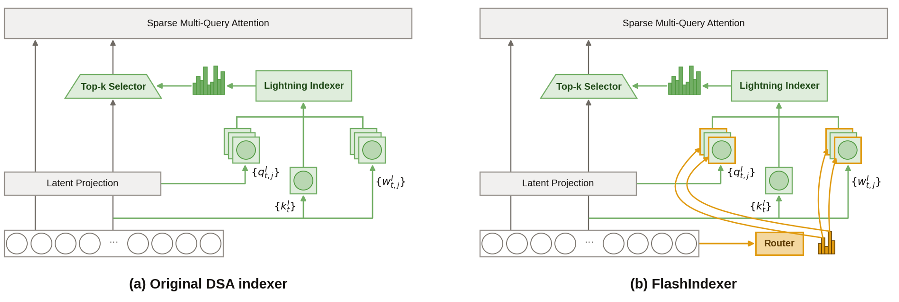

稀疏注意力只读取少量历史位置，却可能先付出昂贵的全历史检索成本。百度 ERNIE 和 vLLM 团队为 ERNIE 5.5 Flash Preview 给出了三项相互关联的工程选择：减少参与索引的头数、让低精度格式与训练对齐，以及让投机草稿跟上目标模型的变化。

Baidu ERNIE Team and vLLM Team · 原文标注 2026-11-24 · [vLLM Day-0 Support for ERNIE 5.5 Flash Preview: Plugin Deployment and E2E Inference Acceleration](https://vllm.ai/blog/2026-11-24-ernie-5-5-flash-preview)

## FlashIndexer 在选 token 之前先选头

DSA 的索引器要在长序列里挑出 2,048 个 token。FlashIndexer 先看当前查询 token 的隐藏状态，用一个很小的路由器选出少数索引头。路由不逐一查看历史 token，因此这一步的成本不随上下文长度增长。然后用阈值预筛去掉明显低分的位置，缩小最终 top-k 的候选集。下游稀疏注意力继续接收相同接口的索引，不必重写注意力内核。

<a class="note-image-link" href="/assets/images/tech/vllm-ernie-5-5-flash-preview/vllm-ernie-5-5-flash-preview.png" target="_blank" rel="noopener" aria-label="查看原图">查看原图 ↗</a>

*右侧路由器只激活部分索引头，随后再筛选候选 token。*

路由器的训练目标来自全头索引器已选中的位置。团队冻结主干和原索引器，仅训练路由器，报告约十亿个 token 即可完成适配。在 1M 上下文时，团队报告索引提速约 40%。从输入到首 token 还包含其余层、数据搬运和调度，因此这个数字的测量对象是索引阶段。

## 让训练见过部署时的数值格式

默认检查点的路由专家使用 MXFP4 权重和 FP8 激活，其余权重用 FP8，KV 缓存也用 FP8。量化感知训练复用推理时的粒度、尺度和舍入，使模型在后训练阶段就经历部署时的误差。索引缓存可以单独选择 MXFP4。要分析精度回归，权重、KV 与索引缓存是三个不同的改变位置。插件还把归一化、旋转位置编码和缓存写入融合，以减少中间数据往返。

## 草稿的接受长度取决于目标模型和任务

三层 DSpark 草稿模型每步最多提出七枚 token。它先在主模型中期训练之后离线训练，随后随目标策略的后训练更新，再用同策略蒸馏缩小分布差异。如果只针对较早版本训练草稿，目标模型继续更新就会让已付费生成的后缀更常被拒。团队在编码和智能体负载上报告平均接受长度超过 4.0，具体长度随任务变化。七是草稿上限，不能把它乘以基础解码速度作为实测吞吐。

vLLM 插件把模型专用路径与引擎版本分开迭代，也支持数据并行注意力配专家并行、Mooncake 传递 KV 的阶段分离和 CPU 缓存卸载。这些组合改变服务端的通信与容量约束。原文给出了组件机制和部署入口，缺少同一到达流上覆盖所有组合的尾延迟对照，因而没有一个可从索引提速直接推导出的通用部署配比。
