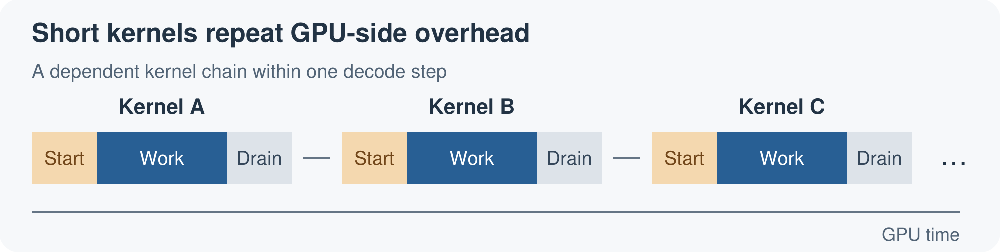

编码 Agent 生成完当前动作才能调用下一个工具。低并发时，每一层多花一点等待，都会累积到用户看见的响应间隔。HIP graph 可以减少 CPU 重复提交工作的开销，但 GPU 仍要启动下一段短内核、等待前段排空，再读取下一步权重。vLLM 团队用 FlyDSL 在 AMD Instinct 上重排这些依赖，目标是缩短每个请求生成 token 的关键路径。

## 一个就绪标记能提前启动哪一步

MonoKernel 把若干相互依赖的算子阶段放进同一次持久内核执行。生产者线程块先把某个 token 或 tile 的结果写回，确认写入可见后设置带标识的就绪标记；消费者可先发起自己的权重读取，等所需输入的标记就绪就开始计算。这样，后段不用等整层所有无关 tile 完成。线程块能够在几个阶段间复用，权重读取也有机会被前段计算掩盖。依赖数据仍须到齐，节约来自等候粒度的改变。

<a class="note-image-link" href="/assets/images/tech/vllm-flydsl-monokernels/overview.png" target="_blank" rel="noopener" aria-label="查看原图 ↗ — 每个短内核都有启动、计算与排空阶段，整图重放后 GPU 仍须依次跨过这些边界。">查看原图 ↗</a>

*每个短内核都有启动、计算与排空阶段，整图重放后 GPU 仍须依次跨过这些边界。*

## 融合边界随模型而变

FlyDSL 让实现者决定 wave 与线程块如何分工、何时发起载入、何处同步。它按所写调度编译，一层可由多个 MonoKernel 承担。以 DeepSeek-V4.1-Flash 为例，普通层将注意力前段与后续计算分配到 K1 和 K2，其他层另有适合其形状的路径。若把所有模型都硬塞进同一融合方案，资源占用与通信边界可能抵消省下的启动时间。预填充走原路径，也就没有理由期待首 token 时间与解码速度同步改善。

## 图中的倍率需要结合并发数阅读

同节点、TP2 的 MI355X 测量中，DeepSeek-V4.1-Flash 开启该路径后，并发一的 p90 交互生成速度从每用户 318.1 升至 429.1 token/s；整个并发扫描内，总吞吐比为 1.04–1.16，p90 首 token 时间变化最多 0.1 秒。不同指标回答不同问题：前者衡量单个用户等待下一 token 的体验，后者受整批设备利用率影响。团队还记录到同模型的 TP8 配置在并发四时，总吞吐比两个 TP4 副本低 26%。布局和并发决定该用多少卡换一次更快的交互，不能用一个低并发倍率替代容量规划。

[Keeping Agents Fast: High-Interactivity Decode with FlyDSL MonoKernels in vLLM](https://vllm.ai/blog/2026-11-18-flydsl-monokernels) · Felix Li, Lingpeng Jin, Hattie Wu, Carlus Huang, Fangzhou Ai, Zaidy Ali, Amanzhol Salykov, Hyukjoon Lee, Ziming Huang, Jun Chen, Yifeng Huang, Bin Ding, Xiaobing Zhang, Yi Gan, Vinayak Gokhale, Hongxia Yang, Doug Lehr, Richard Li, Andy Luo, Peng Sun, and Emad Barsoum · 2026-11-18
