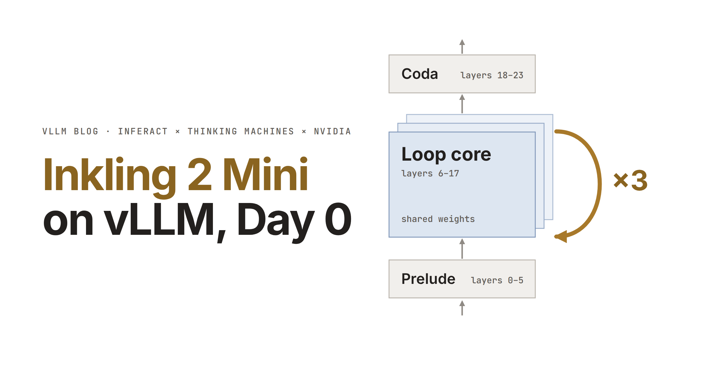

Inkling 2 Mini 让中间十二层重复工作，服务端因此需要区分权重的身份和状态的身份。相同的权重在一次 token 生成中被访问三次，各次拿到的输入不同。若仅按物理层号索引缓存，下一 token 可能读到另一轮生成的历史。vLLM 的适配把“访问哪一轮”写入了缓存层注册方式。

Inferact, Thinking Machines and NVIDIA · 2026-11-20 · [Inkling 2 Mini on vLLM: Day-0 Support for a Looped Model](https://vllm.ai/blog/2026-11-20-inkling2-mini)

## 同一入口产生不同的消息

前六层只跑一次，核心层 6–17 默认跑三遍，最后六层接上末轮结果。三次核心计算都从前六层的输出起步，后续轮次通过消息读取上一轮两个残差块。每个核心层的 Q、K、V 和 MLP 输入各有自己的读取查询；rank-64 控制器按通道调节原输入和消息的混合。后续每一轮因此有 48 次消息读取。即使执行相同投影，先前 token 在不同轮的键值也未必相同。

<a class="note-image-link" href="/assets/images/tech/vllm-inkling2-mini-2026-11-20/figure.png" target="_blank" rel="noopener" aria-label="前段与末段各执行一次，十二层核心在两者之间共享权重执行三轮。">查看原图 ↗</a>

*前段与末段各执行一次，十二层核心在两者之间共享权重执行三轮。*

## 把逻辑层注册给原有缓存管理器

六层开头、三次十二层核心和六层结尾合计 48 次层访问。vLLM 给每次额外访问注册独立注意力层，得到 48 套 KV 和 48 套卷积状态；现有的分页和前缀缓存逻辑可以继续管理这些身份。适配的另一个成本是内核启动。实现把每层四次消息读取合进一次残差内核，将控制器的投影堆叠成批量矩阵乘法，并把门控合并与下一次归一化融合。消息合并保留 FP32。DSpark 草稿头读取前段、核心第二和第三轮，以及最终输出，因而依赖固定的访问位置。

## 共享 KV 能省多少，要看仍独立的状态

可变轮数的研究检查点允许启动时改变轮数或共享 KV。共享模式会覆盖同一 token 的键值，使后来的 token 看到最后一轮写入的结果；卷积状态仍按轮独立。固定轮数的 Mini 检查点不接受这两个开关。

原文在单块 GB200、TP1、4K 上下文下只计前向。批量 32 时，一轮、两轮、三轮的解码步分别为 3.81、5.92、8.11 毫秒，对应缓存容量为 352K、233K、175K token。三轮共享 KV 后容量升到 194K，步时为 8.10 毫秒。这个对照把两种取舍分清了：减少轮数会改变计算深度并释放状态，保留三轮只共享 KV 主要改变容量，而且改变了后续 token 读取的历史。
