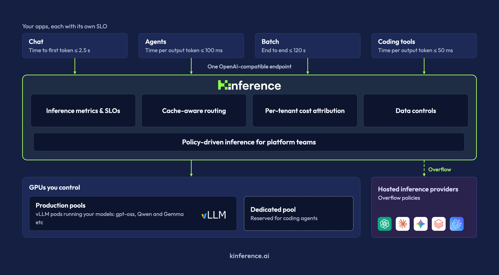

推理服务扩成多副本后，同样的请求发给不同 GPU，代价可能完全不同：一张卡已经缓存了几乎全部系统提示，另一张卡需要从头 prefill；但缓存最热的卡也可能正忙。Kinference 的切入点，是把这个逐请求判断放到 vLLM 之上的 Kubernetes 控制面，同时处理租户、token 用量和路由策略。

原文：[Introducing Kinference: An Open Source Inference Control Plane for vLLM and Kubernetes](https://vllm.ai/blog/2026-11-04-introducing-kinference) · the Kinference Team · 2026-11-04

## 为什么普通 Service 不够表达推理成本

Kubernetes Service 通常按连接把流量分到副本，并不知道某个 prompt 与哪个 worker 的 KV cache 重叠。Buoyant 的基准使用 iptables 模式 kube-proxy，压测端几乎每请求新建连接，因此基线接近随机分配到三副本。共享前缀可能在错误位置反复计算，新增 prefill 还会与正在进行的 decode 争抢执行资源。

Kinference 为每个候选 worker 预测该请求的 TTFT，将缓存内容、GPU 队列和历史性能结合，选择预计最早返回首 token 的端点。它并非把全部请求粘在“缓存命中最多”的节点：若该节点排队成本更高，另一个缓存较冷的 GPU 仍可能更合适。其作用是减少跨副本的不必要工作，底层计算仍由 vLLM 执行。

<a class="note-image-link" href="/assets/images/tech/vllm-kinference/kinference.webp" target="_blank" rel="noopener" aria-label="缓存感知路由与策略层连接客户端、本地模型池和外部 provider；监控与租户成本归因在同一控制面。 · 查看原图 ↗">查看原图 ↗</a>

*缓存感知路由与策略层连接客户端、本地模型池和外部 provider；监控与租户成本归因在同一控制面。*

## 从客户端入口到可独立变更的策略

客户端发送 OpenAI 或 Anthropic 兼容的 HTTP 请求，经过 gateway 和 inference handler 进入本地模型池或外部 provider。平台运营者可用声明式 InferencePolicy 对租户、请求模型、语义标签和集群状态写规则，再独立审核、应用和回滚。

例如，简单请求可在便宜模型和原模型之间按预测 TTFT 选择；若完整历史在昂贵模型的 GPU 上已缓存，临时换便宜模型未必省时。另一个例子根据 queuedPrompts 排除拥挤的本地端点，再选择云端 provider。它们表达的是条件和候选顺序，不代表模型选择质量已经有统一保证。

PII 示例进一步体现“先约束、后优化”：检测到敏感标签时先排除外部 provider，无可用端点则拒绝。这个 fail-closed 行为发生在标签已正确产生的前提下；策略执行本身不证明敏感信息分类没有漏报。工程价值是让可审查的路由约束独立于每次模型生成，而不是把自然语言判断直接当作授权。

## 95% 的 TTFT 下降发生在什么条件

[官方基准说明](https://buoyant.io/blog/distributed-inference-benchmarks-kinference-vs-plain-kubernetes)给出了比公告更有用的条件：AWS 上两组相同的三副本池，每 worker 一张 L40S，运行 vLLM 0.31.0 和 Qwen-3.8-27B-FP8，GuideLLM 在独立节点压测。轻载延迟使用低速泊松到达，每条件三次试验；共享前缀工作负载从 24 个 16,000-token 前缀中选择，再追加 256 个独有输入 token，生成 256 token。

这个条件下，中位 TTFT 从 6.88 秒到 0.31 秒，约降 95%；端到端中位延迟从 20.5 秒到 11.3 秒，约降 45%。八轮对话负载的中位 TTFT 从 1.70 秒到 0.59 秒，约降 65%，因为第一轮没有历史可复用，收益较小。无共享前缀的对照中位 TTFT 为 6.92 与 6.83 秒，没有显著差异。固定到达率下，两边输出吞吐大致相同；更短延迟不应被改写成同幅吞吐提升。

## 容量收益与 SLO 要分开读

容量实验改用闭环并发 4、8、16、24、32，测量满足延迟阈值的请求数，即 goodput。共享前缀要求 90% 请求 TTFT≤8 秒，多轮要求 90%≤4 秒；这些阈值由所选硬件和空载性能制定，属于较宽松、偏离线 Agent 的条件。

两条曲线各自峰值相比，共享前缀 goodput 为 14.0 对 103.0 请求/分钟，约 7.4 倍；多轮为 23.8 对 82.7，约 3.5 倍，峰值未必发生在相同并发。Kinference 在共享前缀并发 32 仍满足总体 SLO，多轮到并发 8 满足；普通 Service 在已测并发都未达到 90% 目标。不能把“还有部分请求达标”与“整组满足 SLO”混为一谈。

## 适用边界：控制面改善的是可复用工作的位置

这项实践最值得迁移的是把队列、缓存和治理共同纳入请求分配。系统还暴露 TTFT、ITL、端到端延迟、缓存/未缓存 token 和每租户用量，以便给不同租户建立性能目标和成本估计。

证据来自厂商维护的三副本、单模型与特定重复前缀工作负载，比较对象为普通 Kubernetes 分流。它没有证明相对其他缓存感知调度器仍有同幅收益，也没有把延迟测试等同于真实业务质量评估。前缀越少、模型切换越频繁，或性能目标从秒级改为严格交互延迟，结果都需重新测量。选择更便宜模型也可能改变回答质量；路由层的效率不能代替模型语义验收。
