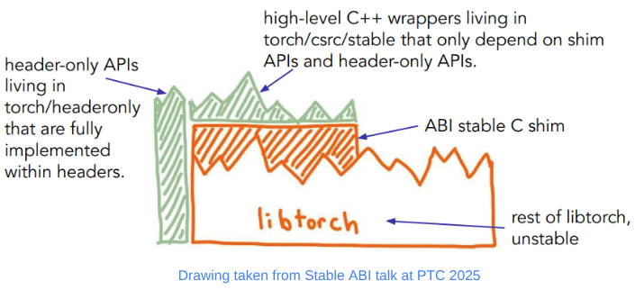

[Migrating vLLM to the LibTorch Stable ABI](https://vllm.ai/blog/2026-11-06-stable-abi-cuda)  
vLLM Team, Red Hat PyTorch Team, and Meta PyTorch Team · 2026-11-06

升级 PyTorch 后，推理引擎即使没有改代码，也可能因为二进制接口变化而无法加载。vLLM 的这次迁移把问题落到可审计的编译边界：CUDA wheel 及其编译依赖只能引用稳定的 LibTorch 接口。它带来的主要价值是减少版本升级和分发的耦合，而非提高模型吞吐。

<a class="note-image-link" href="/assets/images/tech/vllm-libtorch-stable-abi/official.png" target="_blank" rel="noopener" aria-label="LibTorch 的稳定 C 接口、C++ 封装和 header-only 工具边界 · 查看原图 ↗">查看原图 ↗</a>

*稳定 C 接口包住受支持部分，C++ 封装只依赖稳定入口；其余 LibTorch 内部仍可变化。*

## 稳定边界怎样隔开内部实现

源码 API 与 ABI 不是一回事。函数名称和用法看起来不变，编译后的符号、调用约定或数据布局仍可能变化。LibTorch Stable ABI 用三层接口隔离这种变化：底层 C shim 暴露一组稳定入口，C++ wrapper 提供更易用的封装，header-only 工具直接在扩展中编译，不链接不稳定的内部实现。

扩展只依赖这层承诺的接口，才有机会在兼容的新运行库上继续加载。文章称 vLLM 自 v0.33.0 起发布采用该方案的 CUDA wheel。但 Python API、CUDA 最低要求和第三方依赖仍各有约束，不能据此任意替换所有版本。

## 从源码迁移到整个依赖闭包

迁移开始于盘点所用 PyTorch API。稳定接口不暴露 autograd 机制，也缺少稳定 SymInt，因此相关 AutogradFunctions 和 meta 函数移到 Python。随后建立独立的稳定库，分批迁移 175 余个 C++/CUDA 源文件及 120 余个头文件；`TORCH_TARGET_VERSION` 帮助在编译阶段拦截不稳定头文件。

算子注册也必须通过稳定 dispatcher。`STABLE_TORCH_LIBRARY` 配合 `TORCH_BOX`，将具体 C++ 参数装箱为跨 ABI 的通用值。缺少便捷封装时，可用 `torch_call_dispatcher` 调用 ATen 算子，例如迁移时的 `is_pinned()`。这增加类型转换、查找与装箱开销；作者称未观察到明显运行回退，但快速 kernel 的 eager 调用比图捕获后的执行更容易暴露主机端成本。

只改 vLLM 自身还不够。FlashMLA、DeepGEMM、FlashAttention 等编译依赖如果继续引用旧接口，整个 wheel 仍不稳定。文章的迁移前后审计输出正好展示了这个差别：核心库已稳定时，包内其他扩展仍能让整体结果失败。最后展示的完整 wheel 审计最低 torch 版本为 2.13.0，也说明支持范围由实际使用的符号决定。

## DeepGEMM 揭示的接口适配工作

DeepGEMM 原先用 pybind11 注册算子，需要先迁到 `TORCH_LIBRARY`，再采用稳定注册。示例算子原本接收一个包含 tensor 和可选 tensor 的 tuple，以及 C++ `int`；适配层把 tuple 拆成两个参数，并用 `int64_t` 接收 dispatcher 的整数，再在内部转换。Python 外层仍接受原先 tuple，避免把底层迁移暴露给用户。

这类工作不能仅靠替换类型名字完成。源项目升级、引入 DeepJIT、vLLM 切换依赖 fork，都会改变需要迁移的边界。文章明确区分了 vLLM fork 已完成和上游仍在推进的依赖，不能把一个发行包可用等同于所有上游版本都已迁移。

## 证据与适用边界

团队用正确性测试、性能检查和逐行 diff 审阅控制行为变化，并把 `torch-abi-audit` 加入 CI 检查共享库符号。演示中，同一个 vLLM 构建先运行于 PyTorch 2.14.1，再替换为 2.15.0，未重编引擎仍完成小模型生成。这是具体兼容组合的证据，不能替代完整模型与硬件矩阵。

CPU 和 ROCm 构建仍列为后续工作。对维护推理镜像的人，值得读的是依赖审计与 DeepGEMM 案例：真正需要维护的是整个二进制依赖集合的兼容契约，编译成功只是其中一步。
