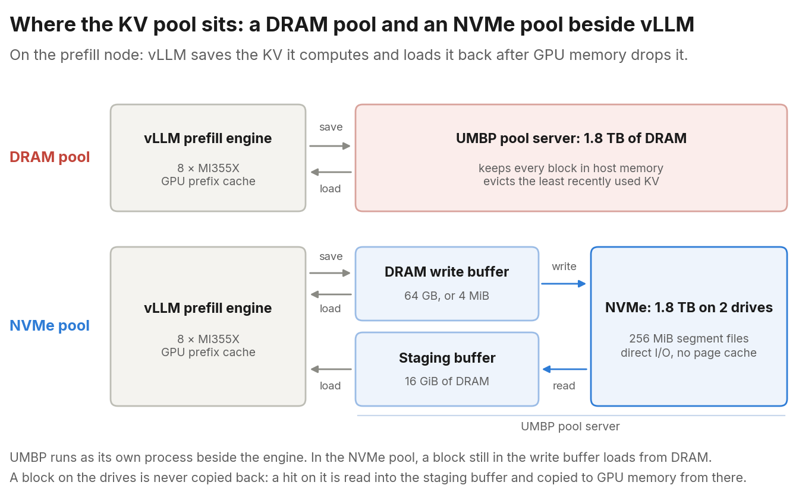

一条编程会话停下来等工具，GPU 可以去服务别人。等工具返回，下一轮却要带上此前几乎全部对话。AgentX 回放中，单轮输入的中位数是 14.2 万 token，超过 96% 是服务器见过的前缀。这让缓存池有了一个比单次读取延迟更实际的指标：会话回来时，还有多少 token 能直接复用？

## DRAM 从保管历史变成暂存数据

AMD 与 Embedded LLM 在 16 块 MI355X 上运行 Kimi-K3，将预填充与解码分开。常规路径把移出 GPU 的 KV 存进主机 DRAM 池。另一条路径把缓存长期保存在 MoRI UMBP 管理的 NVMe 分段文件里，主机上只留 64 GB 写缓冲和 16 GiB 读取暂存。热前缀仍可由 GPU 直接服务，不必每轮都访问盘。

请求抵达后，连接器异步查询并加载命中的前缀，vLLM 等 KV 到位再让该请求进入预填充，同时继续调度其他请求。如果引擎繁忙，读取可以与等待预填充槽位的时间重叠。DeepSeek-V4-Pro 的 64 会话实验中，DRAM 和 NVMe 加载分别花 0.80 和 0.85 秒，都在预填充开始前约两秒完成。轻负载则没有那么长的队列：另一项单请求测试中，128K 前缀从两种介质命中的首 token 时间分别是 0.45 和 0.84 秒，完全重算则需 7.7 秒。

<a class="note-image-link" href="/assets/images/tech/vllm-skip-the-dram-tier/overview.png" target="_blank" rel="noopener" aria-label="DRAM 池直接保存 KV，NVMe 路径仅用 DRAM 缓冲写入和暂存读取">查看原图 ↗</a>

*DRAM 池直接保存 KV，NVMe 路径仅用 DRAM 缓冲写入和暂存读取*

## 等容量看介质，扩大容量看回访

在 AgentX 的 Kimi-K3 回放里，两种池都给 1.8 TB，48、70、96 个会话下 NVMe 吞吐相对 DRAM 的差值分别为 +0.3%、+0.8%、−0.2%。两者运行相近的淘汰策略，六组配对中的命中率差最多只占提示 token 的 0.08%。当命中率从 96% 降到 95%，需要重算的提示份额就从 4% 变成 5%，增加了四分之一。70 会话的 42 次运行中，命中率解释了吞吐差异的 96%；这个拟合来自特定配置，不能当成换一种模型也成立的常数。

容量对照给出另一幅图景。kvlab 轨迹、70 会话下，1.0 TB DRAM 池只能保住 52% 的命中率，4.6 TB NVMe 池达到约 93%，每 GPU 每秒处理 8,813 个 token，约为前者的 5.1 倍。把 DRAM 增至 1.8 TB 的另一轮也达到 91% 命中率。容量不足还会放大损失：重算挤长预填充队列，拉长会话两次访问间隔，使前缀更容易在下次访问前被淘汰。

## 一次释放多少磁盘空间，会改变淘汰结果

缓存按块淘汰，NVMe 后端却要删掉整份分段文件才能收回空间。采用默认 4 GiB 分段时，即使选中活块最少、较久未用的文件，里面仍可能夹带即将复用的数据。仅将分段缩小为 256 MiB，在 AgentX 的 70 会话实验中，命中率便从 94.45% 升至 95.65%，吞吐从 11,672 升至 13,492 token/s/GPU，首 token 时间 P90 从 63.0 秒降到 21.3 秒。细粒度回收也意味着要管理更多打开的文件。

另一个盲点来自上层命中。GPU 已经服务了最热的前缀，下层池看不到读请求，容易误把它淘汰。连接器把 GPU 命中回报给池，才可刷新这些块的最近访问时间。对于混合模型还要保住能恢复的状态边界：Kimi-K3 即使命中普通 KV，若分叉处缺少 KDA 检查点，仍要重算。提高检查点密度可改善复用，同时会让更多数据写盘。这些改动来自不同实验条件，收益不能相加。

## 留存时间和写入耐久度是两本账

在文章测得的每小时 2.3–4.6 TB 写入量下，1.8 TB 只够保留约 23–47 分钟历史。给缓存定容量，可先看会话两次使用同一块的间隔，再看高峰写入速度。96 会话、每小时 3.5 TB 相当于每天写 83 TB；两块 3.84 TB 测试盘即使逻辑空间够用，也要承受每天约 11 次全盘写入。作者按五年连续负载和标价估算，更大的盘组能分摊磨损，成本估算仍未计电力、机架和服务器。

等容量实验里，池最多供给 16% 的提示 token，其余命中可能由 GPU 直接满足。在盘要承担大部分读取、队列不足以覆盖加载、或业务严格限制首 token 尾延迟时，最需要测的是负载下的读取比例、排队与淘汰行为。本文的等容量结果给出了这些条件下可检验的起点。

AMD and Embedded LLM · 2026-11-23 · [Skip the DRAM Tier: MoRI UMBP Runs the Agentic KV Cache on NVMe](https://vllm.ai/blog/2026-11-23-skip-the-dram-tier)
