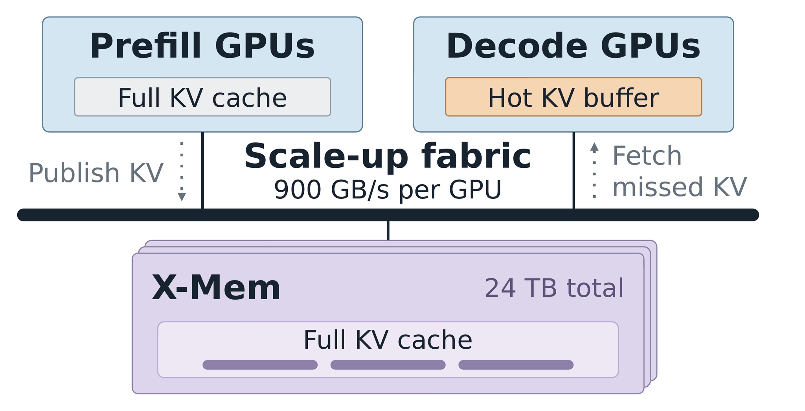

**LMSYS · Netpreme Team · 2026-11-05**  
原文：[XM-Sparse: Pushing the Throughput Frontier of Sparse Attention with Netpreme X-Mem™](https://www.lmsys.org/blog/2026-11-04-xm-sparse/)

稀疏 Attention 每步只读取一部分历史 KV，但不同步选中的位置会变，完整 KV 仍须保存。把全量历史移到外部内存，GPU 保留热数据，能提高并发；不过“放得下”不意味着“取回来足够快”。XM-Sparse 将 Netpreme X-Mem 接入 SGLang HiSparse，围绕这两项约束解释外部内存层的价值。

## 热缓冲减少读取，不能替代完整历史

HiSparse 在 HBM 中保留 hot KV buffer 和 indexer key cache。每步稀疏选择后，只把热缓冲未命中的已选 KV 取回。若只扩大外部容量却仍通过慢链路搬数据，高并发会把更多 miss 叠在一起，TPOT 反而增长；若链路很快但完整历史存不下，并发仍会被容量截断。

文章在四 GPU、Attention DP4 与 MoE EP4 的 GLM-5.3 设置中，按每请求每层 4,096-token 热缓冲、每步选择 2,048 个 KV 分析。建模使用实测的无 KV I/O 计算时间，加上估计 I/O 时间，假设两者不重叠，并采用 20% miss rate。它比较每 GPU 64、225、900 GB/s 等带宽和总计 1 TB/24 TB 容量；这些是模型预算，不是对所有 PCIe、CXL 或 C2C 系统实测后的通用结论。

## 容量与带宽在不同上下文长度下换位

128K 上下文时，两项约束同时存在。1 TB 外存将每 GPU batch 限到 36，提高链路速度也无法多存请求；24 TB 可容纳 batch 109，但若带宽仍为 64 GB/s，更多 KV miss 会继续拖住吞吐。在相同 batch 下，900 GB/s 建模值相对 64 GB/s 的 PCIe-CXL 配置约有 1.39 倍吞吐。

短到 16K，1 TB 已能容纳 batch 241，此时主要看 I/O 带宽；长到 1M，扩容在相同 64 GB/s 下就能把可行 batch 从 4 提到 20。这个分解比笼统宣称“外存越大越快”更有帮助：上下文、热缓冲 miss、完整历史大小与 batch 共同决定瓶颈。

<a class="note-image-link" href="/assets/images/tech/xm-sparse-xmem/kv-tier.png" target="_blank" rel="noopener" aria-label="Prefill 发布完整 KV，decode 从共享外存提取未命中项 · 查看原图 ↗">查看原图 ↗</a>

*读图：完整历史下沉共享层，decode 保留热缓冲；900 GB/s 和 24 TB 是该设计的带宽与容量口径，需结合 Pilot VM 条件理解。*

设计中的单个内存节点有四个 MPU，容量最高 24 TB DDR5、节点聚合带宽约 4 TB/s，由机架内 GPU 共享。图中的每 GPU 链路预算与节点聚合带宽不是同一个口径，扩展时仍要考虑共享竞争。

## 接入点是整个 KV 生命周期

prefill GPU 将 prompt KV 发布到 X-Mem，完成后 decode 不必先把完整 prompt 历史装入自己的 HBM。decode 只取回已选但未命中的 KV；每个成功生成步的新 KV 继续写回外部历史。请求结束则先等待未完成的访问，再回收存储。相同 prefix 可共享外部 KV，避免重复保存。

共享区由 owner 进程创建，其他 GPU 进程通过可移植描述符映射；只有全部映射解除后 owner 才释放物理内存。这样的生命周期安排决定了“增大内存池”是否仍能安全复用地址。集成保留 HiSparse 的稀疏选择、缓存管理和预取机制，并支持 CUDA Graph；但下述测量为隔离 I/O 效果关闭了 prefetch，不能把测试设置和实现能力混为一谈。

## Pilot VM 测量验证了哪一部分

官方试验用四张 B300 做 decode，另四张 B300 的 HBM 充当 X-Mem 内存银行，经预期访问路径提供服务。24 TB 是容量模型预算，并非那四张 bank GPU 真实装下了 24 TB。输入为合成 KV prefix，miss rate 固定在 20% 或 40%；X-Mem 最终硅片尚未上市。

16K、每 GPU batch 192、20% miss 时，平均 TPOT 从 host DRAM 的 167.48 ms 降至 84.99 ms，约降 49.25%；40% miss 时从 255.69 ms 降至 93.13 ms，约降 63.58%。小 batch 差距小，X-Mem 甚至可能略慢。跨 16K–1M、20% miss 的最高已测吞吐比较为 2.09–3.04 倍，但长上下文允许使用不同最大 batch，收益同时来自容量和带宽。

对 serving 规划，这是一份有清晰生命周期与瓶颈分解的早期系统证据。它支持检查“高并发时选中 KV 的 miss 流量是否堵住外部链路”，尚不证明最终硬件在真实 Agent 轨迹、动态 miss、开启预取或共享竞争下保持同样倍率，也没有建立含 prefill 和 TTFT 的完整服务 SLO 优势。
