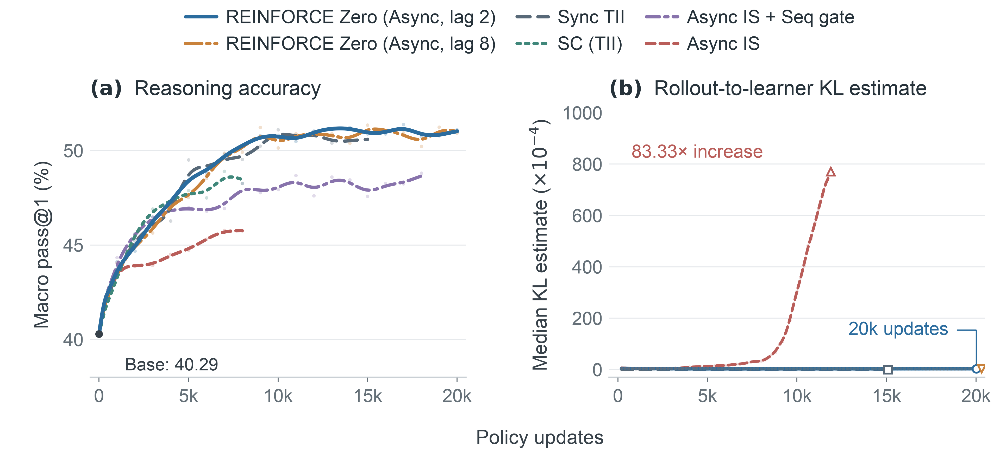

**vLLM · Ao Shen、Jian Hu、Yan Bai、Shekhar Pandey 与 REINFORCE Zero authors · 2026-11-06**  
原文：[Zero Mismatch, Simple Async RL: REINFORCE Zero, DeepSeek-V4.1 and Kimi K3.1](https://blog.vllm.ai/2026/11/06/zero-mismatch-async-rl.html)

异步 RL 让 rollout 和 learner 同时工作，减少互相等待，却让训练消费旧版本策略生成的样本。常见纠偏是重要性采样：用当前策略对采样 token 的概率除以当时 rollout 记录的概率。本文指出，同一比值里其实混着两种不同来源的差异，只有分清它们，才能理解为什么加了纠偏训练仍会漂移。

## 两个概率差距，只有一个来自旧权重

第一项是 learner 新旧权重之间的变化；第二项是在相同旧权重下，learner 与 rollout 的数值实现不一致。后者可能来自 batch 形状导致的内核选择、归约顺序，以及 prefill/decode 的不同运算路径。权重没变，logprob 仍可能改变。

文章把对数概率差分解为这两项：

$$\log \pi_{\theta_k}-\log\mu_v=(\log\pi_{\theta_k}-\log\pi_{\theta_v})+(\log\pi_{\theta_v}-\log\mu_v)$$

重要性采样可以给出正确的期望更新，并不意味着方差足够小。相同参数下额外的数值波动会放大重要性权重的尖峰。作者引用 REINFORCE Zero 实验，用逐 token 的 $$w-1-\log w$$ 更新均值 D3 衡量偏离：对齐内核时峰值为中位数的 1.50 倍，标准内核为 442.54 倍。该比较来自 DeepSeek-R1-Distill-Qwen-1.5B 的异步运行，不是旗舰 MoE 的同规模长期结果。

## 对齐后，训练路径反而可以简化

REINFORCE Zero 先让两侧在相同权重和 token 上给出逐位相同的 logprob，再用不截断的 token 级重要性权重处理剩余的权重滞后。优化目标使用普通 REINFORCE；每个回答的 advantage 为奖励减组均值，回答内部对 token 平均，不额外训练 value model，也不设置样本拒绝门槛。

这条路径的含义不是所有 off-policy 问题都消失，而是将可控的版本变化与不稳定的执行误差分开。截断重要性权重可以压制尖峰，却引入偏差；序列拒绝可以稳定训练，却让已生成样本不再用于更新。消除数值失配后，作者测得无需这些拒绝机制也能保持稳定。

<a class="note-image-link" href="/assets/images/tech/zero-mismatch-async-rl/training.png" target="_blank" rel="noopener" aria-label="对齐内核与标准内核下的推理准确率和 KL 变化 · 查看原图 ↗">查看原图 ↗</a>

*读图：左侧质量曲线与右侧 KL 要一起看；标准内核的漂移没有被普通 IS 消除，对齐路径在这些实验中持续稳定。*

标准内核加重要性采样的对照中，最后一千步相对最初一千步的 rollout-to-learner KL 中位数升高 83.33 倍，在线 AIME24 pass@1 从 34.27% 降至 13.96%。序列 gate 虽使训练稳定，到最后一千步会拒绝 24.48% 序列；对齐路径不拒绝。这使“采样效率”和“训练稳定性”成为同一执行问题的两个侧面。

## 吞吐、滞后和质量要分别读

16 GPU、12K 更新的比较中，对齐内核的异步路径耗时 68.55 小时，对齐内核的同步路径为 164.77 小时，即训练步吞吐约 2.40 倍，并保持可比质量。20K 更新、lag 2/8 的稳定推理实验使用 1.5B 模型；lag 64 的例子则是 Qwen3-4B、Python 工具与 16K 上下文，在 5,000 次更新中平均奖励从 0.287 升至约 0.78。不能把这些条件拼成一条“所有大模型在 lag 64 下稳定训练 20K 步”的结论。

对齐也有成本。OSWorld 对比中，REINFORCE Zero 平均每步 944.25 秒，标准内核加序列 gate 为 884.17 秒，慢 6.8%。是否划算，取决于省下的等待、避免的样本浪费和对齐内核自身损耗，而非只看 rollout 峰值速度。

## 大模型验证揭示了真实故障机制

旗舰模型部分验证的是对齐可行性。DeepSeek-V4.1-Flash 在 16 节点×4 GB200 的 128K agentic RL 中维持 diff 0，特别检查了 prefix-cache hit 与 miss 的一致性。Kimi K3.1 的 KDA 必须让 token 级 decode 重复 chunk prefill 的算术顺序，避免两条路径舍入不同。

AMD MI355X 的排查更具体：库按形状选内核、indexer top-k、prefill/decode 分流，以及按到达顺序求和的专家归并，都可能造成 batch variance。修复后 DeepSeek-V4-Flash 的 serving 吞吐损失从 62–66% 降到 7.4–10.1%；Kimi 的唤醒路径还修复了 eviction 与 reuse 同步写同一 KDA slot 的问题。对运行可靠性而言，这些例子比“开启一致模式”这个开关更有信息量。

官方明确将这些大模型的长期异步训练列为下一步。当前最值得迁移的是逐 token 数值一致性检查、缓存与恢复路径审计，以及分开记录数值失配和策略版本滞后的观测方式。
