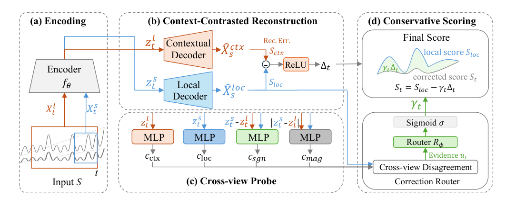
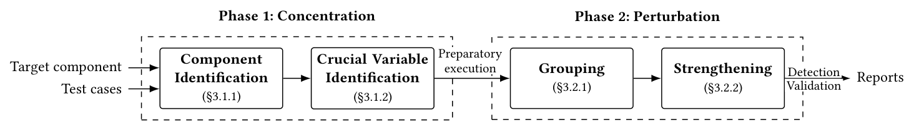
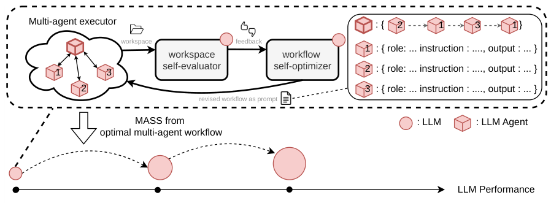

*资讯样稿 · 论文首发于 2026 年 10 月 7—11 日，选自上一批六篇。*

## 本期看点

这期重点看两项 Agent 可靠性工作。[通信故障研究](#paper-messages) 解释了消息能够解析、流程没有报错时，错误证据为什么仍会影响最终决策；[Cadence](#paper-cadence) 则讨论发现执行偏差之后，如何选择介入方式与下一次检查时间。前者帮助理解失败怎样传播，后者给出运行中纠偏的具体机制。

另外四篇带来不同方向的进展：[恢复代码生成](#paper-resilience) 让 LLM 为真实 MPI 程序补上故障恢复能力；[MORA](#paper-mora) 利用时间上下文区分正常变化与异常；[NosRacer](#paper-nosracer) 展示定向并发测试在商用系统中的效果；[MASS](#paper-mass) 尝试把多智能体协作经验训练回模型。

以下两篇展开讲清背景、机制和实验，其余四篇可快速浏览。它们各自提供了新的方法或证据，尚不足以代表整个领域已经转向同一条路线。

*图可点击查看大图。*

## 重点解读

<h2 id="paper-messages">01 · Agent 没有报错，为什么任务还是失败了？</h2>

[When Messages Go Wrong: Understanding Communication Faults in LLM-Based Multi-Agent Systems](https://arxiv.org/abs/2610.15459v1) · [代码与实验材料](https://github.com/SonGoKu21/mas_communication)  
**重点解读 · AgentOps / 通信可靠性 · 10 月 11 日**

**这项研究把多 Agent 的通信可靠性，具体推进到了“下游是否拿到足以支持决策的证据”。** 消息成功送达、格式可以解析，仍可能掩盖任务已经偏离正确结果。

### 从一个能继续运行的错误开始

论文中，一个 Worker 返回了查询得到的书名，但传给 Verifier 的消息缺少三个必要证据字段。Verifier 仍然接受，流程没有即时失败信号。答案字符串甚至与预期一致，但它没有满足任务要求的证据契约。这说明，只监控崩溃、超时或最终回答文本，可能遗漏协作过程里的信息错误。

重试、超时和去重主要处理交付是否完成；Agent 的消息还承载任务约束、观察和证据。已有 Agent 故障研究涉及模型推理、工具和协作错误，这篇则把范围收敛到通信路径，追踪信息如何在交接后被接受和使用。它是一项故障行为研究，不是提出新的推理模型。

### 怎样把故障影响看清楚

作者在 AutoGen 上构建三种工作流，在请求发出、工具观察返回、证据交接处注入丢失、部分内容、语义污染等故障。观察分成三个环节：先确认故障真的到达接收端，再追踪下游状态和行为变化，最后独立判断任务成败。这样能区分“安排了注入却没有触发”和“触发了但系统仍完成任务”。

比较拓扑时，关键差别是图中 Flat 增加的绿色通路。Worker 生成证据后，一份经 Verifier 传递，另一份直接交给最终决策者。如果前一条交接失败，后一条仍可能保留完整信息；若故障发生在 Worker 取得证据之前，两条后续路径都无济于事。

*看绿色虚线从哪里分叉：它保护已经生成的证据，不会凭空补回 Worker 从未获得的信息。*

### 实验发现了什么

实验覆盖五类任务中的 100 个任务、三种工作流和三种模型配置。两个结果最值得记住：

- 在 **8,335 次检测记录完整的失败执行** 中，20.7% 没有即时失败信号；部分内容故障的这个比例达到 76.2%。这类故障容易继续传播，因为接收者仍能处理消息。
- Flat 的配对优势主要出现在证据交接阶段。证据丢失时，相比 Sequential 的任务成功率提高了 66.5 个百分点；在请求或观察阶段，优势很小。这支持“保留未受损信息路径”的作用，不能直接推成扁平结构普遍更可靠。

### 发现问题之后，怎样恢复

论文进一步区分了操作恢复与证据恢复。动作尚未完成时，重试可能有效；动作已经成功、只是回传证据不完整时，再做一遍操作可能引入重复副作用。此时更合适的是检查必要字段，再重新读取可信状态。实验也展示了边界：如果故障连恢复通路一起污染，重新获取信息就不再奏效。

**值得关注的进展，是把传输、信息使用和最终结果连接起来分析。** 它为理解“流程看似正常却做错事”提供了更具体的观察方式。结论仍受这些 AutoGen 实现和任务契约约束，下一步值得跟踪在其他框架及持续故障下是否成立。想进一步读原文，优先看故障案例与保护机制；作者已提供代码和实验材料入口。

<h2 id="paper-cadence">02 · 编码 Agent 走偏时，监控器应该何时介入？</h2>

[Cadence: Strategic Guidance for Coding Agents](https://arxiv.org/abs/2610.12269v1) · [代码](https://github.com/LogAnalysisTech/Cadence)  
**重点解读 · AgentOps / 运行时干预 · 10 月 8 日**

**Cadence 把“检查多频繁”和“发现问题后怎样纠正”放进同一个反馈循环。** 它面向的情况很常见：Agent 一直在读代码、修改文件，但修复方向已经错了，工具调用本身却没有报错。

### 固定检查和规则监控各自卡在哪里

论文中的 Django 案例要求删除对象后清空主键。Agent 把修改放在普通删除路径，而该场景实际走快速路径。补丁语法正确，提交动作也合法，单靠循环调用或阶段停滞等规则很难判断修错了位置。

周期性调用模型检查轨迹，可以覆盖更复杂的语义错误，但检查间隔又成为问题：检查过密，可能打断本来顺利的任务；检查过疏，错误可能在下一次检查前扩大。Cadence 因而将干预判断用于调节检查节奏，让监控资源随执行状态变化。

### 一次检查如何改变后续执行

到达检查点时，监控器收到任务描述、最近的执行轨迹、历史建议，以及**尚未执行的下一步动作**。之后有两种处理：

1. **建议（advisory）：** 当前动作可以执行，把建议放入上下文供后续步骤使用，同时拉长检查间隔。
2. **替换（replacement）：** 丢弃当前拟执行动作，给出纠正意见并要求重新生成，同时将检查间隔恢复到基础值。

因此，同一个判断既决定这一步是否放行，也决定之后盯得多紧。它不会回滚已经发生的副作用，关键是尽量在动作执行前发现偏差。Django 案例中，监控器拦住了提交，指出快速路径没有覆盖，Agent 才转去修改正确位置。

*顺着下方执行序列看：健康执行逐步减少检查，严重偏差触发动作替换，并恢复较密集的监督。*

### 提高了多少，代价是什么

主实验在 SWE-bench Lite 的 300 个任务上，用 Gemini 2.5 Flash 编码、GPT-5.2 监控。表中 token 包含编码 Agent 和监控器的消耗：

| 编码框架 | 解决率：原始 → Cadence | 每任务 token：原始 → Cadence |
| --- | --- | --- |
| mini-swe-agent | 17.00% → 42.33% | 142 万 → 103 万 |
| Moatless | 24.00% → 39.67% | 32 万 → 48 万 |

这组结果说明监控能救回任务，但成本收益取决于框架：mini-swe-agent 同时提高解决率、减少 token；Moatless 则用更多 token 获得更高解决率。不能把两者概括成统一的成本下降。

消融进一步揭示了动态调度的作用：保留两级干预、固定每三步检查，解决率达到 45.67%，高于动态版，但 token 多约 15%。动态版体现的是较好的效果与资源折中。相比 Moatless 上的 LivePlan，其优势也没有在多重比较校正后达到统计显著。

### 这项工作推进了什么

**它给出了一套将语义监控接入执行控制的具体办法。** 相比只给最终产物打分，运行时监控有机会阻止错误继续积累；相比固定检查，它又试图减少不必要的监督。

当前证据集中于代码修复任务。监控器仍会误判修复方向，Agent 也可能只落实了一部分正确建议。因此，后续值得关注的是这些控制策略能否跨任务和模型保持效果，而不只是继续提高单个基准分数。建议先读干预机制，再看消融和失败案例；公开仓库提供实现与运行入口，本期没有执行复现。

## 其他值得关注的工作

<h2 id="paper-resilience">03 · LLM 能否给科学计算程序补上故障恢复能力？</h2>

[LLM Agents as Resilience Engineers for Scientific Applications](https://arxiv.org/abs/2610.11260v1)  
**研究动态 · LLM4Ops / 自动化可靠性工程 · 10 月 8 日**

给 MPI 程序加入 checkpoint/restart，难在找齐恢复所需状态，并选择一致的保存与恢复位置。作者移除应用已有的恢复逻辑，让编码 Agent 重新实现，再用真正的故障注入验证是否能恢复计算，而不只是检查代码能否编译。

*Agent 生成恢复代码后，由独立验证器检查；失败反馈回到 Agent，形成生成—验证—修正循环。*

**这篇最有启发的发现是，难度与状态是否分散密切相关。** 论文在 48 个应用—模型设置中得到 41 个成功实现；状态集中、容易访问时更顺利，跨模块依赖复杂时容易陷入反复修补。这个数字是设置覆盖数，并非每次尝试都有同样高的成功概率；实验规模也仍是单机 4 个 MPI rank。

**为什么值得关注：** LLM 在这里承担的是完整的恢复能力改造，而非生成几个 API 调用。独立验证器还会防止缓存预期输出等“通过测试但未实现恢复”的做法。它展示了自动化可靠性工程的实际进展；走向更大规模和更复杂状态仍是后续值得关注的部分。

<h2 id="paper-mora">04 · MORA：指标变了，不一定是系统坏了</h2>

[MORA: Modeling Observed Changes for Drift-Robust Time-Series Anomaly Detection](https://arxiv.org/abs/2610.09473v1)  
**AIOps 方向建议跟进 · 时序异常检测 · 10 月 7 日**

负载变化和真实故障都可能使指标偏离历史模式。MORA 用短窗口和长历史分别重建**同一段局部数据**：若更多历史能解释这次变化，就适度降低异常分数。它提供了一种无需测试时在线更新的漂移处理思路。

*两路重建指向同一个短窗口；长历史确实降低重建误差时，右侧模块才允许下调异常分数。*

四个时序基准上，方法的平均排名较好，但并非每项指标都最优。**值得关注的是，它尝试直接区分“正常状态变化”和“异常”，而不只是降低对变化的敏感度。** 做 AIOps 可以跟进这一思路。当前结果主要是离线基准表现，持续异常是否会被上下文错误解释、上线阈值下表现如何，还需要更多证据。

<h2 id="paper-nosracer">05 · NosRacer：把难复现的消息竞争变成可测试的对象</h2>

[NosRacer: Dynamic Detection of Race Conditions in On-Device Network Operating Systems](https://arxiv.org/abs/2610.11875v1)  
**方法借鉴 · 并发故障 / 定向扰动 · 10 月 8 日**

相同配置命令，因为内部消息处理顺序不同，可能留下不同的网络控制状态。NosRacer 先缩小到相关组件和关键变量，再定向延迟消息，尝试反转访问顺序，比较状态与后续行为。它在商用 NOS 的五个组件中找到了 15 个新缺陷，并复现了 6 个已知缺陷。

*先定位相关组件和关键变量，再把兼容的扰动分组执行，并在有限范围内增强未成功的扰动。*

**值得关注的是定向并发测试在工业系统中的落地。** 它利用已有测试与局部状态分析，减少需要探索的消息交错，不依赖对全系统的精确调度。不过状态差异仍需要确认是否违反业务要求。该论文 10 月 15 日有 v2 更新，本期内容解读依据 v1。

<h2 id="paper-mass">06 · MASS：把多 Agent 协作经验训练回同一个模型</h2>

[Recursive Self-Improvement through Multi-Agent Self-Supervision](https://arxiv.org/abs/2610.12176v1)  
**拓展关注 · 多智能体 / 自改进 · 10 月 8 日**

MASS 先让同一个模型的多个副本搜索更好的分工与信息交接，再把协作轨迹训练回模型，进入下一轮。其看点在于连接**工作流改进与模型训练**：优化的不只是回答内容，也包括如何组织任务。

*虚线框内优化多 Agent 的协作方式，框外将执行轨迹训练回共享模型，再用更新后的模型开始下一轮。*

两轮实验在部分科研任务上观察到收益，但终端和代码修复基准没有同步提升，训练 token 效率也不等于完整流程成本。**值得关注的是，它把协作编排与模型学习放进了同一个循环。** 这为理解 Agent 能力提升提供了一个不同于单次提示优化的方向。先掌握整体机制即可；是否能长期持续改进、是否会牺牲其他能力，比“递归自改进”这个名称更值得后续跟踪。

## 后续值得跟踪什么

- **运行时可靠性：** 证据检查和动态干预能否在更多框架、任务与模型组合中保持收益。
- **Agent 自改进：** 多轮更新是否持续有效，以及科研任务的进步是否伴随其他能力退化。
- **自动化系统工程：** 生成的恢复代码能否从小规模验证走向更复杂状态和更大部署规模。

这三项是根据本期论文给出的跟踪建议。每日资讯应继续补入新的论文和实质性版本更新，再调整关注重点。
