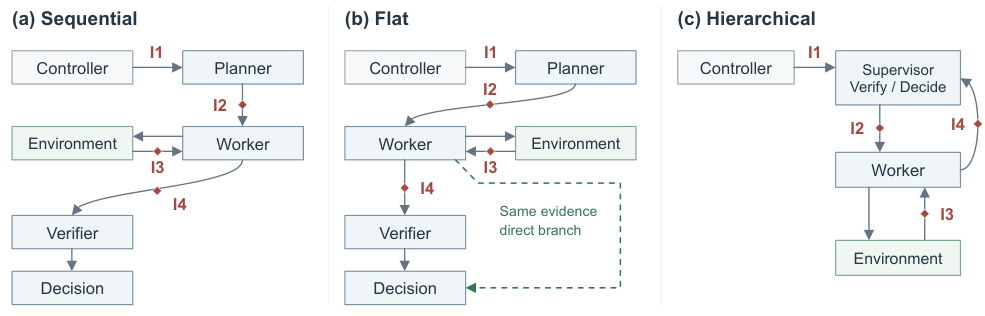
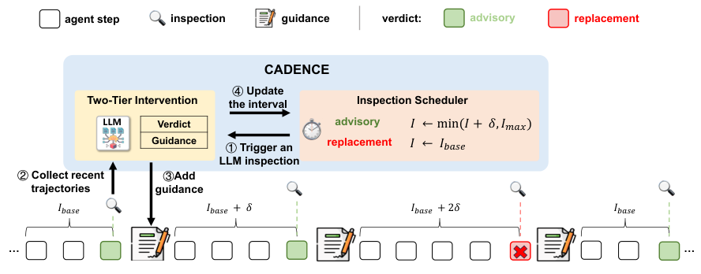

*资讯样稿 · 论文首发于 2026 年 10 月 7—11 日，选自上一批六篇。*

## 本期有哪些值得关注的进展

**Agent 可靠性开始有更具体的过程干预方案。** [通信故障研究](#paper-messages) 检查消息里的证据如何丢失、失真和传播；[Cadence](#paper-cadence) 则把监控接到动作执行前，按运行状态调整纠偏方式。两篇分别补充了信息传递和执行控制这两个环节。

**LLM 正在被用于完成具体的可靠性工程任务。** [自动生成 checkpoint/restart](#paper-resilience) 要求 Agent 修改真实 MPI 程序，并通过故障注入验证恢复能力。它展示了可行范围，也暴露出跨模块状态理解的困难。

**多智能体自改进出现了工作流与权重交替更新的尝试。** [MASS](#paper-mass) 将协作轨迹训练回模型，在部分科研任务上观察到收益。值得跟踪的是这种收益能否持续、能否扩展到更多任务。

**阅读建议：** 优先看通信故障研究和 Cadence，了解 Agent 可靠性的新方法；再看 MASS，把握自改进的尝试。[MORA](#paper-mora) 与 [NosRacer](#paper-nosracer) 分别补充时序检测和并发测试的进展，按兴趣展开即可。

<h2 id="paper-messages">01 · Agent 没有报错，为什么任务还是失败了？</h2>

[When Messages Go Wrong: Understanding Communication Faults in LLM-Based Multi-Agent Systems](https://arxiv.org/abs/2610.15459v1)  
**优先精读 · AgentOps / 通信可靠性 · 10 月 11 日**

一个 Worker 把答案发给下游，消息能解析、流程也继续运行，但支持答案的关键证据已经缺失。只看超时、异常日志或最后一句回答，很可能发现不了这种错误。这篇围绕消息丢失、内容不完整和语义污染，研究故障怎样沿多智能体工作流传播。

**值得关注的是，它把“通信成功”和“信息可信”分开了。** 在检测记录完整的失败执行中，20.7% 没有即时失败信号。增加一条独立证据通路能够救回部分任务，但前提是这条通路没有一起受到污染。因此，加重试或多放几个 Agent，并不自动等于更可靠。

*绿色通路能保护已经生成的证据；若信息在分叉之前就出了问题，两条路径可能一起失效。*

**为什么值得关注：** 它让 Agent 通信可靠性的讨论从“消息能不能送到”，进一步落到“下游依据什么做决定”。这能解释一些没有异常日志的失败。建议重点看故障传播案例和证据恢复机制；结论目前来自特定 AutoGen 工作流，不宜直接推广为所有多智能体系统的规律。

<h2 id="paper-cadence">02 · 编码 Agent 需要一个会选择介入时机的监控器</h2>

[Cadence: Strategic Guidance for Coding Agents](https://arxiv.org/abs/2610.12269v1)  
**优先精读 · AgentOps / 运行时干预 · 10 月 8 日**

固定每隔几步检查一次，会遇到两个问题：正常执行被频繁打断，严重错误却可能在下一次检查前持续扩大。Cadence 根据最近轨迹决定是给出建议，还是阻止尚未执行的动作、要求重新生成；这个判断同时决定下一次检查有多近。

**它的设计重点是把干预强度和检查频率联动。** 在论文的 SWE-bench Lite 主实验中，mini-swe-agent 解决率从 17.00% 提高到 42.33%。但更密集的固定检查在消融中还能获得更高解决率，所以这项工作的价值主要是效果与监控成本的平衡，而非找到普遍最优的检查策略。

*轻微偏差允许继续并给建议；严重偏差拦下当前动作，同时缩短后续检查间隔。*

**为什么值得关注：** 这是一套把“发现走偏”接到“及时纠正”的具体方案，适合跟踪编码 Agent 从事后评分走向执行中控制的进展。建议看两级干预和失败案例：监控器仍会误诊，Agent 也可能没有完整落实正确建议，加入监控还不是可靠性的终点。

<h2 id="paper-resilience">03 · LLM 能否给科学计算程序补上故障恢复能力？</h2>

[LLM Agents as Resilience Engineers for Scientific Applications](https://arxiv.org/abs/2610.11260v1)  
**值得细读 · LLM4Ops / 自动化可靠性工程 · 10 月 8 日**

给 MPI 程序加入 checkpoint/restart，难在找齐恢复所需状态，并选择一致的保存与恢复位置。作者移除应用已有的恢复逻辑，让编码 Agent 重新实现，再用真正的故障注入验证是否能恢复计算，而不只是检查代码能否编译。

**这篇最有启发的发现是，难度与状态是否分散密切相关。** 论文在 48 个应用—模型设置中得到 41 个成功实现；状态集中、容易访问时更顺利，跨模块依赖复杂时容易陷入反复修补。这个数字是设置覆盖数，并非每次尝试都有同样高的成功概率；实验规模也仍是单机 4 个 MPI rank。

**为什么值得关注：** LLM 在这里承担的是完整的恢复能力改造，而非生成几个 API 调用。独立验证器还会防止缓存预期输出等“通过测试但未实现恢复”的做法。它展示了自动化可靠性工程的实际进展；走向更大规模和更复杂状态仍是后续值得关注的部分。

<h2 id="paper-mora">04 · MORA：指标变了，不一定是系统坏了</h2>

[MORA: Modeling Observed Changes for Drift-Robust Time-Series Anomaly Detection](https://arxiv.org/abs/2610.09473v1)  
**AIOps 方向建议跟进 · 时序异常检测 · 10 月 7 日**

负载变化和真实故障都可能使指标偏离历史模式。MORA 用短窗口和长历史分别重建**同一段局部数据**：若更多历史能解释这次变化，就适度降低异常分数。它提供了一种无需测试时在线更新的漂移处理思路。

四个时序基准上，方法的平均排名较好，但并非每项指标都最优。**值得关注的是，它尝试直接区分“正常状态变化”和“异常”，而不只是降低对变化的敏感度。** 做 AIOps 可以跟进这一思路。当前结果主要是离线基准表现，持续异常是否会被上下文错误解释、上线阈值下表现如何，还需要更多证据。

<h2 id="paper-nosracer">05 · NosRacer：把难复现的消息竞争变成可测试的对象</h2>

[NosRacer: Dynamic Detection of Race Conditions in On-Device Network Operating Systems](https://arxiv.org/abs/2610.11875v1)  
**方法借鉴 · 并发故障 / 定向扰动 · 10 月 8 日**

相同配置命令，因为内部消息处理顺序不同，可能留下不同的网络控制状态。NosRacer 先缩小到相关组件和关键变量，再定向延迟消息，尝试反转访问顺序，比较状态与后续行为。它在商用 NOS 的五个组件中找到了 15 个新缺陷，并复现了 6 个已知缺陷。

**值得关注的是定向并发测试在工业系统中的落地。** 它利用已有测试与局部状态分析，减少需要探索的消息交错，不依赖对全系统的精确调度。不过状态差异仍需要确认是否违反业务要求。该论文 10 月 15 日有 v2 更新，本期内容解读依据 v1。

<h2 id="paper-mass">06 · MASS：把多 Agent 协作经验训练回同一个模型</h2>

[Recursive Self-Improvement through Multi-Agent Self-Supervision](https://arxiv.org/abs/2610.12176v1)  
**拓展关注 · 多智能体 / 自改进 · 10 月 8 日**

MASS 先让同一个模型的多个副本搜索更好的分工与信息交接，再把协作轨迹训练回模型，进入下一轮。其看点在于连接**工作流改进与模型训练**：优化的不只是回答内容，也包括如何组织任务。

两轮实验在部分科研任务上观察到收益，但终端和代码修复基准没有同步提升，训练 token 效率也不等于完整流程成本。**值得关注的是，它把协作编排与模型学习放进了同一个循环。** 这为理解 Agent 能力提升提供了一个不同于单次提示优化的方向。先掌握整体机制即可；是否能长期持续改进、是否会牺牲其他能力，比“递归自改进”这个名称更值得后续跟踪。

## 后续值得跟踪什么

- **运行时可靠性：** 证据检查和动态干预能否在更多框架、任务与模型组合中保持收益。
- **Agent 自改进：** 多轮更新是否持续有效，以及科研任务的进步是否伴随其他能力退化。
- **自动化系统工程：** 生成的恢复代码能否从小规模验证走向更复杂状态和更大部署规模。

这三项是根据本期论文给出的跟踪建议。每日资讯应继续补入新的论文和实质性版本更新，再调整关注重点。
