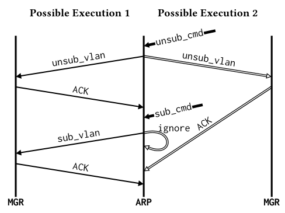

**NosRacer 的价值是让“消息顺序不同，控制状态悄悄变错”成为可以主动触发、比较和交给开发者确认的问题。** 它面向设备内网络操作系统的配置更新，并不试图穷举整个分布式系统的执行空间。

### 相同命令，为什么最终状态不同

论文的例子是先取消 VLAN 订阅，再重新订阅。如果取消订阅的 ACK 及时返回，第二条命令会看到已取消状态，正确发起新订阅。如果 ACK 晚到，第二条命令读到旧的“已订阅”状态，被当成重复操作忽略；随后 ACK 才把状态改为未订阅。命令顺序没变，内部消息交错却改变了最终结果。[原文 §1、图 2，PDF 第 2–3 页](https://arxiv.org/pdf/2610.11875v1#page=2)

*读图重点：右侧新订阅命令先于取消 ACK 被处理，因读取旧状态而被忽略。来源：原文图 2，PDF 第 3 页。*

### 如何把巨大执行空间缩到可测试范围

第一步利用已有测试、组件交互和静态分析，集中到一项配置任务相关的少数组件与关键变量。运行轨迹建立 happens-before 关系，找出可能受不同处理顺序影响的访问。

第二步不是对所有消息随机加延迟，而是针对这些候选，在发送点插入延迟，尝试反转具体处理顺序；反转成功后再比较关键变量值。兼容的扰动合并执行，不成功的扰动有限增强。延迟过大会把程序推向超时或重试路径，所以“扰动更强”并不总意味着“更容易复现同一个竞争”。[原文 §3.1–3.3，PDF 第 5–8 页](https://arxiv.org/pdf/2610.11875v1#page=5)

### 结果里最容易混淆的两个口径

在一个商用 NOS 的五个组件上，32 份报告中有 21 个被开发者确认为严重缺陷，其中 **15 个是新发现，6 个是已知问题的复现**。不能写成发现了 21 个新缺陷，也不能把 66% 的报告确认率解释成召回率。[原文 §5.1，PDF 第 9 页](https://arxiv.org/pdf/2610.11875v1#page=9)

论文中的“低于 10%”对应启用 tracing 后的执行时间增幅，而不是整个搜索过程只多花 10% 成本。表 3 另列了 1,000 次准备执行和 3,474 次扰动执行，累计运行时间分别为 65.19 与 314.02 小时；累计时间也不是并行后的墙钟时间。这些分母必须分开。[原文表 3–4，PDF 第 10–11 页](https://arxiv.org/pdf/2610.11875v1#page=10)

### 阅读判断：值不同是线索，业务错误才是目标

两次执行的变量值不同，不一定违反业务不变量：选出了另一个合法主节点，或者短暂差异随后被同步机制修复，都可能是良性的。论文讨论了这类报告，也明确实际部署没有严格的完备性保证。只有部分候选成功构造出了反序执行，未触发不能证明安全。[原文 §3.3、§5.3，PDF 第 8、11–12 页](https://arxiv.org/pdf/2610.11875v1#page=11)

对云系统和 Agent 工作流，值得借鉴的是“先定位共享状态，再围绕依赖关系施加扰动”。但迁移到自然语言消息时，状态等价和业务不变量更难定义，不能直接套用变量值比较。后续研究可以把显式工具状态与证据契约作为观测点，比较它们比最终任务失败更早提供多少诊断信息。这是迁移思路，不是论文已验证的跨领域效果。
