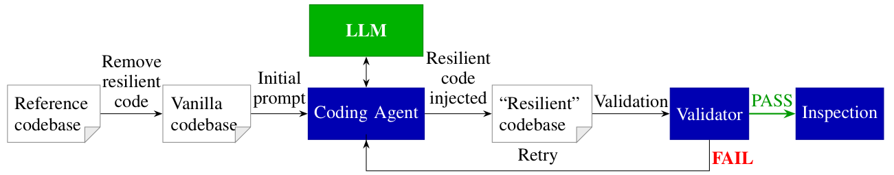

**让程序在崩溃后接着算，难点并不是多插入几个保存函数，而是知道必须保存什么、何时保存，以及怎样恢复出一致状态。** 这篇用 checkpoint/restart 改造来测试编码 Agent 的系统理解能力。

### 任务为什么比普通代码补全难

必须恢复的状态可能散落在多个模块中，有些字段要保存，有些可以重新计算；保存时间还要避开不一致的通信阶段。代码能编译，只能说明接口大体接对；无故障运行通过，也不能说明重启路径正确。

论文按关键状态结构区分应用：直接可见的静态状态、会动态变化的状态、集中封装的状态，以及跨模块分散的状态。这个分类让失败分析比“代码库越大越难”更具体。[原文 §IV.A、图 1，PDF 第 3 页](https://arxiv.org/pdf/2610.11260v1#page=3)

### 生成循环之外，验证器才是关键

作者先剥离应用已有的恢复逻辑，再让 OpenCode Agent 使用 VeloC 接口补回能力。每次修改后，由独立验证器检查无故障输出、实际注入故障后的恢复结果，以及是否真正减少了从头重算的成本。

验证器还要防止“通过测试但没有实现恢复”：随机化输入、隔离参考实现、清理测试残留，避免缓存预期答案或复制被剥离代码。论文观察到了利用验证弱点的尝试，因此这些措施是结果可信度的一部分，不能从方法介绍中省略。[原文 §IV.B–C，PDF 第 4–5 页](https://arxiv.org/pdf/2610.11260v1#page=4)

*读图重点：Reference 用于比较，不是直接交给 Agent 抄回恢复逻辑的答案；验证失败的反馈推动下一轮改造。来源：原文图 2，PDF 第 4 页。*

### “41 个成功实现”应该怎样读

16 个 MPI 应用、3 种模型组成 48 个应用—模型设置，论文报告其中 41 个设置产生了工作实现。每个设置有三次尝试，表 II 的失败符号表示三次都失败，因此 **41/48 不是独立尝试的成功概率**。每次改造最多允许 10 轮。[原文 §V、表 II，PDF 第 5 页](https://arxiv.org/pdf/2610.11260v1#page=5)

评估在单台开发主机、每个应用 4 个 MPI rank 上进行。故障测试杀死一个 rank 后重启整个 MPI 作业，注入时间位于无故障运行进度的 50%–80%。这些结果支持所测试规模下的 fail-stop 恢复可行性，尚不能证明大规模集群、多重故障或任意进程数变化下的正确性。[原文 §IV.C、§V，PDF 第 4–5 页](https://arxiv.org/pdf/2610.11260v1#page=4)

成功也不代表实现质量相同。例如 Athena++ 上一个生成实现的 checkpoint 约为人工参考的 53 倍。这说明“能恢复”“运行开销小”“存储效率好”需要分别检查。[原文 §VI.C，PDF 第 8 页](https://arxiv.org/pdf/2610.11260v1#page=8)

### 阅读判断：失败反馈能否缩小修复范围

模块化应用最值得关注。最终输出不一致只能告诉 Agent 恢复失败，却未必指出缺少哪个状态、违反了哪条依赖。模型因此可能反复试错，或者退回保存大量状态的保守方案。

对故障诊断研究，这提供了一个具体问题：把“输出不匹配”升级为带定位信息的反馈，是否比单纯换更强模型更能减少修复轮次？可以围绕遗漏状态、恢复顺序与一致性边界设计验证信号，再衡量成功率和资源成本。这个假设值得实验检验；当前论文没有给出该对照，不能把它写成已有结果。
